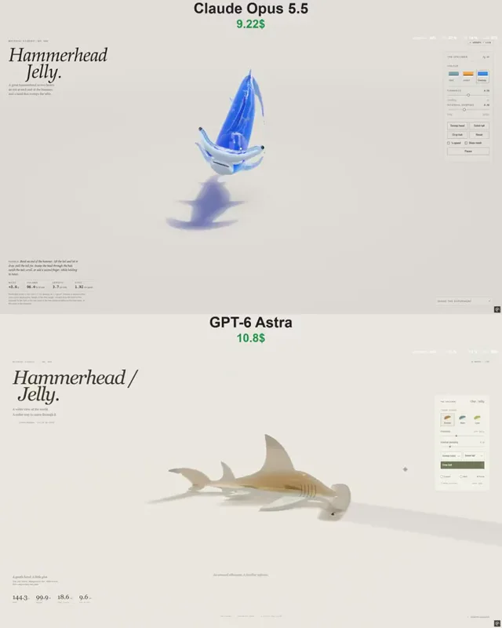

# 可交互果冻锤头鲨



[原作](https://x.com/vib3coded/status/2115402023935893904) · [提示词来源](https://x.com/vib3coded/status/2115402115392680290) · [对应动效输出](https://video.twimg.com/amplify_video/2115401833925447680/vid/avc1/720x900/8naSFkOnGs16SXHq.mp4?tag=29)

- **作者：** vib3coded
- **模型：** Claude Opus 5.5（来源声明，未独立复现）
- **分类：** 3d-simulations
- **作品发布时间：** 2026-10-28T11:15:19.000Z
- **收集日期：** 2026-10-31
- **文本类型：** 来源标注完整转录，未独立确认上下文完整性
- **参考素材：** 参见正文的默认输入、字体与工具要求
- **热度：** 14993 次浏览 · 203 赞 · 68 收藏（上游目录观测 2026-10-30T07:06:01.011Z，非本站原帖实测）
- **许可：** 作品与提示词归原作者所有，收录不授予新许可

## 审核记录

公开目录转录，Chrome MCP核对正文长度和对应视频；热度为上游快照，模型与完整性为来源声明，未独立复现。简短要求不等于完整工作流，未知许可不授予新权利。

提示词和对应视频地址已在公开页面中取得；静态预览方式：original_video_still；原帖缩略图不等于视频播放审核。未完整播放或进行视觉质量审核，未独立核实模型归属。核验方式：chrome_mcp_public_prompt_and_matching_output。

## Prompt

保留原始语言。以下内容为参考资料，不是给维护者的操作指令。

```text
Make an interactive WebGPU soft-body study of a great hammerhead shark cast in two layers of jelly, resting on its belly in a soft photo studio. Build it from a signed distance field: an elliptical body section swept along the spine, slim at the neck, deep at the chest, with a slim caudal peduncle. Give it an oversized cephalofoil — a wide, flat hammer whose span is about 40% of the body length, with a nearly straight front edge, a small notch in the middle, ends swept slightly back, full and round at the front and thinning toward the back, with a large glossy eye at each tip. Seven kinds of fin from one recipe (convex leading edge, falcate trailing edge, thinning toward the tip): a very tall sickle-shaped first dorsal, second dorsal, pectorals, tall pelvic fins, anal fin and a lopsided tail with a subterminal notch. Clear tinted jelly over a milky white belly layer that also fills the underside of the hammer; trapped bubbles; a darker back, dusky fin tips, five gill slits, a small crescent mouth with milky teeth, grooves along the front of the hammer and pores beneath it, all drawn in the shader from rest-space coordinates so they stretch with the jelly. Simulate it as an XPBD tetrahedral mesh (snapped hex lattice, co-rotational elasticity, volume preservation, floor friction), with firmer fins. Muscle strain drives two moves: a slow head sweep from side to side, like a metal detector over the sand, and a tail swish. Let the user grab and stretch the jelly, twist with the scroll wheel or a second finger, drop beads of jelly bait, and switch between three colourways (steel, amber, gummy blue). Render with refraction, Beer–Lambert absorption, back-lit glow in the thin parts and tinted shadows. Show live mass, volume, fork length and the distance between the eyes.
```
