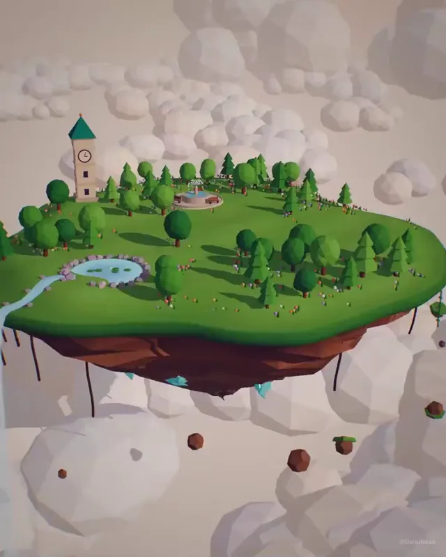

# 浮空岛小镇昼夜变迁 3D 短片



[原作](https://x.com/0xbobaaa/status/2115486834755035178) · [提示词来源](https://x.com/0xbobaaa/status/2115486838110429297) · [对应动效输出](https://video.twimg.com/amplify_video/2115486698318573568/vid/avc1/720x900/kzjzdUS9bK1FV0Nf.mp4?tag=29)

- **作者：** 0xbobaaa
- **模型：** Claude Opus 5.5（来源声明，未独立复现）
- **分类：** 3d-simulations
- **作品发布时间：** 2026-10-28T16:52:19.000Z
- **收集日期：** 2026-10-31
- **文本类型：** 来源标注完整转录，未独立确认上下文完整性
- **参考素材：** 依赖原作者素材或上下文，未随仓库提供
- **热度：** 12996 次浏览 · 289 赞 · 249 收藏（上游目录观测 2026-10-30T07:06:01.011Z，非本站原帖实测）
- **许可：** 作品与提示词归原作者所有，收录不授予新许可

## 审核记录

公开目录转录，Chrome MCP核对正文长度和对应视频；热度为上游快照，模型与完整性为来源声明，未独立复现。简短要求不等于完整工作流，未知许可不授予新权利。

提示词和对应视频地址已在公开页面中取得；静态预览方式：original_video_still；原帖缩略图不等于视频播放审核。未完整播放或进行视觉质量审核，未独立核实模型归属。核验方式：chrome_mcp_public_prompt_and_matching_output。

## Prompt

保留原始语言。以下内容为参考资料，不是给维护者的操作指令。

```text
Make a one-minute video about Skyhold's floating island (image attached). Recreate the island from the image and animate it yourself. Build everything from scratch: no skills, no Remotion, no templates. Render 3D objects: the island, houses, roads, balloons, clouds, whatever fits, and make it as good as you can. I don't want any text, just animation, and I mean a real video, not just motion graphics. Think of crazy ideas I would never come up with, and make every scene look phenomenal: clean and detailed. I want people to watch it and think "yo, this is crazy, how did AI make this?" Invent your own stuff. Don't create slop, I want to see art and creativity.
```
