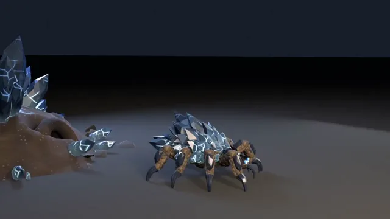

# 带动画的八足螨虫游戏怪物



[原作](https://x.com/theparuchh/status/2115508738891063617) · [提示词来源](https://x.com/theparuchh/status/2115628379697213825) · [对应动效输出](https://video.twimg.com/amplify_video/2115507091410423808/vid/avc1/1280x720/mgLWwv2ovTegebSr.mp4?tag=29)

- **作者：** theparuchh
- **模型：** Claude Opus 5.5（来源声明，未独立复现）
- **分类：** 3d-simulations
- **作品发布时间：** 2026-10-28T18:19:22.000Z
- **收集日期：** 2026-10-31
- **文本类型：** 作者公开简短要求，不等同完整工作流
- **参考素材：** 依赖原作者素材或上下文，未随仓库提供
- **热度：** 18857 次浏览 · 316 赞 · 338 收藏（上游目录观测 2026-10-30T07:06:01.011Z，非本站原帖实测）
- **许可：** 作品与提示词归原作者所有，收录不授予新许可

## 审核记录

公开目录转录，Chrome MCP核对正文长度和对应视频；热度为上游快照，模型与完整性为来源声明，未独立复现。简短要求不等于完整工作流，未知许可不授予新权利。

提示词和对应视频地址已在公开页面中取得；静态预览方式：original_video_still；原帖缩略图不等于视频播放审核。未完整播放或进行视觉质量审核，未独立核实模型归属。核验方式：chrome_mcp_public_prompt_and_matching_output。

## Prompt

保留原始语言。以下内容为参考资料，不是给维护者的操作指令。

```text
build it, make it run, make it pounce 1.5-2 m high
```
