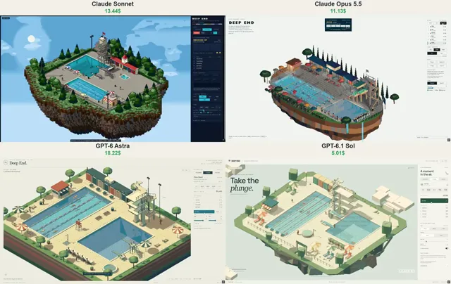

# 四款模型像素风浮空岛泳池场景对比



[原作](https://x.com/vib3coded/status/2115595806665240630) · [提示词来源](https://x.com/vib3coded/status/2115596228171874731) · [对应动效输出](https://video.twimg.com/amplify_video/2115594758798123008/vid/avc1/1140x720/P4MvNXcs-dU73GNn.mp4?tag=29)

- **作者：** vib3coded
- **模型：** Claude Opus 5.5 / Claude Sonnet 5.5（来源声明，未独立复现）
- **分类：** 3d-simulations
- **作品发布时间：** 2026-10-29T00:05:20.000Z
- **收集日期：** 2026-10-31
- **文本类型：** 来源标注完整转录，未独立确认上下文完整性
- **参考素材：** 参见正文的默认输入、字体与工具要求
- **热度：** 12164 次浏览 · 273 赞 · 184 收藏（上游目录观测 2026-10-30T07:06:01.011Z，非本站原帖实测）
- **许可：** 作品与提示词归原作者所有，收录不授予新许可

## 审核记录

公开目录转录，Chrome MCP核对正文长度和对应视频；热度为上游快照，模型与完整性为来源声明，未独立复现。简短要求不等于完整工作流，未知许可不授予新权利。

提示词和对应视频地址已在公开页面中取得；静态预览方式：original_video_still；原帖缩略图不等于视频播放审核。未完整播放或进行视觉质量审核，未独立核实模型归属。核验方式：chrome_mcp_public_prompt_and_matching_output。

## Prompt

保留原始语言。以下内容为参考资料，不是给维护者的操作指令。

```text
Build "Deep End": an open-air lido on a floating island of earth and rock, rendered as a real-time 3D scene in pixel art (three.js, orthographic isometric camera rendering into a small low-res target, no anti-aliasing, depth-buffer outlines, every pixel snapped to a fixed 64-colour palette matched in OKLab; quarter-turn rotation, zoom, pixel-size slider, Raw 3D toggle).
Scene: a 25 m lap pool and a 5 m deep diving pool cut into a concrete deck; 1 m and 3 m springboards that visibly bend; a 1930s concrete diving tower with platforms at 5, 7.5 and 10 m and an open stair; striped changing cabins with a clock, a kiosk, loungers and parasols; a judges' table.
Diving meet with real physics: each dive is flown, not animated — takeoff speed and angular momentum are solved to land the somersaults, angular momentum is conserved so tucking spins the diver faster and kicking out slows them to line up the entry. Divers kick out slightly early or late (more on harder dives), the entry angle sets the splash, five judges hold up score cards, highest and lowest are dropped, the rest are multiplied by the degree of difficulty. Events: 10 m, 3 m, free swim.
Water: each pool surface is a wave-equation height field (~20 cm cells) — entries, strokes, rain and clicks make rings that bounce off the walls; shaded from its normals with sun glints and a mirrored reflection of the lido; caustics on the tiled floor.
People: box-rig figures with two-bone IK — swimmers doing freestyle, breaststroke and backstroke with flip turns; divers swim to the ladder, shower, sit in the warm tub and climb again; children who run and get whistled at by the lifeguard; wet footprints on the deck that dry in the sun.
Light and weather: day / dusk / night (pool lights glow underwater, tower floodlights at night), dry / rain (rain rings the water and darkens the deck). Click the water to make a splash. Side panel with the meet scoreboard, controls and a short "How it's drawn" note. Original fictional content only, English UI.
```
