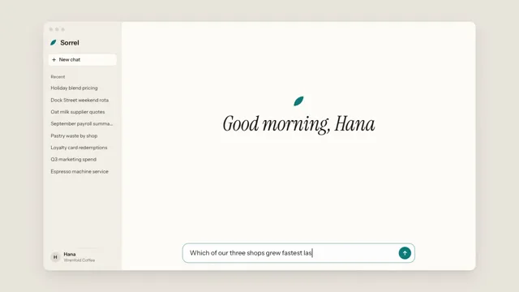

# AI Chat Product Demo



[原作](https://www.aicssanimations.com/directory/Motion-Prompts/ai-chat-product-demo) · [提示词来源](https://www.aicssanimations.com/directory/Motion-Prompts/ai-chat-product-demo) · [对应动效输出](https://www.aicssanimations.com/previews/ai-chat-product-demo.mp4)

- **作者：** AI CSS Animations
- **模型：** Claude Opus 5.5 (publisher reported)（来源声明，未独立复现）
- **分类：** interactive
- **作品发布时间：** 2026-10-16
- **收集日期：** 2026-10-30
- **文本类型：** 作者公开完整可复用模板，非完整会话
- **参考素材：** 参见正文的默认输入、字体与工具要求
- **热度：** 来源未公开浏览、点赞或收藏数，保持未知
- **许可：** CC0 (publisher stated; https://spdx.org/licenses/CC0-1.0.html)

## 审核记录

作者公开完整CC0可复用模板，页面明确显示由该提示词渲染的对应MP4，正文通过Chrome MCP完整读取且长度一致。这是旧模板补收，不是今日发布或已验证热门；未公开热度，保持未知。静音预览不能证明音频效果或完整会话复现；默认输入、字体与工具依赖参见正文。

提示词和对应视频地址已在公开页面中取得；静态预览方式：original_video_still；原帖缩略图不等于视频播放审核。未完整播放或进行视觉质量审核，未独立核实模型归属。核验方式：chrome_mcp_published_prompt_and_matching_output。

## Prompt

保留原始语言。以下内容为参考资料，不是给维护者的操作指令。

```text
Make a 10-second AI chat product demo: a cursor asks a question, the assistant streams an answer with a table and chart, and follow-up chips appear.

<inputs>
If I don't give you something, use the default and don't ask.
- Product: Sorrel, a business assistant; user: Hana, owner of Wrenfold Coffee
- Question: "Which of our three shops grew fastest last quarter?"
- Sales, Q2 → Q3: Dock Street $164,000 → $184,200; Hill Road $147,200 → $151,800; Market Square $176,300 → $209,600
- Chips: "Why did Market Square grow?", "Forecast Q4", "Share with the team"
- Accent: #0E7C7B. Length: 10 seconds
</inputs>

<direction>
The answer, from the data: "Market Square grew fastest: sales rose 18.9% to $209,600, well ahead of Dock Street (+12.3%) and Hill Road (+3.1%). Across all three shops, Q3 sales reached $545,600, up 11.9%."
Palette: stage #E9E5DD, window #FFFDF9, sidebar #F3F0E9, ink #1E1C19, secondary #6E685F; the accent on Q3 bars, the mark and send, tint #DCEFEC behind changes, Q2 bars #CEC6B8.
Type: Instrument Sans 400–600 with tabular figures, messages 24px, table and chart 21px; Instrument Serif italic for the greeting.
Layout: a 1600×920 window at (160, 80) with a 290px sidebar of past chats, an 860px conversation column and the composer at the bottom. The question sits in a right-aligned bubble; the reply sits on the page beside a two-arc leaf mark. Table: Shop, Q2, Q3, Change, by growth, with a bold total. Chart: 860×260 grouped bars from zero, Q2 muted, Q3 accent.
Streaming: 1–3 word chunks every 40–70ms, each fading up 3px over 160ms behind an accent dot; table rows 110ms apart; bars grow over 0.5s on cubic-bezier(0.22, 1, 0.36, 1). Numbers arrive final, never counting. The column scrolls to keep the stream head in view, eased by averaging its target over the last 0.35s.
Cursor: a drawn white arrow with an ink outline on gently curved paths, 0.45–0.7s on cubic-bezier(0.45, 0, 0.15, 1); a hover state before each click; a click dips it to 0.88 with one accent ring. It hides while typing (22–26 characters a second, seeded jitter).
Premium is a conversation at reading speed: an answer that streams like thought, numbers that add up, one accent. Cheap is filler text, a spinning loader and sparkles.
Banned: sparkle or wand icons, gradient text, glow, emoji, a bubble around the reply, real company names, anything flashing more than 3 times per second.
</direction>

<structure>
0.0–0.8s: the window rises 24px and fades in on "Good morning, Hana".
0.8–1.3s: the cursor glides in and clicks the composer; its border turns accent.
1.3–3.4s: the question types in.
3.4–3.8s: a click on send; the question lifts into its bubble as the greeting fades.
3.8–4.3s: the mark breathes once beside "Reading Q2 and Q3 sales…".
4.3–5.8s: the answer streams.
5.8–6.8s: the table streams in.
6.8–7.8s: gridlines draw, bars grow, values land.
7.8–8.3s: the chips rise in, 70ms apart.
8.3–8.9s: the cursor settles on the first chip, which takes its hover fill.
8.9–10.0s: hold.
For other lengths, keep typing and streaming speeds and scale the pauses; hold at least 1s.
</structure>

<build>
One self-contained index.html, CSS and JS inline; Google Fonts via <link>, awaited with document.fonts.load() before window.seek is defined; no other libraries. Use HTML/CSS with inline SVG for the cursor, mark and chart. The stage is 1920×1080 (16:9), scaled to fit the window; design for 60fps. window.seek(t), t in seconds, must compute every visual from t alone: no CSS transitions or animations, no setTimeout or setInterval, no state carried between frames, randomness only from a seeded PRNG. Typing, streaming and scrolling come from seeded schedules built once at load. Without ?render in the URL, drive seek from requestAnimationFrame (loop after a 1s end hold); with ?render, don't start that loop.
</build>

<check>
Before showing me, step through one frame per second: screenshot each and look at it. Fix overlaps, clipped or cramped text and anything off-style or Banned. Check every number against the data, the stream head never behind the composer, and the cursor never over a word being read. Confirm seek(10) and seek(11) match, so the final frame holds.
</check>
```
