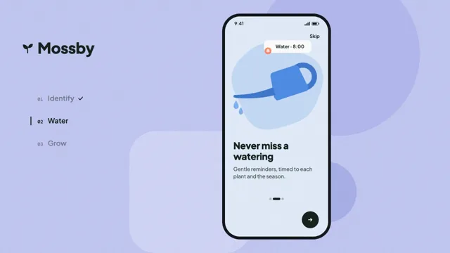

# App Onboarding



[原作](https://www.aicssanimations.com/directory/Motion-Prompts/app-onboarding-carousel) · [提示词来源](https://www.aicssanimations.com/directory/Motion-Prompts/app-onboarding-carousel) · [对应动效输出](https://www.aicssanimations.com/previews/app-onboarding-carousel.mp4)

- **作者：** AI CSS Animations
- **模型：** Claude Opus 5.5 (publisher reported)（来源声明，未独立复现）
- **分类：** product-brand
- **作品发布时间：** 2026-10-18
- **收集日期：** 2026-10-30
- **文本类型：** 作者公开完整可复用模板，非完整会话
- **参考素材：** 参见正文的默认输入、字体与工具要求
- **热度：** 来源未公开浏览、点赞或收藏数，保持未知
- **许可：** CC0 (publisher stated; https://spdx.org/licenses/CC0-1.0.html)

## 审核记录

作者公开完整CC0可复用模板，页面明确显示由该提示词渲染的对应MP4，正文通过Chrome MCP完整读取且长度一致。这是旧模板补收，不是今日发布或已验证热门；未公开热度，保持未知。静音预览不能证明音频效果或完整会话复现；默认输入、字体与工具依赖参见正文。

提示词和对应视频地址已在公开页面中取得；静态预览方式：original_video_still；原帖缩略图不等于视频播放审核。未完整播放或进行视觉质量审核，未独立核实模型归属。核验方式：chrome_mcp_published_prompt_and_matching_output。

## Prompt

保留原始语言。以下内容为参考资料，不是给维护者的操作指令。

```text
Make a 10-second mobile onboarding demo: a phone swipes through three screens whose illustrations morph shape by shape from one to the next, the page dots stretch with each swipe, and the next button grows into "Get started".

<inputs>
If I don't give you something, use the default and don't ask.
- App: Mossby, plant care (fictional).
- Screen 1: "Know every plant" / "Point your camera at a leaf and Mossby names it, with care notes."
- Screen 2: "Never miss a watering" / "Gentle reminders, timed to each plant and the season."
- Screen 3: "Watch them grow" / "Log new leaves and see your shelf fill in, week by week."
- Cards: "Monstera", "Water · 8:00", "+3 leaves this month"
- Buttons: Skip, Next, Get started.
- Length: 10 seconds.
</inputs>

<direction>
- Stage: periwinkle #C3C8F4 with a 3% grain. Behind the phone, three big flat shapes (a 700px circle #B3B9EE upper right, a 520px rounded square #D2D6F8 at lower left of the phone, a 260px circle #A9B0EA) shift sideways with each swipe at 20% of the screen's travel, for parallax.
- Phone: 440×940, 64px corner radius, a #15161B frame 12px thick, centered at (1180, 540); a status bar with "9:41" and drawn signal and battery glyphs; "Skip" at top right in 20px/600.
- The screen's tint morphs with the page: mint #E4F3E8, sky #E3EDFB, apricot #FCEAD9.
- Shared-element illustrations: the art fills the top 500px of the screen and is always the same eight primitives, each a filled SVG path resampled to 64 points with aligned start points, so any can morph into any. Between screens each primitive interpolates its points, position, rotation and fill (mixed in OKLab): the art transforms in place and never slides away.
  - Screen 1: A, a mint backdrop blob #BFE5CC (380px); B, a terracotta pot #D9734E with a tapered body and a rim band; E, F and G, three leaves on short stems in #3E9B63, #22694A and #8FD19E, E broad and split like a monstera leaf; C, a white rounded card reading "Monstera"; D, a coral pin dot #FF8A65 on leaf E joined to the card by a 2px line; H, a small yellow dot #F6B93B.
  - Screen 2: A becomes a sky blob #C6DBF7; B a watering-can body #4D8DE8 tilted −18°; E stretches into its long tapered spout #3F78CF; F curls into its thick crescent handle #3F78CF; G and H become two water drops #7FB3F5 below the spout; C becomes the card "Water · 8:00"; D becomes the card's bell dot.
  - Screen 3: A becomes an apricot blob #F8D3B4; B the pot again, 15% taller; E, F and G three bigger leaves of a grown plant; H a 120px sun disc #F6B93B rising behind it; C becomes "+3 leaves this month"; D a coral check dot.
  Card text crossfades with a 6px vertical slide. Stems are separate 6px lines that fade out for screen 2 and back in for screen 3.
- Swipes: a touch indicator (a 48px white circle at 35% with a 2px white ring) lands on the right of the screen and drags 200px left over 0.35s, the text following the finger (title at 1.0×, body at 0.85×, for parallax), then lifts, and the page settles on a spring (stiffness 260, damping 26, about 4% overshoot). Outgoing text leaves left and fades; incoming text enters from 60px right. The illustration morph runs on the same progress, its primitives staggered 30ms, backdrop first.
- Page dots: three 10px dots in #16201A at 25%; the active one is a 32px #16201A pill that stretches like a worm during a swipe, its leading edge following the swipe and its trailing edge catching up 80ms later.
- The button: Next is a 72px #16201A circle with a white arrow at the bottom right of the screen; on screen 3 it expands into a 360×72 pill reading "Get started" (white, 24px/700) over 0.45s on cubic-bezier(0.65, 0, 0.35, 1), the arrow sliding to sit after the label, while Skip fades out. A tap scales it to 0.96 with a white circle spreading inside it at 20%.
- Left column, beside the phone: the wordmark "Mossby" in Plus Jakarta Sans 800, 64px, #16201A, at (160, 230) next to a small two-leaf mark; three steps from y 430, 96px apart, each an index in DM Mono 500, 20px, and a name in Plus Jakarta Sans 600, 30px: "01 Identify", "02 Water", "03 Grow". The active step is full ink with a 4px bar to its left; the others sit at 45%. A step gains a small check when its screen is left; 03 gains its check on the tap.
- Type on the screen: titles in Plus Jakarta Sans 800, 40px, #16201A; body in Plus Jakarta Sans 500, 22px, #4E5A53, leading 1.4, 368px wide, with 36px side padding.
- Motion: pops use a closed-form spring with at most 8% overshoot; text fades take 0.3s on cubic-bezier(0.22, 1, 0.36, 1).
- Premium: one illustration that transforms, an indicator that follows the finger, text with parallax, a button that grows instead of swapping. Cheap: three static slides pushed sideways and dots that only change color.
Banned: real phone brands or system UI, stock illustrations, illustrations sliding out instead of morphing, gradients on the art, glow, sparkles, emoji, text under 20px, anything flashing more than 3 times per second.
</direction>

<structure>
- 0.0–1.0s: the phone rises 30px onto the stage; screen 1's primitives pop in from scale 0, 50ms apart; the title and body rise; the left column fades up with 01 active.
- 1.0–2.2s: hold to read; leaf E sways ±3° on a slow sine; the pin's line draws to the card.
- 2.2–3.2s: swipe to screen 2: the gesture, the morph, the worm and the sky tint; 01 gets its check and 02 activates.
- 3.2–4.4s: hold; the two drops fall 120px from the spout and fade, twice, and are back at rest by 4.4s.
- 4.4–5.4s: swipe to screen 3: pot, leaves and sun form; the tint turns apricot; 02 gets its check and 03 activates.
- 5.4–5.85s: Next grows into "Get started"; Skip fades. At 6.0s screen 3 is complete and still.
- 6.0–7.4s: leaf G unfurls a little further (scale 0.85 → 1, turning 12°); the card's count rises in.
- 7.4–8.0s: a tap on "Get started": pressed and released; 03 gets its check.
- 8.0–8.6s: everything settles.
- 8.6–10.0s: hold, perfectly still.
For other lengths, stretch the reading holds; keep each swipe at 1.0s and at least 1s of hold.
</structure>

<build>
- One self-contained index.html (inline CSS and JS), a 1920×1080 (16:9) stage scaled to fit the window, designed for 60fps. No image, video, texture or model files: every shape and texture is generated in code.
- window.seek(t), t in seconds, computes every visual from t alone: no CSS transitions or CSS animations, no setTimeout/setInterval, no state carried between frames, randomness only from a seeded PRNG. Anything cumulative is solved analytically from t or precomputed once at load at a fixed step. Past the end, seek clamps to the last frame.
- Without ?render in the URL, drive seek from requestAnimationFrame so it plays in a browser (loop after a 1s end hold); with ?render, don't start that loop.
- Google Fonts via <link> are fine; await document.fonts.load() for each face before defining window.seek.
- Engine: inline SVG for the illustrations, whose path d attributes are rebuilt each seek from point sets precomputed at load; the phone, text, dots and buttons are HTML/CSS positioned from seek.
- Springs are closed-form in the time since their trigger, and each primitive's morph progress is a function of t.
</build>

<check>
Before showing me, step through one frame per second (t = 0…10): screenshot each and look at it. Fix overlaps, clipped or cramped text, and anything off-style or Banned. Check the art morphs in place on both swipes with no primitive popping, flipping inside out or crossing the text, the worm indicator matches the page, all screen text sits on its tint at 20px or more, the left column's active step matches the screen, and the 6s and final frames are complete compositions. Confirm seek(10) and seek(11) match, so the final frame holds.
</check>
```
