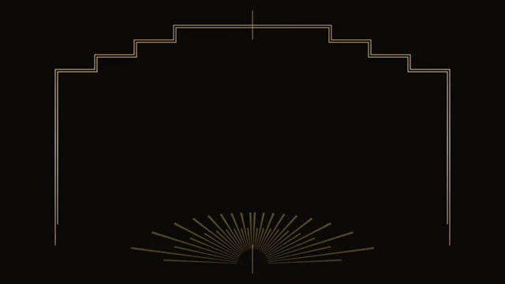

# Art Deco Gold



[原作](https://www.aicssanimations.com/directory/Motion-Prompts/art-deco-gold) · [提示词来源](https://www.aicssanimations.com/directory/Motion-Prompts/art-deco-gold) · [对应动效输出](https://www.aicssanimations.com/previews/art-deco-gold.mp4)

- **作者：** AI CSS Animations
- **模型：** Claude Opus 5.5 (publisher reported)（来源声明，未独立复现）
- **分类：** motion-studies
- **作品发布时间：** 2026-10-12
- **收集日期：** 2026-10-30
- **文本类型：** 作者公开完整可复用模板，非完整会话
- **参考素材：** 参见正文的默认输入、字体与工具要求
- **热度：** 来源未公开浏览、点赞或收藏数，保持未知
- **许可：** CC0 (publisher stated; https://spdx.org/licenses/CC0-1.0.html)

## 审核记录

作者公开完整CC0可复用模板，页面明确显示由该提示词渲染的对应MP4，正文通过Chrome MCP完整读取且长度一致。这是旧模板补收，不是今日发布或已验证热门；未公开热度，保持未知。静音预览不能证明音频效果或完整会话复现；默认输入、字体与工具依赖参见正文。

提示词和对应视频地址已在公开页面中取得；静态预览方式：original_video_still；原帖缩略图不等于视频播放审核。未完整播放或进行视觉质量审核，未独立核实模型归属。核验方式：chrome_mcp_published_prompt_and_matching_output。

## Prompt

保留原始语言。以下内容为参考资料，不是给维护者的操作指令。

```text
Make a 10-second Art Deco title reveal in black and gold.

<inputs>
Name: THE HALCYON. Descriptor: Hotel & Ballroom. Tagline: "An evening in gold." Three words: Dine, Dance, Stay. Duration: 10s. If I don't give you something, use the default and don't ask.
</inputs>

<direction>
Palette: black #0C0B0A, ivory #EFE6D2 for small text, and gold as an SVG linear gradient (#7A5A24 → #C9A04F → #F4E3A6 → #B38A3E → #6E5020), never a flat yellow. The specular sweep is that gradient's offsets shifting with t.
Type: Poiret One for the name (150px, uppercase, tracking 0.22em); Josefin Sans 300, uppercase, tracked 0.4em, at 28–34px for everything else.
Composition: strict bilateral symmetry about the vertical center, every element mirrored. Motifs: a 180° sunburst of alternating long and short rays rising from the lower center at 40% opacity, a stepped ziggurat frame with three setbacks per side, double pinstripes (3px gold, 6px gap), chevrons, and a 240px medallion with a fan inside. Keep a calm black field around the name.
Motion is ceremonial and exact. Linework draws on via stroke-dashoffset, always from the center outward on both sides at once; fans and sunbursts open around a pivot; nothing bounces. Easing cubic-bezier(0.45, 0, 0.15, 1) over 0.8–1.6s, with 100ms staggers. Real Deco is geometry, symmetry and material richness; the cheap version is gold text and a lens flare over a random pattern.
Banned: asymmetry, lens flares, glitter particles, bevel or emboss, flat #FFD700 gold, script fonts, bounce or overshoot, fast cuts, colors beyond black, gold and ivory.
</direction>

<structure>
0.0–0.9s: black; a gold hairline draws up and down from the stage center to form the axis.
0.9–2.2s: the sunburst opens: 36 rays, collapsed to vertical, rotate apart around the pivot to span 180°.
2.2–3.4s: the ziggurat frame's double pinstripes draw from top center outward along both sides, stepping down through the setbacks to the bottom corners, while the axis line withdraws from the middle, leaving short spurs at top and bottom.
3.4–4.6s: the medallion draws above center; the name reveals from its middle letter outward, each letter rising 20px out of a mask while tracking eases from 0.32em to 0.22em.
4.6–5.4s: the descriptor appears below between two short pinstripe rules growing outward.
5.4–6.6s: a specular highlight sweeps once across all the gold, left to right, over 1.2s; the tagline fades up in ivory beneath over 0.8s.
6.6–7.8s: the three words appear in a row separated by small gold diamonds, the center word first, then the outer two together.
7.8–10.0s: hold, perfectly still.
For other durations, scale every timestamp proportionally.
</structure>

<build>
One self-contained index.html, CSS and JS inline. Google Fonts via <link> are fine; no other libraries (no three.js: this style is flat). Draw in inline SVG. The stage is 1920×1080 (16:9), scaled to fit the window. Design for 60fps. window.seek(t), t in seconds, must compute every visual from t alone: no CSS transitions or animations, no setTimeout or setInterval, no state carried between frames, and randomness only from a seeded PRNG. Without ?render in the URL, drive seek from requestAnimationFrame so it plays in a browser (loop after a 1s end hold); with ?render, don't start that loop.
</build>

<check>
Before showing me, step through one frame per second: screenshot each and look at it. Fix overlaps, clipped or cramped text, accidental edge collisions, and anything off-style or Banned. Mirror a frame horizontally: anything that changes breaks the symmetry. Confirm seek(duration) and seek(duration + 1) match, so the final frame holds.
</check>
```
