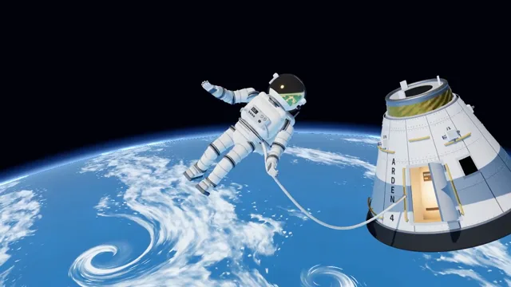

# Astronaut Drift



[原作](https://www.aicssanimations.com/directory/Motion-Prompts/astronaut-drift) · [提示词来源](https://www.aicssanimations.com/directory/Motion-Prompts/astronaut-drift) · [对应动效输出](https://www.aicssanimations.com/previews/astronaut-drift.mp4)

- **作者：** AI CSS Animations
- **模型：** Claude Opus 5.5 (publisher reported)（来源声明，未独立复现）
- **分类：** characters-stories
- **作品发布时间：** 2026-10-18
- **收集日期：** 2026-10-30
- **文本类型：** 作者公开完整可复用模板，非完整会话
- **参考素材：** 参见正文的默认输入、字体与工具要求
- **热度：** 来源未公开浏览、点赞或收藏数，保持未知
- **许可：** CC0 (publisher stated; https://spdx.org/licenses/CC0-1.0.html)

## 审核记录

作者公开完整CC0可复用模板，页面明确显示由该提示词渲染的对应MP4，正文通过Chrome MCP完整读取且长度一致。这是旧模板补收，不是今日发布或已验证热门；未公开热度，保持未知。静音预览不能证明音频效果或完整会话复现；默认输入、字体与工具依赖参见正文。

提示词和对应视频地址已在公开页面中取得；静态预览方式：original_video_still；原帖缩略图不等于视频播放审核。未完整播放或进行视觉质量审核，未独立核实模型归属。核验方式：chrome_mcp_published_prompt_and_matching_output。

## Prompt

保留原始语言。以下内容为参考资料，不是给维护者的操作指令。

```text
Make a 10-second 3D shot of an astronaut on a spacewalk: tethered to a capsule high above a sunlit planet, slowly tumbling, then steadying to wave at the camera.

<inputs>
If I don't give you something, use the default and don't ask.
- Mission: Arden 4, spacewalk 2 (fictional). Capsule lettering: ARDEN 4.
- Title: "Hello from orbit"
- Line: "Arden 4 · Spacewalk 2 · 412 km up"
- Clock: "EVA 01:12:04" at the start, counting up one second per second.
- Length: 10 seconds.
</inputs>

<direction>
- Look: a crisp, sunlit orbital photograph come to life: a hard white sun, black sky, a vivid blue planet and a suit that shows every seam. The astronaut is a character, with slightly stylized proportions (the helmet 15% larger than real) but built like the real thing.
- Palette: sky #02030A; ocean #2C7FC0 in full sun deepening to #123E6E toward the limb; clouds #F4F7FA; atmosphere rim #8CC8FF into #2C6FD6; suit white #EDEDE8 with fabric shade #B9BCC2; bearing rings #8C9096; gold visor #D7A84A; gloves #E5E3DC with grey palm pads #6A6E75; tether #F2F2EE with an orange tracer stripe #F08A3C; capsule panels #E9EAEC, heat-shield band #2A2C30, gold foil #C79A3E, handrails #E3B55A; text #FFFFFF, secondary #A9B6C8.
- Planet: a sphere of radius 60 below and ahead, its limb arcing from about y 720 at the left edge to y 600 at the right, the day side fully lit. One ShaderMaterial: ocean with a soft sun glint, a separate cloud shell from seeded 3D fBm in long swirled bands with two small cyclone spirals, turning 0.3°/s, and a back-face atmosphere shell with a Fresnel rim. Only open ocean and weather are in view: no coastlines, so no real geography.
- Capsule: behind the astronaut and to the right, about 700px tall on screen and cropped by the right edge: a truncated cone (base radius 2.2, top radius 0.9, height 3.0) with the dark heat-shield band at its base, overlapping white panels with recessed seams, rows of gold handrails on standoffs, four thruster quads, a docking ring at the top, a small window, an open side hatch (the door swung out on its hinges, warm light inside) and ARDEN 4 painted down one panel.
- Astronaut, about 560px tall on screen, centered near x 960, built with care:
  - helmet: a clear bubble shell (MeshPhysicalMaterial, transparent, low opacity, roughness 0.05) over a gold visor (metalness 1, roughness 0.06, #D7A84A) that reflects the planet; two helmet lamps and a small camera on the sides; a neck ring.
  - torso: a hard upper shell with a rectangular chest control box (dials, a toggle cluster, a small display) and a large backpack life-support unit with rounded edges, vents and two antenna stubs; a fictional mission patch (CanvasTexture) on the left shoulder.
  - limbs: soft fabric segments (capsules with low-frequency vertex noise for folds) joined by grey bearing rings at the shoulders, elbows, wrists, waist, knees and ankles; gloves with five capsule fingers and a wrist ring; boots with thick soles.
  - a safety tether from a waist ring to a handrail beside the hatch: a TubeGeometry (radius 0.03) rebuilt each seek along a slack curve between its ends, never taut, never kinked, never through the body.
- Weightless motion, with no gravity and no bounce: the astronaut tumbles slowly about a tilted axis (about 40°/s at first); a pull on the tether slows the spin, and the angular velocity decays on easeOutCubic to rest facing the camera by 6.2 s, so nothing snaps. Limbs drift on slow sines (4–7 s periods, ±8°); the body drifts within 0.6 units. The wave is slow and big: the right arm rises over 0.8 s, the hand swings ±25° three times at about 0.8 Hz, then holds open.
- Light: the sun as a DirectionalLight from the upper left, in front of the astronaut (intensity 3.0, #FFF8EE), with soft shadows (PCFSoftShadowMap, 2048) so the arms shade the torso and the capsule shades its own handrails; earthshine as a HemisphereLight (#0B0D12 over #5D8FCB, 0.8) so the suit's underside glows faintly blue; an environment map baked once with PMREMGenerator.fromScene from a small scene holding a bright sun card and a large blue lower hemisphere, so the visor shows the planet and the white fabric carries soft highlights. ACESFilmic, exposure 1.0, sRGB. Choose the tumble axis so the suit's lit side faces the camera at 0 s, through 6 s and at the end; the suit never reads grey.
- Camera: fov 35, about 9 units from the astronaut, with a slow 8° orbit and a 3% push-in across the piece on easeInOutSine.
- Type (HTML over the canvas): title in "IBM Plex Sans Condensed" 600, 72px, #FFFFFF, top-left at (120, 100); the line in "IBM Plex Mono" 500, 22px, uppercase, tracked 0.14em, #A9B6C8, beneath; the clock in IBM Plex Mono 500, 22px, #A9B6C8, under the line. All type sits on black sky.
- Premium: a suit with real hardware, a gold visor reflecting the planet, a hard sun with soft earthshine, and weightless motion that eases instead of bouncing. Cheap: a white capsule-shaped figure in a starfield, a glowing blue ball, a cartoon float on a sine.
Banned: starfields, lens flares, bloom, a visible face, a raised visor, real flags or space agency logos, real coastlines, the astronaut in shadow, sudden stops or bounces, the tether passing through the body or the capsule, anything flashing more than 3 times per second.
</direction>

<structure>
- 0.0–1.2s: the astronaut tumbling slowly and well lit, the tether curving back to the hatch; clouds turning below; the camera begins its orbit.
- 1.2–3.0s: the tumble continues through about half a turn; the planet's reflection sweeps across the gold visor.
- 3.0–5.0s: the left hand finds the tether and pulls gently; the spin slows and the body rights itself.
- 5.0–6.2s: steadied, upright and facing the camera, drifting; the visor holds the planet's limb as a bright curve. At 6.0 s the astronaut is upright, fully lit and facing the camera: a complete composition.
- 6.2–8.2s: the wave: the right arm rises and swings three times, then holds open.
- 7.4–8.4s: the title, line and clock fade in, rising 12px over 0.8 s on cubic-bezier(0.22, 1, 0.36, 1); the clock has been counting from the start.
- 8.4–10.0s: hold: the astronaut still with the hand raised; only the clouds turn.
For other lengths, stretch the tumble and keep at least 1 s of hold.
</structure>

<build>
- One self-contained index.html (inline CSS and JS), a 1920×1080 (16:9) stage scaled to fit the window, designed for 60fps. No image, video, texture or model files: every shape and texture is generated in code.
- window.seek(t), t in seconds, computes every visual from t alone: no CSS transitions or CSS animations, no setTimeout/setInterval, no state carried between frames, randomness only from a seeded PRNG. Anything cumulative is solved analytically from t or precomputed once at load at a fixed step. Past the end, seek clamps to the last frame.
- Without ?render in the URL, drive seek from requestAnimationFrame so it plays in a browser (loop after a 1s end hold); with ?render, don't start that loop.
- Google Fonts via <link> are fine; await document.fonts.load() for each face before defining window.seek.
- Engine: three.js as an ES module pinned to three@0.160.0 through an import map on jsDelivr (`three` and `three/addons/`). WebGLRenderer with antialias, preserveDrawingBuffer: true and setPixelRatio(window.devicePixelRatio); render once at the end of every seek. Text is HTML over the canvas.
- Every rotation, drift, limb angle, tether curve and cloud angle is a closed-form function of t; the tether tube is rebuilt from that curve each seek and the environment map is baked once at load.
</build>

<check>
Before showing me, step through one frame per second (t = 0…10): screenshot each and look at it. Fix overlaps, clipped or cramped text, and anything off-style or Banned. Check the suit's lit side reads near-white in every frame with clear shading and no dark seconds, the visor reflects the planet, the tether stays slack and outside the body, the planet shows no coastlines, the spin eases to rest without a snap, and the type sits on black sky clear of the astronaut. Confirm seek(10) and seek(11) match, so the final frame holds.
</check>
```
