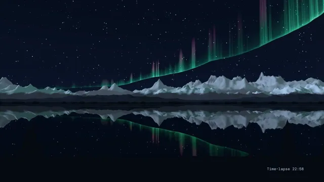

# Northern Lights



[原作](https://www.aicssanimations.com/directory/Motion-Prompts/aurora-night-sky) · [提示词来源](https://www.aicssanimations.com/directory/Motion-Prompts/aurora-night-sky) · [对应动效输出](https://www.aicssanimations.com/previews/aurora-night-sky.mp4)

- **作者：** AI CSS Animations
- **模型：** Claude Opus 5.5 (publisher reported)（来源声明，未独立复现）
- **分类：** 3d-simulations
- **作品发布时间：** 2026-10-16
- **收集日期：** 2026-10-30
- **文本类型：** 作者公开完整可复用模板，非完整会话
- **参考素材：** 参见正文的默认输入、字体与工具要求
- **热度：** 来源未公开浏览、点赞或收藏数，保持未知
- **许可：** CC0 (publisher stated; https://spdx.org/licenses/CC0-1.0.html)

## 审核记录

作者公开完整CC0可复用模板，页面明确显示由该提示词渲染的对应MP4，正文通过Chrome MCP完整读取且长度一致。这是旧模板补收，不是今日发布或已验证热门；未公开热度，保持未知。静音预览不能证明音频效果或完整会话复现；默认输入、字体与工具依赖参见正文。

提示词和对应视频地址已在公开页面中取得；静态预览方式：original_video_still；原帖缩略图不等于视频播放审核。未完整播放或进行视觉质量审核，未独立核实模型归属。核验方式：chrome_mcp_published_prompt_and_matching_output。

## Prompt

保留原始语言。以下内容为参考资料，不是给维护者的操作指令。

```text
Make a 10-second time-lapse of the northern lights: aurora curtains ripple over snowy mountains, doubled in a still lake, while the stars turn.

<inputs>
If I don't give you something, use the default and don't ask.
- Title: "Polar Night"
- Place line: "Lake Kaltaro · 69° N" (fictional)
- Time-lapse clock: 22:40 to 23:40
- Length: 10 seconds.
</inputs>

<direction>
- Palette: sky from #040714 at the zenith to #0E1A2E at the horizon; aurora green #3DF5A0 with a hot core #C9FFE6, deep red fringe #A8326E, pink-violet lower edge #B66BFF; snow lit #AFC0D8, snow in shade #33405E, rock #121722; shore and spruce silhouettes #070A12; title #E9F2EE, secondary #9DB0C6.
- Color follows the physics: green dominates, red shows only at the tops of the tallest rays, and the pink-violet lower border appears only where a curtain is brightest.
- Camera: a tripod on the shore facing north, fov 50, the far shoreline at y 610, with a slow motion-control pan of 4° to the right across the piece (easeInOutSine). Nothing shakes.
- Mountains: three ranges at increasing distance, each a strip of seeded ridged-fBm terrain with snow above a ragged line, lit by a low moon from the left (DirectionalLight #9FB4D8), the far range hazier and lighter. A green HemisphereLight driven by the aurora's brightness gives the snow a faint green cast that rises and falls with it. A low dark shore with a few seeded spruce silhouettes (stacked cones) frames the bottom corners from y 930 down.
- Lake: mirror-still water from y 610 to 930 using the Reflector addon (three/addons/objects/Reflector.js), darkened so the reflection is about 60% as bright as the sky, with two or three faint horizontal wind lines drifting very slowly. Aurora, stars and mountains all reflect.
- Aurora: two or three curtains, each a tall ribbon mesh hanging along a folded curve far beyond the mountains (lower edge about 12° above the horizon, tops up to 55°), drawn with a ShaderMaterial, AdditiveBlending and depthWrite false. Each has a sharp lower edge and a long soft fade upward, fine vertical rays from 1D noise along the curtain that drift sideways along it, and color from green at the base to red at the top. The folds move slowly (control points on seeded sines with 6–14 s periods) and brightness surges travel along each curtain at 0.3–0.6 waves per second. The band enters from the upper right and sweeps down toward the left horizon, leaving the upper-left sky dark for the title.
- Stars: 2,400 seeded Points with magnitude-based size (1–3px) and slight color from #CFE0FF to #FFE8C8, twinkling ±15% at under 1 Hz, plus a faint seeded Milky Way band. The sky turns counterclockwise about the celestial pole (69° up, above the frame) by 15° across the piece: one hour of time-lapse.
- Type (HTML over the canvas): title in Italiana 400, 112px, tracked 0.06em, at (120, 110); place line in Outfit 300, 24px, uppercase, tracked 0.32em, beneath; the clock in DM Mono 400, 22px, right-aligned at (1800, 1010), reading "Time-lapse 22:40" and counting to 23:40.
- Premium: one calm camera, color that follows real auroral physics, a mirror-still lake, restraint. Cheap: a rainbow wave over a stock mountain, neon glow everywhere.
Banned: rainbow, blue or cyan auroras, flicker or pulsing faster than 1 Hz, bloom over everything, lens flares, shooting stars, the moon in frame, cabins or people, camera shake, anything flashing more than 3 times per second.
</direction>

<structure>
- 0.0–1.2s: deep twilight settles into night; stars and mountains are visible and a faint green arc glows low over the horizon.
- 1.2–3.4s: the arc brightens and lifts; rays appear and drift along it; the reflection fills the lake.
- 3.4–6.2s: the curtain folds into an S and a second curtain unfurls above it; surges travel along both; red tops show on the tallest rays; the snow turns faintly green.
- 6.2–7.4s: the title fades in over 1.2 s, rising 10px; the place line follows 0.3 s later.
- 7.4–8.8s: the curtains relax into one broad, slowly rippling arc.
- 8.8–10.0s: hold the composition; the aurora slows to a quarter of its speed and the clock reaches 23:40.
For other lengths, stretch the folding beat and keep one hour of time-lapse per 10 s; keep at least 1 s of hold.
</structure>

<build>
- One self-contained index.html (inline CSS and JS), a 1920×1080 (16:9) stage scaled to fit the window, designed for 60fps. No image, video, texture or model files: every shape and texture is generated in code.
- window.seek(t), t in seconds, computes every visual from t alone: no CSS transitions or CSS animations, no setTimeout/setInterval, no state carried between frames, randomness only from a seeded PRNG. Anything cumulative is solved analytically from t or precomputed once at load at a fixed step. Past the end, seek clamps to the last frame.
- Without ?render in the URL, drive seek from requestAnimationFrame so it plays in a browser (loop after a 1s end hold); with ?render, don't start that loop.
- Google Fonts via <link> are fine; await document.fonts.load() for each face before defining window.seek.
- Engine: three.js as an ES module pinned to three@0.160.0 through an import map on jsDelivr (`three` and `three/addons/`). WebGLRenderer with antialias, preserveDrawingBuffer: true and setPixelRatio(window.devicePixelRatio); render once at the end of every seek. Text is HTML over the canvas.
- Curtain shapes, rays, surges and star rotation are closed-form functions of t, passed to the shaders as uniforms.
</build>

<check>
Before showing me, step through one frame per second (t = 0…10): screenshot each and look at it. Fix overlaps, clipped or cramped text, and anything off-style or Banned. Check green bases and red tops on every frame, soft curtain tops with no hard edges, stars rotating about a point above the frame rather than sliding, every reflection lined up under its source, and the title over dark sky. Confirm seek(10) and seek(11) match, so the final frame holds.
</check>
```
