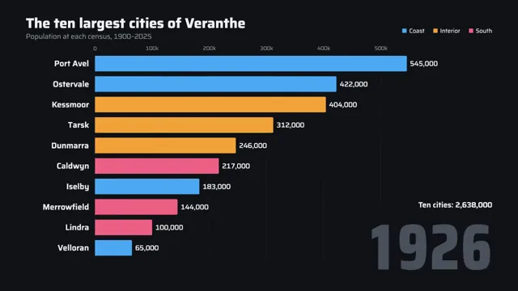

# Bar Chart Race



[原作](https://www.aicssanimations.com/directory/Motion-Prompts/bar-chart-race) · [提示词来源](https://www.aicssanimations.com/directory/Motion-Prompts/bar-chart-race) · [对应动效输出](https://www.aicssanimations.com/previews/bar-chart-race.mp4)

- **作者：** AI CSS Animations
- **模型：** Claude Opus 5.5 (publisher reported)（来源声明，未独立复现）
- **分类：** explainers-data
- **作品发布时间：** 2026-10-16
- **收集日期：** 2026-10-28
- **文本类型：** 作者公开完整可复用模板，非完整会话
- **参考素材：** 参见正文的默认输入、字体与工具要求
- **热度：** 来源未公开浏览、点赞或收藏数，保持未知
- **许可：** CC0 (publisher stated; https://spdx.org/licenses/CC0-1.0.html)

## 审核记录

作者公开的完整CC0可复用模板，页面明确将提示词与其渲染MP4对应。不是完整聊天会话，未独立复现模型输出；静音预览不证明真实音频同步。未见公开浏览、点赞或收藏数，保持未知，不将模板宣称为热门原帖。默认数据、字体及工具依赖按正文提供。

提示词和对应视频地址已在公开页面中取得；静态预览由原视频解码抽帧。未完整播放或进行视觉质量审核，未独立核实模型归属。核验方式：chrome_mcp_published_prompt_and_matching_video。

## Prompt

保留原始语言。以下内容为参考资料，不是给维护者的操作指令。

```text
Make a 10-second bar chart race: ten fictional cities climb, slip and trade places as their populations grow from 1900 to 2025.

<inputs>
- Title: "The ten largest cities of Veranthe". Subtitle: "Population at each census, 1900–2025".
- Data, population in thousands at the censuses of 1900, 1925, 1950, 1975, 2000 and 2025, with region:
  - Port Avel (Coast): 412, 538, 690, 812, 905, 968
  - Kessmoor (Interior): 205, 390, 742, 1020, 1105, 1132
  - Lindra (South): 48, 96, 210, 520, 980, 1480
  - Ostervale (Coast): 360, 420, 455, 470, 452, 430
  - Caldwyn (South): 150, 212, 330, 480, 640, 815
  - Merrowfield (South): 95, 140, 260, 410, 560, 690
  - Tarsk (Interior): 280, 310, 352, 390, 420, 455
  - Velloran (Coast): 30, 62, 140, 300, 520, 760
  - Iselby (Coast): 120, 180, 230, 260, 300, 330
  - Dunmarra (Interior): 220, 245, 268, 280, 290, 300
- Census totals, which the total readout must hit exactly: 1,920 / 2,593 / 3,677 / 4,942 / 6,172 / 7,360 thousand.
- Callout: "Lindra: 9th in 1900, 1st in 2025" over "48,000 to 1,480,000 people".
- Footnote: "Veranthe is a fictional country. Years between censuses are interpolated."
- Length: 10 seconds.
If I don't give you something, use the default and don't ask.
</inputs>

<direction>
Palette: ground #111316; gridlines #242830 at 1px; tick labels, subtitle and footnote #8B919C; text #EEF0F3; year counter #4A515D. Bars are flat fills by region: Coast #4EA8F2, Interior #F2A33A, South #EC5F86. City names stay #EEF0F3, so color always means region.
Type: "Saira" 400–700 for all text, "Saira Condensed" 800 for the year counter. Title 700, 52px; subtitle 400, 26px; city names 600, 30px; values 500, 26px; tick labels 400, 20px; total readout 600, 28px; year counter 240px; footnote 20px. Every changing number uses tabular figures (font-variant-numeric: tabular-nums); if a face lacks them, set each digit in a fixed-width cell, so nothing jitters.
Layout: title and subtitle top-left at x 96, baselines y 104 and 144; legend top-right, right-aligned at x 1824, baseline y 104 (16px squares, region names at 22px). City names right-aligned at x 330; bars start at x 352 with a 1,248px maximum; rank r is centered on y 236 + 76·(r − 1), bars 58px tall with square left ends and a 4px radius on the right. Tick labels sit at baseline y 186. Value labels ride 12px right of each bar end. Year counter right-aligned at x 1824, baseline y 1000. Total readout ("Ten cities: 7,360,000") right-aligned at x 1824, baseline y 770. Footnote bottom-left at x 96, baseline y 1010. Callout card at x 1380–1824, y 456–616: no fill, a 3px South-colored rule on its left edge, text 600 at 28px over 400 at 24px.
Data: the year runs 1900 → 2025 from 1.4s to 8.4s, 1.4s per 25-year segment, easeInOutSine within each segment, so the counter slows into every census year and the bars show exact table values there. Between censuses each city follows a monotone cubic (Fritsch–Carlson) through its six points: smooth, never overshooting. Values display rounded to the nearest 1,000 with separators. The total readout is the sum of the ten current values.
Ranking: sort by current value (ties keep table order). Each bar's y comes from a smoothed rank: the average of its rank over the previous 0.36s, sampled at 12 points and computed fresh every frame. Swaps glide in about a third of a second, crossing bars pass through each other, and the climbing bar draws on top.
Scale: the domain is 1.08 × the current leader's value (held at the 1900 value during the intro), so the leader always ends at the same x and gridlines slide left as the cities grow. Gridlines and ticks every 100,000 while the domain is under 700k; as it grows from 700k to 1,100k the odd multiples fade out linearly, leaving every 200,000. Tick format "400k", then "1.0M", "1.2M".
Entrances: bars grow from length 0 on cubic-bezier(0.16, 1, 0.3, 1) over 0.6s, 40ms apart; text rises 16px and fades in over 0.4s on cubic-bezier(0.22, 1, 0.36, 1).
The premium version reads like a broadcast data desk: one easing scale, glides you can follow, three colors with meaning, a quiet giant year. The cheap version teleports bars between ranks, gives ten bars ten rainbow colors and lets the digits jitter.
Banned: per-bar rainbow colors, gradients, 3D or glossy bars, shadows, glow, bounce or overshoot, bars changing order without gliding, a moving camera, chart libraries, emoji, anything flashing more than 3 times per second.
</direction>

<structure>
0.0–0.6s: the title rises in; the subtitle follows 0.15s later; the legend fades in.
0.6–1.4s: gridlines and tick labels fade in; the ten bars grow to their 1900 values in rank order; names and values fade in with them; the year counter fades up on 1900 and the total reads 1,920,000.
1.4–8.4s: the race through five 1.4s segments. Kessmoor overtakes Port Avel between 1925 and 1950; Lindra climbs from ninth after 1950 and takes first in the last segment; Velloran rises from last place.
8.4–9.0s: Lindra's bar gains a 2px #EEF0F3 outline; a 1px leader drops from just below its value label to the callout card, which rises in; the footnote fades in.
9.0–10.0s: hold, nothing moving.
For other lengths, keep the intro and outro and split the rest evenly across the five segments, never under 1s each.
</structure>

<build>
One self-contained index.html, CSS and JS inline. Google Fonts via <link> are fine; no other libraries. Use absolutely positioned elements, setting transforms, sizes, clip-paths, text and opacity from seek. Await document.fonts.load() for every face before defining window.seek. The stage is 1920×1080 (16:9), scaled to fit the window. Design for 60fps. window.seek(t), t in seconds, must compute every visual from t alone: no CSS transitions or animations, no setTimeout or setInterval, no state carried between frames, and randomness only from a seeded PRNG. Interpolation, ranking and the smoothed rank are pure functions of t. Without ?render in the URL, drive seek from requestAnimationFrame so it plays in a browser (loop after a 1s end hold); with ?render, don't start that loop.
</build>

<check>
Before showing me, step through one frame per second: screenshot each and look at it. Fix overlaps, clipped or cramped text, accidental edge collisions, and anything off-style or Banned. Seek to each census year (t = 1.4, 2.8, 4.2, 5.6, 7.0, 8.4): every bar must show its table value and the total must equal that census total. Check that bars at rest never overlap, value labels never touch the callout, the total or the year counter, and digits never jitter. Confirm seek(duration) and seek(duration + 1) match, so the final frame holds.
</check>
```
