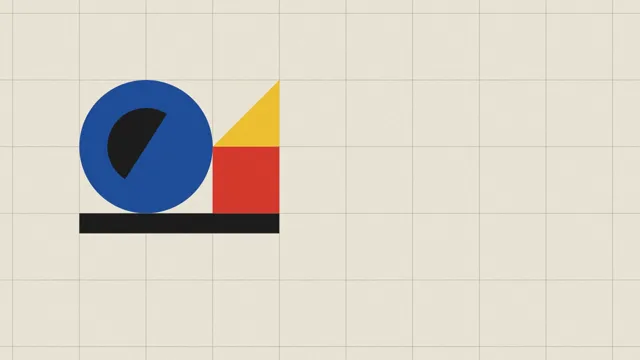

# Bauhaus Geometry



[原作](https://www.aicssanimations.com/directory/Motion-Prompts/bauhaus-geometry) · [提示词来源](https://www.aicssanimations.com/directory/Motion-Prompts/bauhaus-geometry) · [对应动效输出](https://www.aicssanimations.com/previews/bauhaus-geometry.mp4)

- **作者：** AI CSS Animations
- **模型：** Claude Opus 5.5 (publisher reported)（来源声明，未独立复现）
- **分类：** motion-studies
- **作品发布时间：** 2026-10-12
- **收集日期：** 2026-10-28
- **文本类型：** 作者公开完整可复用模板，非完整会话
- **参考素材：** 参见正文的默认输入、字体与工具要求
- **热度：** 来源未公开浏览、点赞或收藏数，保持未知
- **许可：** CC0 (publisher stated; https://spdx.org/licenses/CC0-1.0.html)

## 审核记录

作者公开的完整CC0可复用模板，页面明确将提示词与其渲染MP4对应。不是完整聊天会话，未独立复现模型输出；静音预览不证明真实音频同步。未见公开浏览、点赞或收藏数，保持未知，不将模板宣称为热门原帖。默认数据、字体及工具依赖按正文提供。

提示词和对应视频地址已在公开页面中取得；静态预览由原视频解码抽帧。未完整播放或进行视觉质量审核，未独立核实模型归属。核验方式：chrome_mcp_published_prompt_and_matching_video。

## Prompt

保留原始语言。以下内容为参考资料，不是给维护者的操作指令。

```text
Make a 10-second Bauhaus logo build: geometric parts assemble into a mark.

<inputs>
Brand: atlas & oak. Tagline: "made to be used." Three words: form, function, craft. Colors: the primaries below (map any brand palette onto their roles). Duration: 10s. If I don't give you something, use the default and don't ask.
</inputs>

<direction>
Palette: paper #EEE8DA, black #1A1A1A, red #D9372A, yellow #F2C230, blue #1E4C9A. Flat fills; a faint seeded paper grain at 4%.
Type: Jost 400 and 700, all lowercase in the Bauhaus manner: wordmark 150px (tracking -0.02em), tagline 44px, labels 26px.
Composition: a construction grid of 200px cells, shown and then removed. The mark is three cells wide and two tall, standing on a black bar (three cells × 60px): a blue circle filling the left 2×2 cells, a red square lower right, a yellow triangle on the square (Kandinsky's shape-color pairing). Mark left of center, wordmark to its right with its baseline on the bar's bottom edge: balanced, not symmetrical.
Motion is mechanical, like parts assembled on a workbench. Shapes travel straight rails; the circle rolls (rotation = distance ÷ radius) with a black half-disc inset so the roll reads; rotations go in 90° steps. Moves use cubic-bezier(0.7, 0, 0.2, 1) over 0.4–0.9s; landings get one small overshoot, cubic-bezier(0.34, 1.56, 0.64, 1) over 0.2s. Every motion has a cause and a clean stop. Real Bauhaus feels engineered; imitations scatter random colored shapes.
Banned: gradients, shadows, outlines on filled shapes, pastels, serif or script type, an uppercase wordmark, wobbling shapes, angles other than multiples of 45°, more than four parts in the mark.
</direction>

<structure>
0.0–0.6s: grid lines (1.5px black, 25% opacity) draw on.
0.6–1.0s: the bar wipes in from the left.
1.0–1.9s: the circle rolls in from off-stage left along the bar, decelerating into its cells.
1.9–2.3s: the square drops onto the bar and lands with the overshoot (scaleY 0.94 at contact).
2.3–3.0s: the triangle turns into place on the square in three 90° steps (0.16s each, 0.06s rests).
3.0–3.7s: a 3px compass arc sweeps 270° around the circle; arc and grid then fade over 0.4s.
3.7–4.8s: the wordmark slides up out of a mask, letters 35ms apart.
4.8–5.6s: the tagline appears beneath, led by a 22px red square bullet.
5.6–6.6s: function beat: the circle rolls right as the square, carrying the triangle, lifts over it and drops into the left position, on cubic-bezier(0.65, 0, 0.35, 1).
6.6–7.8s: the three words slide in under the tagline, each led by a 28px icon of its shape, 150ms apart.
7.8–10.0s: hold.
For other durations, scale every timestamp proportionally.
</structure>

<build>
One self-contained index.html, CSS and JS inline. Google Fonts via <link> are fine; no other libraries (no three.js: this style is flat). Draw in inline SVG. The stage is 1920×1080 (16:9), scaled to fit the window. Design for 60fps. window.seek(t), t in seconds, must compute every visual from t alone: no CSS transitions or animations, no setTimeout or setInterval, no state carried between frames, and randomness only from a seeded PRNG. Without ?render in the URL, drive seek from requestAnimationFrame so it plays in a browser (loop after a 1s end hold); with ?render, don't start that loop.
</build>

<check>
Before showing me, step through one frame per second: screenshot each and look at it. Fix overlaps, clipped or cramped text, accidental edge collisions, and anything off-style or Banned. Check the circle never slides without rolling. Confirm seek(duration) and seek(duration + 1) match, so the final frame holds.
</check>
```
