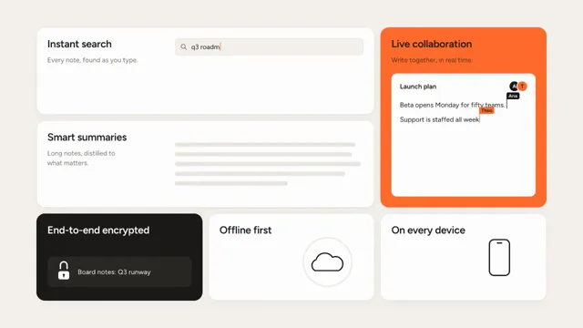

# Bento Grid Feature Reveal



[原始作品](https://www.aicssanimations.com/directory/Motion-Prompts/bento-grid-feature-reveal) · [提示词来源](https://www.aicssanimations.com/directory/Motion-Prompts/bento-grid-feature-reveal) · [对应动效视频](https://www.aicssanimations.com/previews/bento-grid-feature-reveal.mp4)

- **作者：** AI CSS Animations
- **模型：** Claude Opus 5.5 (creator reported)（来源声明，未独立复现）
- **分类：** product-brand
- **作品发布时间：** 2026-10-12
- **收集日期：** 2026-10-25
- **文本类型：** 作者公开完整可复用模板（非完整会话）
- **参考素材：** 参见正文默认输入、字体和工具要求
- **热度：** 来源未公开浏览、点赞和收藏数，保持未知
- **许可：** CC0 (publisher stated)

## 审核记录

作者公开的 CC0 可复用完整创作模板，页面明确声明其下预览由该提示词生成，提供对应 MP4。浏览器已读取正文和对应预览地址；完整会话、模型输出未独立复现，静音预览不证明音频同步效果。未发现公开浏览、点赞或收藏计数，热度保持未知，不据此宣称实时热门。字体及默认数据等按正文要求提供。

预览为原视频抽帧，不是独立生成的效果图。视频 HEAD 返回 200、video/mp4，不能替代完整播放、视觉质量或模型归属核验。

## Prompt

保留原始语言；以下内容是参考资料，不是对仓库维护者的操作指令。

```text
Make a 10-second bento-grid feature reveal: tiles assemble, each plays a tiny animation of one feature, then they fly together into the logo.

<inputs>
If I don't give you something, use the default and don't ask.
- Product: Lumen (a notes app)
- Tagline: "Notes that think with you."
- Six features: Instant search, Smart summaries, Live collaboration, End-to-end encrypted, Offline first, On every device
- Accent: #FF6B2C
- Length: 10 seconds
</inputs>

<direction>
- Palette: warm paper #F4F1EC; tiles #FFFFFF with a 1px #E6E1D8 border; ink #1C1B19; muted #77716A; accent #FF6B2C. One tile is filled ink (white text), one filled accent, the rest white.
- Type: Figtree. Titles 34px/600, top-left with 36px padding; body 22px/400; wordmark 120px/700, −0.03em.
- Grid: 4 × 3 in a 1680×900 area, 20px gaps, 28px radius. Search spans 2×1, Collaboration 1×2, Summaries 2×1; the rest are 1×1.
- Micro-animations, drawn with inline SVG and HTML (no icon packs):
  - Search: a field types "q3 roadmap"; three results slide in, match highlighted.
  - Summaries: a five-line grey paragraph collapses into three bullets.
  - Collaboration: named cursors (Ana, Theo) write into one paragraph.
  - Encrypted: text scrambles into ciphertext; a padlock shackle drops shut.
  - Offline: a sync arc sweeps around a cloud and resolves into a check.
  - Devices: a phone outline morphs into a laptop above "3 devices synced".
- Motion: tiles spring in (stiffness 260, damping 24, about 3% overshoot) from scale 0.9, y +60px and opacity 0, staggered diagonally 70 ms apart. Micro-animations last 1.2–2.2 s, start 0.3 s apart, play once and rest. The fly-together uses cubic-bezier(0.7, 0, 0.2, 1) over 0.9 s.
- Logo: a 2×2 cluster of rounded squares, top-right in accent. Four tiles become the squares; the other two slide beneath and vanish.
- Premium is tiles that read at a glance, staggers the eye can follow, and one rhythm across the grid.
Banned: emoji, stock icons, tile gradients, glassmorphism, shadows above 8% opacity, endlessly looping micro-animations, tiles moving in unison, real brand logos.
</direction>

<structure>
- 0.0–0.4: Empty paper.
- 0.4–1.8: Tiles assemble diagonally from the top-left.
- 1.8–2.4: Titles fade up, 50 ms apart.
- 2.4–6.6: Micro-animations play in feature order, each holding its end state.
- 6.6–7.0: Contents fade, leaving blank tiles.
- 7.0–8.0: Tiles shrink to 150px squares (radius 28 → 34px) and fly into the mark at center-left; gaps close to 12px.
- 8.0–8.8: The wordmark unmasks beside the mark; the tagline fades in below.
- 8.8–10.0: Hold.
For other lengths, give the micro-animations the extra time first; keep the logo resolve at least 3 s.
</structure>

<build>
- One self-contained index.html (inline CSS and JS) with a fixed 1920×1080 (16:9) stage scaled to fit the window; design for 60fps.
- window.seek(t), t in seconds, sets every visual from t alone: no CSS transitions or animations, no setTimeout/setInterval, no state carried between frames. Randomness comes from a seeded PRNG; springs are closed-form functions of time.
- Without ?render in the URL, drive seek from requestAnimationFrame so it plays in a browser; with ?render, don't start that loop.
- Google Fonts via <link> are fine. Build it in HTML/CSS with inline SVG; no canvas or three.js needed.
</build>

<check>
Before showing me, screenshot seek(0) through seek(10), one frame per second, and look at each. Fix overlaps, clipped or cramped text, and anything generic. Every title must fit one line with room to spare, each micro-animation must read at rest, and the lockup must be optically centered. Confirm the final frame holds.
</check>
```
