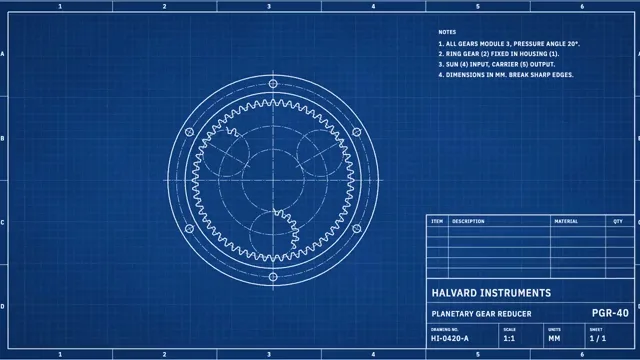

# Blueprint Technical Drawing



[原始作品](https://www.aicssanimations.com/directory/Motion-Prompts/blueprint-technical) · [提示词来源](https://www.aicssanimations.com/directory/Motion-Prompts/blueprint-technical) · [对应动效视频](https://www.aicssanimations.com/previews/blueprint-technical.mp4)

- **作者：** AI CSS Animations
- **模型：** Claude Opus 5.5 (creator reported)（来源声明，未独立复现）
- **分类：** explainers-data
- **作品发布时间：** 2026-10-12
- **收集日期：** 2026-10-25
- **文本类型：** 作者公开完整可复用模板（非完整会话）
- **参考素材：** 参见正文默认输入、字体和工具要求
- **热度：** 来源未公开浏览、点赞和收藏数，保持未知
- **许可：** CC0 (publisher stated)

## 审核记录

作者公开的 CC0 可复用完整创作模板，页面明确声明其下预览由该提示词生成，提供对应 MP4。浏览器已读取正文和对应预览地址；完整会话、模型输出未独立复现，静音预览不证明音频同步效果。未发现公开浏览、点赞或收藏计数，热度保持未知，不据此宣称实时热门。字体及默认数据等按正文要求提供。

预览为原视频抽帧，不是独立生成的效果图。视频 HEAD 返回 200、video/mp4，不能替代完整播放、视觉质量或模型归属核验。

## Prompt

保留原始语言；以下内容是参考资料，不是对仓库维护者的操作指令。

```text
<inputs>
You're making a blueprint-style technical animation. I may supply any of these; if I don't give you something, use the default and don't ask.
- Mechanism: planetary gear reducer, module 3; sun 24 teeth, three 18-tooth planets, ring 60; ring fixed, sun in, carrier out at 3.5 : 1.
- Maker and part: Halvard Instruments, PGR-40 (fictional).
- Callouts: housing, ring gear, planet gear, sun gear, carrier.
- Length: 10 seconds.
</inputs>

<direction>
Cyanotype sheet: paper #103F7F darkening to #0A2D5E at the corners, linework #F1F5FF. Grid: minor lines every 24px at 7% white, major every 120px at 14%. Mottle the paper with low-frequency blotches (±4% brightness) and fine grain.
Line hierarchy, never one weight: visible outlines 2.5px; hidden edges 1.5px dashed 9/5; centerlines 1px long-dash-dot; dimension and extension lines 1px, extension lines with a 4px gap at the part and 8px overrun; solid arrowheads 14px long at 3:1. Section cuts get 45° hatching at 8px pitch. Lay a 0.5px blur under each crisp stroke so it reads printed, not glowing.
Draw at 2.5px per mm. Type: "IBM Plex Sans Condensed" 500, uppercase, tracking 0.06em, for notes and the title block; "IBM Plex Mono" 20px for dimension values, which must agree with the geometry.
Sheet furniture: double border, zone letters A–D and numbers 1–6 in the margin, title block bottom-right (maker, part, drawing HI-0420-A, scale 1:1, units mm).
Motion follows drafting order, construction before form. Centerlines shoot out from the center (0.3s, easeOutQuad). Circles sweep like a compass from 12 o'clock (0.4–0.6s, easeInOutSine). Dimension lines grow from their midpoint to both arrows; values then type on at 30ms per character. Gears mesh: derive every angle from t and the tooth counts. The camera drifts like a reader's eye, never past 6% zoom.
Authentic means real drafting conventions a machinist could read; cheap means a glowing sci-fi hologram.
Banned: neon glow, HUD rings, 3D wireframes, colored fills, gradients beyond the paper, handwriting fonts, numbers that disagree with the drawing.
</direction>

<structure>
- 0–1.0s: border, zone marks and title block draw; the grid fades up.
- 1.0–2.2s: centerlines and construction circles.
- 2.2–4.2s: ring, planets, sun and carrier draw in that order; the housing gets a half-section hatch.
- 4.2–5.8s: dimensions Ø180 (ring pitch), Ø72 (sun pitch) and 63 (center distance); values type on.
- 5.8–7.8s: an input arrow lands on the sun; the train turns, easing to a stop by 7.8s; the carrier arrow and "i = 3.5 : 1" appear.
- 7.8–9.0s: balloons 1–5 with leaders; parts-list rows type into the title block.
- 9.0–10s: hold.
Other lengths: scale the beats proportionally and end on at least 1s of hold.
</structure>

<build>
One self-contained index.html (inline CSS and JS; Google Fonts via <link> are fine), a 1920×1080 (16:9) stage scaled to fit the window, built for 60fps. Draw in SVG; three.js isn't needed.
window.seek(t) (t in seconds) sets every visual from t alone, clamping past the end to the last frame. No CSS transitions or CSS animations, no setTimeout/setInterval, no state carried between frames. Mottling and grain come from a fixed-seed PRNG (anything that changes per frame seeds from the frame number); never Math.random.
With no ?render in the URL, call seek from requestAnimationFrame so it plays in a browser; with ?render, don't start that loop.
</build>

<check>
Before showing me, step through one frame per second (0–10s) and look at each. Fix overlaps, clipped or cramped text and anything off-style: teeth meshing without overlap, arrowheads touching extension lines, every dimension matching the geometry, leaders never crossing. Confirm the final frame holds.
</check>
```
