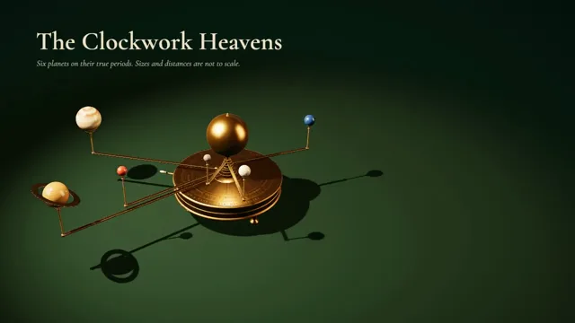

# Brass Orrery



[原作](https://www.aicssanimations.com/directory/Motion-Prompts/brass-orrery) · [提示词来源](https://www.aicssanimations.com/directory/Motion-Prompts/brass-orrery) · [对应动效输出](https://www.aicssanimations.com/previews/brass-orrery.mp4)

- **作者：** AI CSS Animations
- **模型：** Claude Opus 5.5 (publisher reported)（来源声明，未独立复现）
- **分类：** 3d-simulations
- **作品发布时间：** 2026-10-16
- **收集日期：** 2026-10-28
- **文本类型：** 作者公开完整可复用模板，非完整会话
- **参考素材：** 参见正文的默认输入、字体与工具要求
- **热度：** 来源未公开浏览、点赞或收藏数，保持未知
- **许可：** CC0 (publisher stated; https://spdx.org/licenses/CC0-1.0.html)

## 审核记录

作者公开的完整CC0可复用模板，页面明确将提示词与其渲染MP4对应。不是完整聊天会话，未独立复现模型输出；静音预览不证明真实音频同步。未见公开浏览、点赞或收藏数，保持未知，不将模板宣称为热门原帖。默认数据、字体及工具依赖按正文提供。

提示词和对应视频地址已在公开页面中取得；静态预览由原视频解码抽帧。未完整播放或进行视觉质量审核，未独立核实模型归属。核验方式：chrome_mcp_published_prompt_and_matching_video。

## Prompt

保留原始语言。以下内容为参考资料，不是给维护者的操作指令。

```text
Make a 10-second film of a brass orrery: a clockwork solar system that turns its planets at their true relative periods.

<inputs>
If I don't give you something, use the default and don't ask.
- Maker: Penhallow & Vane, Instrument Makers (fictional), engraved around the drum.
- Title: "The Clockwork Heavens"
- Subtitle: "Six planets on their true periods. Sizes and distances are not to scale."
- Planets and sidereal periods in days: Mercury 87.97, Venus 224.70, Earth 365.26, Mars 686.98, Jupiter 4,332.6, Saturn 10,759.2.
- Top speed: 80 days per second.
- Length: 10 seconds.
</inputs>

<direction>
- Palette: velvet backdrop #0B2219 falling to #04100B at the corners, green baize tabletop #12352A, brass #C9A15A, shadowed brass #6E5226, ivory type #EFE3C8, engraved brass-light #E2C88E. Planets are polished stone and enamel: Mercury pewter #8F8C86, Venus ivory #E6DAC0, Earth lapis #2E5AA6, Mars carnelian #B0422B, Jupiter banded agate (#D9B98C, #A86F45 and #F0E2C6 bands in a generated CanvasTexture), Saturn tiger's-eye #C2924A with a thin brass ring tilted 26.7°.
- The instrument: a squat brass drum (radius 1.1, height 0.35) on three turned legs standing on the baize. The drum top is an engraved calendar ring: 365 day ticks (every fifth longer), twelve month names in small caps, and the maker's name around the rim. From its center rises a stack of six concentric tubes, each a little taller and thinner, each carrying one arm: a flat brass bar (0.06 wide, 0.025 thick) that leaves its tube horizontally and ends in a vertical post with a collar, holding the planet clear above every inner arm. Arm radii 0.95, 1.35, 1.8, 2.3, 2.95 and 3.55 units; planet radii 0.07, 0.11, 0.115, 0.09, 0.26 and 0.22 (Saturn's ring reaching 0.42). The Sun is a gilded sphere (radius 0.42) on top of the central column. Earth's tube carries a slim pointer that reads the date on the calendar ring. A crank with an ivory handle stands out from the side of the drum.
- Materials and light: brass as MeshPhysicalMaterial (metalness 1, roughness 0.28, clearcoat 0.3), the drum top with fine radial brushing from a generated roughness map; stones roughness 0.15–0.35, clearcoat 1. Bake an environment once with PMREMGenerator.fromScene from a small dark room holding two warm softboxes and one dim cool strip, so the brass shows long, soft highlights instead of flat yellow. A warm SpotLight from upper left casts soft shadows (PCFSoftShadowMap, 2048 map) of the arms onto the drum and the baize. A dim warm PointLight sits inside the Sun, like the lamp at the center of some 18th-century orreries, so each planet's Sun-facing side is a little brighter. ACESFilmic tone mapping, sRGB output.
- One crank drives everything. Days elapsed D(t) is the integral of the crank speed (0 at rest, 80 days/s at full speed, with easeInOutSine ramps), solved analytically. Each planet's angle is θ₀ + 360° × D ÷ its period, counterclockwise seen from above; the crank turns once per 30 days. At full speed Mercury laps every 1.1 s while Saturn barely creeps: that contrast is the show. Choose each θ₀ so that in the final frame no planet hides behind the Sun or another arm.
- Camera: fov 30, one continuous move: low and close on the Sun and tube stack (pitch 10°), pulling back and up to a three-quarter view (pitch 32°), then orbiting 22° of yaw across the run on easeInOutSine. In the final view the Saturn arm's sweep spans about 62% of frame width, centered at x 760.
- Type (HTML over the canvas): title in Cormorant Garamond 600, 84px, ivory, top-left at (120, 96); subtitle Cormorant Garamond 500 italic, 28px, ivory at 70%, beneath. A legend plate at right (x 1420–1800, y 300–780) inside a thin double rule of brass-light: one row per planet with a 14px swatch, the name in Cormorant SC 600, 26px, tracked 0.12em, its period ("88 days", "11.9 years"), and a live revolution count to two decimals in EB Garamond 500 with tabular lining figures. Beneath the rows, "Day" with the running count and Earth years to two decimals.
- Easing: camera and crank on easeInOutSine; text rises 14px as it fades in over 0.6 s on cubic-bezier(0.22, 1, 0.36, 1). Nothing bounces.
- Premium: weighty brass with real reflections and shadows, every planet moving at its true rate from one crank, a calm camera, plain labels. Cheap: glowing orbit rings in a space void, a spinning sun, planets at made-up speeds.
Banned: orbit lines or trails, starfields or space backgrounds, bloom, lens flares, photo planet textures, zodiac or astrological symbols, planets passing through arms, motion blur, anything flashing more than 3 times per second.
</direction>

<structure>
- 0.0–1.6s: close on the gilded Sun and the tube stack, everything still; the camera pulls back and rises to reveal the whole orrery on the baize.
- 1.6–3.0s: the crank begins to turn and every planet accelerates together; the title and subtitle rise in.
- 3.0–7.0s: full speed. Mercury laps every 1.1 s, Venus every 2.8 s, Earth every 4.6 s, Mars crawls, Jupiter and Saturn barely move. The legend rows rise in from 3.2 s, 0.15 s apart; the counters run; the camera orbits.
- 7.0–8.2s: the crank eases to rest. The run totals 424 days: Mercury 4.82 revolutions, Venus 1.89, Earth 1.16, Mars 0.62, Jupiter 0.10, Saturn 0.04.
- 8.2–8.8s: an engraved name label on a hairline leader attaches to each planet, 80 ms apart, on the side away from the Sun.
- 8.8–10.0s: hold, perfectly still.
For other lengths, stretch the full-speed beat at 80 days/s and recompute the totals; keep at least 1 s of hold.
</structure>

<build>
- One self-contained index.html (inline CSS and JS), a 1920×1080 (16:9) stage scaled to fit the window, designed for 60fps. No image, video, texture or model files: every shape and texture is generated in code.
- window.seek(t), t in seconds, computes every visual from t alone: no CSS transitions or CSS animations, no setTimeout/setInterval, no state carried between frames, randomness only from a seeded PRNG. Anything cumulative is solved analytically from t or precomputed once at load at a fixed step. Past the end, seek clamps to the last frame.
- Without ?render in the URL, drive seek from requestAnimationFrame so it plays in a browser (loop after a 1s end hold); with ?render, don't start that loop.
- Google Fonts via <link> are fine; await document.fonts.load() for each face before defining window.seek.
- Engine: three.js as an ES module pinned to three@0.160.0 through an import map on jsDelivr (`three` and `three/addons/`). WebGLRenderer with antialias, preserveDrawingBuffer: true and setPixelRatio(window.devicePixelRatio); render once at the end of every seek. Text is HTML over the canvas.
- D(t) and every angle are closed-form functions of t, so any frame can be computed directly.
</build>

<check>
Before showing me, step through one frame per second (t = 0…10): screenshot each and look at it. Fix overlaps, clipped or cramped text, and anything off-style or Banned. Check that arms never touch planets or each other, the brass shows highlights rather than flat yellow, every legend count matches its planet's angle, and the legend and labels stay clear of the instrument. Confirm seek(10) and seek(11) match, so the final frame holds.
</check>
```
