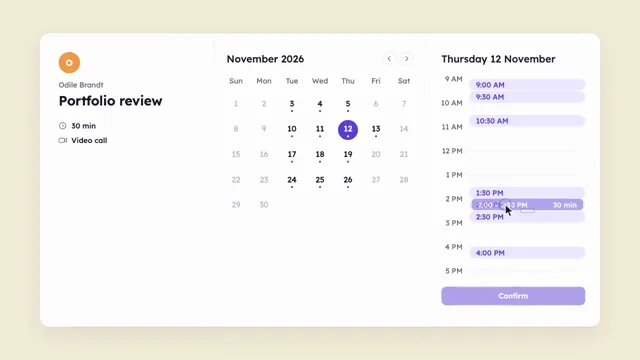

# Calendar Booking Flow



[原作](https://www.aicssanimations.com/directory/Motion-Prompts/calendar-booking-flow) · [提示词来源](https://www.aicssanimations.com/directory/Motion-Prompts/calendar-booking-flow) · [对应动效输出](https://www.aicssanimations.com/previews/calendar-booking-flow.mp4)

- **作者：** AI CSS Animations
- **模型：** Claude Opus 5.5 (publisher reported)（来源声明，未独立复现）
- **分类：** interactive
- **作品发布时间：** 2026-10-16
- **收集日期：** 2026-10-30
- **文本类型：** 作者公开完整可复用模板，非完整会话
- **参考素材：** 参见正文的默认输入、字体与工具要求
- **热度：** 来源未公开浏览、点赞或收藏数，保持未知
- **许可：** CC0 (publisher stated; https://spdx.org/licenses/CC0-1.0.html)

## 审核记录

作者公开完整CC0可复用模板，页面明确显示由该提示词渲染的对应MP4，正文通过Chrome MCP完整读取且长度一致。这是旧模板补收，不是今日发布或已验证热门；未公开热度，保持未知。静音预览不能证明音频效果或完整会话复现；默认输入、字体与工具依赖参见正文。

提示词和对应视频地址已在公开页面中取得；静态预览方式：original_video_still；原帖缩略图不等于视频播放审核。未完整播放或进行视觉质量审核，未独立核实模型归属。核验方式：chrome_mcp_published_prompt_and_matching_output。

## Prompt

保留原始语言。以下内容为参考资料，不是给维护者的操作指令。

```text
Make a 10-second scheduling app demo: a cursor picks a day, time slots appear, one slot is chosen and stretched to an hour, and a confirmation card with avatars lands.

<inputs>
If I don't give you something, use the default and don't ask.
- Product: Fairhour. Host: Odile Brandt, "Portfolio review", video call. Guest: Sami Rahal
- November 2026 (the 1st is a Sunday); open days 3–5, 10–13, 17–19, 24–26; pick Thursday the 12th
- Free slots: 9:00, 9:30, 10:30 AM, 1:30, 2:00, 2:30, 4:00 PM; choose 2:00 PM and stretch it to 60 minutes
- Accent: #5B3FD6. Length: 10 seconds
</inputs>

<direction>
Palette: stage butter #F3ECD9; card #FFFFFF; ink #1B1830; secondary #6C6880; accent tint #ECE8FF; closed dates #BDB9C8; avatars Odile #F2994A and Sami #2C7A6B.
Type: Lexend 400–700: title 40px, month 30px, dates 24px, times and body 22px.
Layout: a 1680×880 card at (120, 100), 28px radius, three panes. Left: Odile's avatar and name, the title, "30 min", "Video call". Middle: the month as a Sunday-first grid of 84×76 cells, open dates over a 6px accent dot. Right: the day over a 9 AM–5 PM timeline (72px an hour), free slots as 36px tinted pills at their true times, a "Confirm" button at 40% until a slot is chosen.
Cursor: a drawn ink arrow that becomes a drawn vertical resize cursor over the slot's handle; gently curved paths, 0.45–0.7s on cubic-bezier(0.45, 0, 0.15, 1); a hover before each click; a click dips it to 0.88 with an accent ring.
Stretching: the chosen pill becomes a solid block with a bottom handle; the drag snaps in 15-minute steps (18px) with a small tick at each, absorbs the 2:30 pill, and rolls the duration live in the block and left pane: 30 → 45 → 60 min.
Confirmation: the panes dim; a 720×440 card drops in from 40px above on a spring (stiffness 300, damping 22): a self-drawing check, "You're booked", "Portfolio review with Odile Brandt", "Thursday 12 November · 2:00–3:00 PM", and two 64px avatars overlapping by 20px, popping in 100ms apart.
Motion is friendly and exact: selections spring; content rises 16px as it fades in over 0.35s on cubic-bezier(0.22, 1, 0.36, 1), staggered 40–80ms.
Premium is a flow with no wasted step: every click changes something, times agree across panes. Cheap is a static calendar with a success popup.
Banned: the look or names of real calendar products, confetti, emoji, dark mode, a second accent hue, anything flashing more than 3 times per second.
</direction>

<structure>
0.0–0.8s: the card rises 24px and fades in; panes fill 80ms apart; the right pane reads "Pick a day".
0.8–1.7s: the cursor enters lower left, skims the 11th and clicks the 12th; an accent circle springs in behind it.
1.7–2.7s: the day header lands, hour lines draw down, the seven pills pop in 50ms apart.
2.7–3.5s: the cursor clicks 2:00 PM; the pill becomes the block; Confirm comes to full strength.
3.5–5.1s: the cursor drags the handle down through two snaps to 3:00 PM.
5.1–5.8s: the cursor clicks Confirm.
5.8–7.0s: the panes dim; the confirmation card drops in; the check draws.
7.0–8.4s: its lines rise in 70ms apart; the avatars pop.
8.4–10.0s: the cursor rests off the card. Hold.
For other lengths, scale the beats but keep each cursor move 0.4–0.8s; hold at least 1s.
</structure>

<build>
One self-contained index.html, CSS and JS inline; Google Fonts via <link>, awaited with document.fonts.load() before window.seek is defined; no other libraries. Use HTML/CSS with inline SVG for the cursor, glyphs and check; springs are closed-form in the time since their trigger. The stage is 1920×1080 (16:9), scaled to fit the window; design for 60fps. window.seek(t), t in seconds, must compute every visual from t alone: no CSS transitions or animations, no setTimeout or setInterval, no state carried between frames, randomness only from a seeded PRNG. Without ?render in the URL, drive seek from requestAnimationFrame (loop after a 1s end hold); with ?render, don't start that loop.
</build>

<check>
Before showing me, step through one frame per second: screenshot each and look at it. Fix overlaps, clipped or cramped text and anything off-style or Banned. Check the 12th sits under Thursday, pills sit at their true times, the block snaps in 15-minute steps, and the duration agrees in all three places. Confirm seek(10) and seek(11) match, so the final frame holds.
</check>
```
