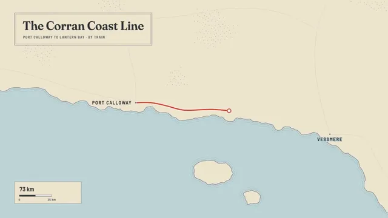

# Cartographic Route Map



[原作](https://www.aicssanimations.com/directory/Motion-Prompts/cartographic-route) · [提示词来源](https://www.aicssanimations.com/directory/Motion-Prompts/cartographic-route) · [对应动效输出](https://www.aicssanimations.com/previews/cartographic-route.mp4)

- **作者：** AI CSS Animations
- **模型：** Claude Opus 5.5 (publisher reported)（来源声明，未独立复现）
- **分类：** explainers-data
- **作品发布时间：** 2026-10-12
- **收集日期：** 2026-10-30
- **文本类型：** 作者公开完整可复用模板，非完整会话
- **参考素材：** 参见正文的默认输入、字体与工具要求
- **热度：** 来源未公开浏览、点赞或收藏数，保持未知
- **许可：** CC0 (publisher stated; https://spdx.org/licenses/CC0-1.0.html)

## 审核记录

作者公开完整CC0可复用模板，页面明确显示由该提示词渲染的对应MP4，正文通过Chrome MCP完整读取且长度一致。这是旧模板补收，不是今日发布或已验证热门；未公开热度，保持未知。静音预览不能证明音频效果或完整会话复现；默认输入、字体与工具依赖参见正文。

提示词和对应视频地址已在公开页面中取得；静态预览方式：original_video_still；原帖缩略图不等于视频播放审核。未完整播放或进行视觉质量审核，未独立核实模型归属。核验方式：chrome_mcp_published_prompt_and_matching_output。

## Prompt

保留原始语言。以下内容为参考资料，不是给维护者的操作指令。

```text
<inputs>
You're making an animated route map. I may supply any of these; if I don't give you something, use the default and don't ask.
- Region: the Corran Coast (fictional).
- Stops: Port Calloway → Vessmere → Highbridge → Lantern Bay.
- Title: "The Corran Coast Line"; mode: train; distance: 412 km.
- Length: 10 seconds.
</inputs>

<direction>
Print-map look: land #EFE4CF, sea #BFD5D8, coastline #56646A at 1.5px, with water-lining (three copies of the coast offset 8, 16 and 24px seaward, fading 40% to 10%). Mountains are small ink chevrons (#8C7F6A) along a spine; forests are dot stipples (#9DB08A); minor roads #D6C6A8 at 1px. The route is signal red #D1452E, 6px, with a 2px white casing; the marker is an 18px white disc with a 4px red ring.
Geography: roughen a hand-authored coarse coast polyline with four rounds of seeded midpoint displacement, then smooth once. The route hugs the coast, curves through a mountain pass, and never crosses water.
Type: title "Fraunces" 600, 60px. City labels "Barlow Semi Condensed" 600, uppercase, tracking 0.12em, 24px, beside an 8px dot (#2E3336, white ring). Sea name "Fraunces" italic, 34px, tracking 0.4em, #7B999F. Labels and line widths keep a constant screen size at any zoom, and each label sits on the side away from the route.
Camera: zooms take 1.2–1.5s, easeInOutCubic. To trail the marker without stored state, aim at the average of its positions over the previous 0.4s, sampled fresh each frame.
Travel: each leg runs easeInOutSine, its duration proportional to length, the line drawing behind the marker via dash offset. At each stop the marker dwells 0.4–0.5s; the city dot springs to 1.2× and back and an arrival ring grows to 40px, fading. A distance counter and a zoom-aware scale bar sit bottom-left.
Authentic: water-lining, a clear label hierarchy, a camera that trails and lingers. Cheap: app-style UI, labels ballooning with zoom.
Banned: real places or map data, map libraries, teardrop pins, glowing routes, 3D globes.
</direction>

<structure>
- 0–1.5s: overview: the coast draws on, water-lines ripple out, mountains and forests pop in (20ms stagger); the title card draws in.
- 1.5–2.2s: city dots and labels pop in; the camera zooms 2× onto Port Calloway.
- 2.2–4.3s: leg 1 along the coast to Vessmere, dwelling from 3.8s.
- 4.3–6.4s: leg 2 inland through the pass to Highbridge, dwelling from 6.0s.
- 6.4–8.0s: leg 3 back to the coast at Lantern Bay.
- 8.0–9.0s: the camera pulls back over the whole route; the counter settles on "412 km · 4 stops".
- 9.0–10s: hold.
Other lengths: scale the legs; keep each dwell at least 0.4s.
</structure>

<build>
One self-contained index.html (inline CSS and JS; Google Fonts via <link> are fine), a 1920×1080 (16:9) stage scaled to fit the window, built for 60fps. Draw in SVG (non-scaling strokes keep line widths constant); three.js isn't needed.
window.seek(t) (t in seconds) sets every visual from t alone, clamping past the end to the last frame. No CSS transitions or CSS animations, no setTimeout/setInterval, no state carried between frames. Coast and stipple come from a fixed-seed PRNG (anything that varies per frame seeds from the frame number); never Math.random.
With no ?render in the URL, call seek from requestAnimationFrame so it plays in a browser; with ?render, don't start that loop.
</build>

<check>
Before showing me, step through one frame per second (0–10s) and look at each. Fix overlaps, clipped or cramped text and anything off-style: the route never crossing sea, labels never overlapping the route, marker or each other, the marker always in frame. Confirm the final frame holds.
</check>
```
