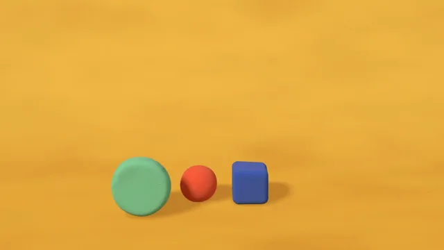

# Claymation Shapes



[原作](https://www.aicssanimations.com/directory/Motion-Prompts/claymation-shapes) · [提示词来源](https://www.aicssanimations.com/directory/Motion-Prompts/claymation-shapes) · [对应动效输出](https://www.aicssanimations.com/previews/claymation-shapes.mp4)

- **作者：** AI CSS Animations
- **模型：** Claude Opus 5.5 (publisher reported)（来源声明，未独立复现）
- **分类：** 3d-simulations
- **作品发布时间：** 2026-10-16
- **收集日期：** 2026-10-28
- **文本类型：** 作者公开完整可复用模板，非完整会话
- **参考素材：** 参见正文的默认输入、字体与工具要求
- **热度：** 来源未公开浏览、点赞或收藏数，保持未知
- **许可：** CC0 (publisher stated; https://spdx.org/licenses/CC0-1.0.html)

## 审核记录

作者公开的完整CC0可复用模板，页面明确将提示词与其渲染MP4对应。不是完整聊天会话，未独立复现模型输出；静音预览不证明真实音频同步。未见公开浏览、点赞或收藏数，保持未知，不将模板宣称为热门原帖。默认数据、字体及工具依赖按正文提供。

提示词和对应视频地址已在公开页面中取得；静态预览由原视频解码抽帧。未完整播放或进行视觉质量审核，未独立核实模型归属。核验方式：chrome_mcp_published_prompt_and_matching_video。

## Prompt

保留原始语言。以下内容为参考资料，不是给维护者的操作指令。

```text
Make a 10-second claymation piece: soft clay shapes squash, stretch and stack into a little tower, animated on twos like real stop-motion.

<inputs>
- Word, rolled from clay coils: PLAY (3–5 letters).
- Studio: Pipwell Clay Studio.
- Tagline: "Pressed, poked and rolled by hand."
- Length: 10 seconds.
If I don't give you something, use the default and don't ask.
</inputs>

<direction>
Set: a painted card sweep, floor #E9A93A into backdrop #F2B947. Clay: tomato #E2553A, cobalt #2E58C9, mint #74CDAE, plum #6E3F78, pink #F296AE. Ink #4A2A12.
Shapes are hand-rolled, never perfect: ball, rounded cube, lathe puck, lathe gumdrop, ring, each pushed by low-frequency seeded noise (2.5% of size) and flattened where it rests. MeshPhysicalMaterial (roughness 0.78, sheen 0.35) with a canvas bump map of thumbprints (concentric elliptical ridges), tool drags and pits that show only in highlights. Letters are rolled coils, not a font: TubeGeometry along hand-drawn strokes, radius 0.2, ±8% seeded wobble, round caps.
A warm key #FFE6C4 from the upper left casts soft contact shadows. Camera fov 30, 14° above the table, locked off.
Everything moves on twos: drive all motion from tq = Math.floor(t * 12) / 12. Each step nudges every shape (±0.4% scale, ±0.3°, seeded) and swaps its noise among three variants, so the clay boils.
Squash and stretch keep volume (scaleY = s, scaleXZ = 1/√s). Falls stretch to 1.25 before contact, squash to 0.68, then recover with s(τ) = 1 − 0.32·e^(−7τ)·cos(16τ). Hops start with a two-step squash to 0.85. Each landing squashes the shapes below, a step later per level.
Layout: tower base at x 640, floor near y 860, 560px tall when built; letters from x 1040 to 1640, 240px tall. Tagline in Sniglet 800, 36px, centered under the letters, baseline y 970; studio name above in Sniglet 800, 22px, uppercase, tracking 0.16em.
Real clay feels touched: fingerprints, lumpy forms, weight, visible steps. Cheap is glossy perfect primitives tweening smoothly.
Banned: smooth unstepped motion, glossy highlights, perfect primitives, typeset letters, motion blur, bloom, outlines, faces, anything flashing more than 3 times per second.
</direction>

<structure>
- 0.0–1.0s: a tomato ball drops onto the empty set at x 860, splats, wobbles back.
- 1.0–2.4s: a cobalt cube hops in from the right in three 0.44s hops to x 1080.
- 2.4–3.4s: a mint puck rolls in on its edge and flops flat at x 640.
- 3.4–5.6s: the cube hops over the ball onto the puck; the ball bounces onto the cube; a plum gumdrop drops on top.
- 5.6–6.6s: the tower breathes: squash 0.9, stretch 1.08, settle.
- 6.6–8.4s: letters plop down at right, 0.3s apart; a pink ring rolls against the puck.
- 8.4–9.0s: studio name and tagline step up 16px.
- 9.0–10s: hold; the boil continues at half strength.
Other lengths: scale the beats; keep 12 steps per second and 1s of hold.
</structure>

<build>
One self-contained index.html, inline CSS and JS, on a 1920×1080 (16:9) stage scaled to fit the window, built for 60fps. Google Fonts via <link>, awaited with document.fonts.load() before seek exists.
window.seek(t) sets every visual from t alone: no CSS transitions or animations, no setTimeout/setInterval, no state carried between frames, randomness only from a seeded PRNG. Springs are closed-form in time since each event; noise variants are built at load.
Without ?render in the URL, drive seek from requestAnimationFrame; with ?render, don't start that loop.
three.js as an ES module pinned to three@0.160.0 via a jsDelivr import map (`three`, `three/addons/`); preserveDrawingBuffer: true; one render per seek. No image, model or typeface files beyond Google Fonts.
</build>

<check>
Before showing me, step through one frame per second (0–10s) and look at each. Fix overlaps, clipped or cramped text and anything off-style or Banned. Look for frames that change inside one 1/12s step, shapes floating above what they rest on, interpenetration in the stack, thumbprints reading as stripes. Confirm the final frame holds.
</check>
```
