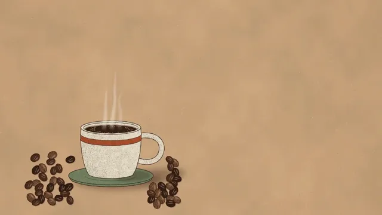

# Coffee Brand Ident



[原作](https://www.aicssanimations.com/directory/Motion-Prompts/coffee-brand-ident) · [提示词来源](https://www.aicssanimations.com/directory/Motion-Prompts/coffee-brand-ident) · [对应动效输出](https://www.aicssanimations.com/previews/coffee-brand-ident.mp4)

- **作者：** AI CSS Animations
- **模型：** Claude Opus 5.5 (publisher reported)（来源声明，未独立复现）
- **分类：** product-brand
- **作品发布时间：** 2026-10-18
- **收集日期：** 2026-10-30
- **文本类型：** 作者公开完整可复用模板，非完整会话
- **参考素材：** 参见正文的默认输入、字体与工具要求
- **热度：** 来源未公开浏览、点赞或收藏数，保持未知
- **许可：** CC0 (publisher stated; https://spdx.org/licenses/CC0-1.0.html)

## 审核记录

作者公开完整CC0可复用模板，页面明确显示由该提示词渲染的对应MP4，正文通过Chrome MCP完整读取且长度一致。这是旧模板补收，不是今日发布或已验证热门；未公开热度，保持未知。静音预览不能证明音频效果或完整会话复现；默认输入、字体与工具依赖参见正文。

提示词和对应视频地址已在公开页面中取得；静态预览方式：original_video_still；原帖缩略图不等于视频播放审核。未完整播放或进行视觉质量审核，未独立核实模型归属。核验方式：chrome_mcp_published_prompt_and_matching_output。

## Prompt

保留原始语言。以下内容为参考资料，不是给维护者的操作指令。

```text
Make a 10-second brand ident for a coffee roaster: roasted beans tumble onto kraft paper around a stoneware cup, its steam rises and curls into the logo mark, and the wordmark sets, all in warm, grainy illustration.

<inputs>
If I don't give you something, use the default and don't ask.
- Roaster: Loamfield Roasters (fictional).
- Tagline: "Roasted on Thursdays."
- Details: Small batch · Est. 2019
- Mark: one steam curl that loops once, inside an open ring.
- Length: 10 seconds.
</inputs>

<direction>
- Palette, flat inks on kraft: kraft #C8A27C with fibre flecks #B48C63 and #DDBF9A; espresso #2B1A12 for type and linework; roast browns #5B3523, #3E2418 and highlight #8A5A3B; crema #E8CFA4; glaze cream #F2E6D1 speckled #A08A6E; terracotta #B4532F; sage #7E8C69; steam and mark #F6EDDC.
- Texture is the warmth. Generate once at load a kraft sheet (soft mottling ±5%, a few hundred short fibres, flecks) and a gouache grain mask. Every illustrated fill is multiplied by the grain and shaded with stipple (seeded dots, denser toward the shadow side) instead of gradients, inside a 2px espresso outline that wanders ±0.6px like a brush line. Add a warm vignette at 6%.
- Beans, drawn to read as real roasted coffee: ovals about 46×34px (±10%), each half a slightly different tone, a deep S-shaped cleft running tip to tip with a thin crema line inside it, a small highlight on the upper half and stipple on the lower. Each bean takes a seeded roast tone from the three browns.
- The cup: stoneware on a sage saucer, seen slightly from above, the cup centered at (560, 760): a 300px body with a gentle taper, a rolled rim showing dark coffee with a crema ring, a terracotta band, a loop handle on the right, speckled glaze, stipple on its left side and a soft cast shadow falling right onto the kraft.
- Beans tumble: 46 beans in two waves drop in from above the top edge, each on its own closed-form ballistic path (gravity 2,600 px/s²) with a seeded spin, landing on rest slots precomputed at load in two loose drifts either side of the saucer (x 140–360 and x 760–900), packed so none overlaps another by more than 20% and a few rest on top of others. Each lands with two damped bounces (heights × 0.28, then × 0.08) and its spin settles on the bounce. Nothing rests in the air, and no bean enters the logo zone right of x 920.
- Steam: three wisps rise from the coffee as soft ribbons: polylines of 80 points flowing upward at 70px/s, pushed sideways by two slow sines and seeded 1D noise, tapering from 22px to 3px, cream at 50% under a 3px blur. They are closed-form functions of t, never particles.
- Steam into mark: a growing breeze leans the wisps right and up toward the mark's center at (1260, 360). Over 1.4s on cubic-bezier(0.65, 0, 0.35, 1), the leading wisp's points interpolate into the mark's centerline (both resampled to 200 points), its width settling to an even 12px, its blur to 0 and its opacity to 100%, while the other two thin out and fade. The mark: a 320px ring, 12px stroke, open for 30° at the bottom where the curl enters; inside, one continuous curl rising from that gap, looping once clockwise near the top and ending in a small flick to the right, with round caps. Once the curl lands, the ring draws itself clockwise from the gap over 0.6s.
- Type, centered on x 1260: "Loamfield" in Fraunces (opsz 144, wght 700, SOFT 100, WONK 1), 132px, espresso, baseline y 690; "ROASTERS" in Familjen Grotesk 600, 26px, tracked 0.42em, baseline 745; the tagline in Fraunces italic 400, 36px, baseline 815; the details in Familjen Grotesk 500, 22px, uppercase, tracked 0.24em, baseline 875.
- Motion is warm and unhurried: type rises out of masks at its baseline, letters 40ms apart, over 0.5s on cubic-bezier(0.22, 1, 0.36, 1); a slow 1.00 → 1.02 push toward the mark runs from 0.6s and eases to rest at 8.6s on easeInOutSine. From 8.6s nothing moves.
- Premium: beans with a cleft and stipple that fall with weight, steam that becomes the mark in one continuous gesture, grain you can feel in every fill. Cheap: a vector cup icon, a dissolve to a logo and a brown gradient.
Banned: clip-art cups, latte-art hearts, beans drawn as plain ovals with a straight line, smooth vector gradients, photo textures, glossy 3D, steam made of particles or dots, grey or fiery smoke, beans over the type, emoji, anything flashing more than 3 times per second.
</direction>

<structure>
- 0.0–0.6s: kraft paper with the cup and saucer already resting in their shadow; the view settles from 1.04 to 1.0.
- 0.6–2.8s: the beans tumble in: 26 from the upper left, then 20 from above the cup 0.6s later, bouncing and settling into their drifts.
- 2.2–4.0s: three wisps rise from the coffee, swaying.
- 4.0–5.4s: the breeze leans them right; the lead wisp climbs and curls into the mark; the others thin away.
- 5.4–6.0s: the ring draws around the curl. At 6.0s cup, beans and mark form one complete frame.
- 6.0–7.2s: "Loamfield" rises letter by letter; "ROASTERS" follows.
- 7.2–8.2s: the tagline, then the details.
- 8.2–8.6s: the push eases to rest.
- 8.6–10.0s: hold, completely still.
For other lengths, stretch the gaps between beats; keep the bean physics, the 1.4s steam morph and at least 1s of hold.
</structure>

<build>
- One self-contained index.html (inline CSS and JS), a 1920×1080 (16:9) stage scaled to fit the window, designed for 60fps. No image, video, texture or model files: every shape and texture is generated in code.
- window.seek(t), t in seconds, computes every visual from t alone: no CSS transitions or CSS animations, no setTimeout/setInterval, no state carried between frames, randomness only from a seeded PRNG. Anything cumulative is solved analytically from t or precomputed once at load at a fixed step. Past the end, seek clamps to the last frame.
- Without ?render in the URL, drive seek from requestAnimationFrame so it plays in a browser (loop after a 1s end hold); with ?render, don't start that loop.
- Google Fonts via <link> are fine; await document.fonts.load() for each face before defining window.seek.
- Engine: Canvas 2D, repainting every frame from scratch, the backing store sized from CSS size × devicePixelRatio. Canvas won't fetch fonts itself, so the awaited loads matter. Request Fraunces' opsz, wght, SOFT and WONK axes and its italic.
- The kraft sheet, grain mask, bean and cup sprites and the bean rest slots are built once at load; bean paths, steam and the morph are closed-form functions of t.
</build>

<check>
Before showing me, step through one frame per second (t = 0…10): screenshot each and look at it. Fix overlaps, clipped or cramped text, and anything off-style or Banned. Check every bean shows its S-shaped cleft and rests on the paper or on another bean, none crosses into the logo zone, the steam stays soft ribbons and never dots, the mark's curl is one unbroken line that meets the ring's gap, grain survives at 1280×720, and the type reads cleanly on the kraft. Confirm seek(10) and seek(11) match, so the final frame holds.
</check>
```
