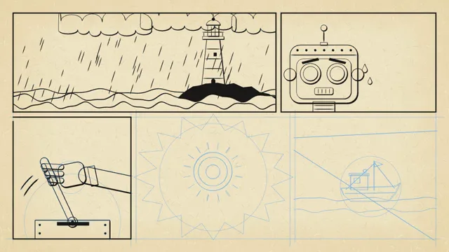

# Comic Book Page



[原作](https://www.aicssanimations.com/directory/Motion-Prompts/comic-book-page) · [提示词来源](https://www.aicssanimations.com/directory/Motion-Prompts/comic-book-page) · [对应动效输出](https://www.aicssanimations.com/previews/comic-book-page.mp4)

- **作者：** AI CSS Animations
- **模型：** Claude Opus 5.5 (publisher reported)（来源声明，未独立复现）
- **分类：** characters-stories
- **作品发布时间：** 2026-10-16
- **收集日期：** 2026-10-28
- **文本类型：** 作者公开完整可复用模板，非完整会话
- **参考素材：** 参见正文的默认输入、字体与工具要求
- **热度：** 来源未公开浏览、点赞或收藏数，保持未知
- **许可：** CC0 (publisher stated; https://spdx.org/licenses/CC0-1.0.html)

## 审核记录

作者公开的完整CC0可复用模板，页面明确将提示词与其渲染MP4对应。不是完整聊天会话，未独立复现模型输出；静音预览不证明真实音频同步。未见公开浏览、点赞或收藏数，保持未知，不将模板宣称为热门原帖。默认数据、字体及工具依赖按正文提供。

提示词和对应视频地址已在公开页面中取得；静态预览由原视频解码抽帧。未完整播放或进行视觉质量审核，未独立核实模型归属。核验方式：chrome_mcp_published_prompt_and_matching_video。

## Prompt

保留原始语言。以下内容为参考资料，不是给维护者的操作指令。

```text
Make a 10-second animated comic book page that builds itself the way comics were made: pencils, inks, color, then lettering.

<inputs>
Story title: THE KEEPER OF GULLHAVEN. Caption 1: "Midnight. The storm had put out the Gullhaven light." Balloon 2: "The boats can't see the rocks!" Balloon 3: "Hold on... almost..." Sound effect: FWOOM! Caption 5: "And every boat came home." Duration: 10s. If I don't give you something, use the default and don't ask.
</inputs>

<direction>
Paper and inks: newsprint #EFE3C4 with seeded fibers and slight yellowing toward the edges; black #1C1A18; process red #D7312E; yellow #F3C935; blue #2D5FA6; night blue #26356E; non-photo-blue pencil #7FB6E3. The color plate prints 2px down-right of the black line, so slivers of paper show at some edges.
Ben-Day tints: uniform dots at 11px pitch, radius 3px: red dots on paper for pink, blue dots for sky, yellow dots for light. Tone never comes from opacity.
Type: Luckiest Guy for the title and sound effect; Shantell Sans 700 uppercase at 30px, line height 1.15, for captions and balloons. The title is "THE KEEPER OF" at 56px over "GULLHAVEN" at 110px, yellow with a 6px black outline and a red offset shadow 8px down-right, no blur.
Page: fills the stage inside a 56px margin, 22px gutters, 5px black borders, read left to right.
P1 (x 56–1180, y 56–480): a night storm: a red-and-white lighthouse on black rocks in the right third, rain streaks, waves as layered sine shapes with white crest lines; the title across the upper-left sky; caption 1 in a yellow box with a 3px border at bottom-left.
P2 (x 1202–1864, y 56–480): the keeper, an original brass robot, in close-up: a rounded-box head in yellow with red trim, two round lamp eyes, an antenna, two sweat drops; balloon 2 top-right.
P3 (x 56–560, y 502–1024): a three-fingered robot hand pulling a big lever, with two curved motion arcs; balloon 3 at the top.
P4 (x 582–1240, y 502–1024): the burst panel. Its border is a 16-point jagged star breaking into the gutters, the lamp blazing at its center with yellow Ben-Day rays, and FWOOM! at 140px in red with a black outline, tilted −8°.
P5 (x 1262–1864, y 502–1024): a small fishing boat on calmer water inside a beam of yellow dots; caption 5 at bottom-left.
Line work: brush-weighted strokes, thicker on the shadow side, tapered at the ends. Balloons are white ovals with a 3px border, a pointed tail and 20px of padding.
Process: pencils are thin non-photo-blue lines, each path drawn twice with seeded ±2px offsets, plus a few construction circles. Inks trace each path with a moving stroke reveal; once a panel is inked its pencils fade out, the way non-photo blue dropped out in print. Flats print in a 0.3s top-down wipe, then the dots; letters come last.
Motion follows the process, panel by panel in reading order. Inks take 0.45s per panel on cubic-bezier(0.4, 0, 0.2, 1). Balloons and captions scale 0.85 → 1 in 0.2s with 6% overshoot. FWOOM! scales 0 → 1.12 → 1 over 0.3s and the page shakes 6px, decaying over 0.3s.
The real thing shows the hand: weighted ink, visible dots, slightly loose registration, hand lettering. The cheap version is clean vector art with a dot filter on top.
Banned: gradients, soft shadows, glow, blur, Comic Sans, existing comic characters or logos, photo textures, full-frame flashes, flashing more than 3 times per second.
</direction>

<structure>
0.0–0.4s: blank newsprint; the panel borders rule in as blue pencil lines.
0.4–1.8s: pencils sketch into all five panels in reading order, starting 0.25s apart, 0.5s each.
1.8–3.8s: inks: P1 to P5, starting 0.4s apart; each panel's border inks with it and its pencils drop out.
3.8–5.6s: color: each panel's flats and dots print, starting 0.35s apart; at 4.9s the burst panel fills and FWOOM! slams in with the shake.
5.6–7.2s: lettering: the title, caption 1, balloon 2, balloon 3 and caption 5, 0.3s apart.
7.2–10.0s: hold the finished page, completely still.
For other durations, scale every timestamp proportionally.
</structure>

<build>
One self-contained index.html, CSS and JS inline. The stage is 1920×1080 (16:9), scaled to fit the window. Design for 60fps. window.seek(t), t in seconds, must compute every visual from t alone, clamping past the end to the last frame: no CSS transitions or animations, no setTimeout or setInterval, no state carried between frames, and randomness only from a seeded PRNG. Anything cumulative is precomputed once at load at a fixed step or solved analytically, so seek can jump to any time. Load Google Fonts via <link> and await document.fonts.load() for each face before defining window.seek. Without ?render in the URL, drive seek from requestAnimationFrame so it plays in a browser (loop after a 1s end hold); with ?render, don't start that loop.
Engine: Canvas 2D, repainting every frame from scratch. Define each panel's art once as paths with stroke weights; pencils, inks, flats and dot tints all draw from those same paths according to t, with dots clipped to their shapes. Generate the newsprint texture once at load. No three.js.
</build>

<check>
Before showing me, step through one frame per second (0–10s): screenshot each and look at it. Fix overlaps, clipped or cramped text, accidental edge collisions, and anything off-style or Banned. Check that pencils are gone from inked panels, dots read clearly at 1280×720, the color plate sits slightly off the black line, balloons and captions have padding and don't cover the key drawing, and the burst panel's points break into the gutters. Confirm seek(10) and seek(11) match, so the final frame holds.
</check>
```
