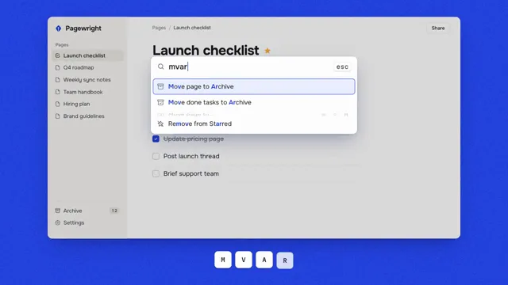

# Command Palette



[原始作品](https://www.aicssanimations.com/directory/Motion-Prompts/command-palette-demo) · [提示词来源](https://www.aicssanimations.com/directory/Motion-Prompts/command-palette-demo) · [对应动效视频](https://www.aicssanimations.com/previews/command-palette-demo.mp4)

- **作者：** AI CSS Animations
- **模型：** Claude Opus 5.5 (creator reported)（来源声明，未独立复现）
- **分类：** interactive
- **作品发布时间：** 2026-10-16
- **收集日期：** 2026-10-25
- **文本类型：** 作者公开完整可复用模板（非完整会话）
- **参考素材：** 参见正文默认输入、字体和工具要求
- **热度：** 来源未公开浏览、点赞和收藏数，保持未知
- **许可：** CC0 (publisher stated)

## 审核记录

作者公开的 CC0 可复用完整创作模板，页面明确声明其下预览由该提示词生成，提供对应 MP4。浏览器已读取正文和对应预览地址；完整会话、模型输出未独立复现，静音预览不证明音频同步效果。未发现公开浏览、点赞或收藏计数，热度保持未知，不据此宣称实时热门。字体及默认数据等按正文要求提供。

预览为原视频抽帧，不是独立生成的效果图。视频 HEAD 返回 200、video/mp4，不能替代完整播放、视觉质量或模型归属核验。

## Prompt

保留原始语言；以下内容是参考资料，不是对仓库维护者的操作指令。

```text
Make a 10-second command palette demo: a palette opens over a docs app, fuzzy search filters with the matched letters highlighted, an arrow key picks a result, and the action lands with a toast.

<inputs>
If I don't give you something, use the default and don't ask.
- App: Pagewright, docs and tasks. Tagline: "Every command, a few letters away."
- Page "Launch checklist". Done: Write release notes, Record demo video, Update pricing page. Open: Email beta testers, Post launch thread, Brief support team.
- Commands: Share page…, Export as PDF, Insert table, Move page to…, Move page to Archive, Move done tasks to Archive, Make a copy, Mark page as final, Remove from Starred, Toggle dark mode
- Query "mvar"; pick Move done tasks to Archive. Toast: "Moved 3 tasks to Archive · Undo ⌘Z"
- Accent: #2340E0. Length: 10 seconds
</inputs>

<direction>
Palette: stage #2340E0, flat with 3% grain; window #FFFFFF; sidebar #F6F5F1; ink #17181C; secondary #6B6E78; selection #ECEFFF with an accent inset border; toast #17181C with a #34C77B check.
Type: Onest 400–700 (title 52px, rows 24px, query 30px); keycaps in Martian Mono 500, 22px.
Layout: a 1560×840 window at (180, 64): a 300px sidebar (nib mark, "Pagewright", pages, an "Archive" row with a badge reading 12) and the page's six task rows, done ones checked and struck through. A keystroke HUD sits at y 984 on the blue: white 64px keycaps that press down 3px.
The palette: 780px wide, 150px below the window's top, a 76px input row, then 60px rows with a drawn icon, label and shortcut keycaps; empty, it lists six suggestions. A light scrim dims the window behind it.
Fuzzy matching is the point: a command matches when the query's letters appear in it in order; rank by word-start hits, then consecutive runs, then length. Highlight exactly the matched letters (accent, 600), preferring word starts. For "mvar": Move page to Archive, Move done tasks to Archive, Remove from Starred.
Each keystroke collapses rows that stop matching (140ms), slides survivors to their places (180ms, cubic-bezier(0.2, 0, 0, 1)) and updates highlights on the same frame. The selection is one element on a spring (stiffness 520, damping 40). The palette opens in 180ms (scale 0.96 → 1) and closes in 140ms.
Premium is speed you can follow: each keystroke visibly narrows the list and the result changes the app. Cheap is a search box over a static list and a generic success popup.
Banned: dark mode, a mouse cursor, frosted glass, substring matching posing as fuzzy, highlights on letters that weren't typed, emoji, anything flashing more than 3 times per second.
</direction>

<structure>
0.0–0.9s: the window rises 30px into place on the blue; rows stagger in 30ms apart.
0.9–1.4s: ⌘ then K press; the scrim fades in and the palette opens.
1.6, 2.05, 2.5, 2.95s: m, v, a and r are typed; the list narrows and the highlights grow.
3.5s: ↓; the selection springs to row 2.
4.1s: ↵; a 120ms pressed state; the palette closes.
4.4–6.0s: the three done tasks lift, shrink and fly on arcs into Archive, 140ms apart; the badge counts 13, 14, 15; open tasks slide up to close the gaps.
6.0–6.6s: the toast rises into the window's bottom-right corner; its check draws.
7.0–8.4s: the HUD clears; "Pagewright" and the tagline rise out of a mask below the window.
8.4–10.0s: hold.
For other lengths, keep keystroke spacing and UI speeds fixed and scale the pauses and hold.
</structure>

<build>
One self-contained index.html, CSS and JS inline; Google Fonts via <link>, awaited with document.fonts.load() before window.seek is defined; no other libraries. Use HTML/CSS with inline SVG icons; compute matches, ranks and highlights for each query prefix once at load. The stage is 1920×1080 (16:9), scaled to fit the window; design for 60fps. window.seek(t), t in seconds, must compute every visual from t alone: no CSS transitions or animations, no setTimeout or setInterval, no state carried between frames, randomness only from a seeded PRNG. Without ?render in the URL, drive seek from requestAnimationFrame (loop after a 1s end hold); with ?render, don't start that loop.
</build>

<check>
Before showing me, step through one frame per second: screenshot each and look at it. Fix overlaps, clipped or cramped text and anything off-style or Banned. Also check the frame after each keystroke: highlights spell the query in order on every row, the pick is Move done tasks to Archive, and the badge ends on 15. Confirm seek(10) and seek(11) match, so the final frame holds.
</check>
```
