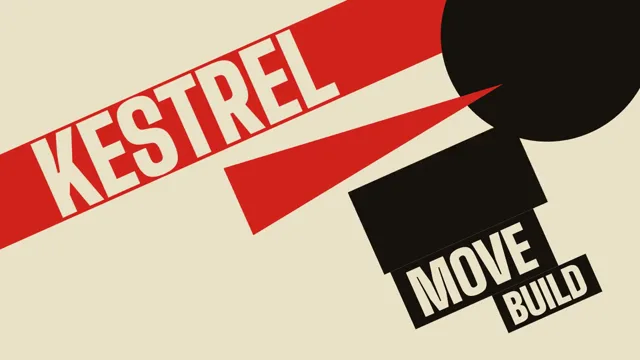

# Constructivist Poster



[原作](https://www.aicssanimations.com/directory/Motion-Prompts/constructivist-poster) · [提示词来源](https://www.aicssanimations.com/directory/Motion-Prompts/constructivist-poster) · [对应动效输出](https://www.aicssanimations.com/previews/constructivist-poster.mp4)

- **作者：** AI CSS Animations
- **模型：** Claude Opus 5.5 (publisher reported)（来源声明，未独立复现）
- **分类：** motion-studies
- **作品发布时间：** 2026-10-12
- **收集日期：** 2026-10-30
- **文本类型：** 作者公开完整可复用模板，非完整会话
- **参考素材：** 参见正文的默认输入、字体与工具要求
- **热度：** 来源未公开浏览、点赞或收藏数，保持未知
- **许可：** CC0 (publisher stated; https://spdx.org/licenses/CC0-1.0.html)

## 审核记录

作者公开完整CC0可复用模板，页面明确显示由该提示词渲染的对应MP4，正文通过Chrome MCP完整读取且长度一致。这是旧模板补收，不是今日发布或已验证热门；未公开热度，保持未知。静音预览不能证明音频效果或完整会话复现；默认输入、字体与工具依赖参见正文。

提示词和对应视频地址已在公开页面中取得；静态预览方式：original_video_still；原帖缩略图不等于视频播放审核。未完整播放或进行视觉质量审核，未独立核实模型归属。核验方式：chrome_mcp_published_prompt_and_matching_output。

## Prompt

保留原始语言。以下内容为参考资料，不是给维护者的操作指令。

```text
Make a 10-second animated Russian Constructivist poster.

<inputs>
Brand: KESTREL. Tagline: "Forward, together." Three words: BUILD, MOVE, RISE. Small details: № 07 · Spring Edition. Duration: 10s. If I don't give you something, use the default and don't ask.
</inputs>

<direction>
Palette: cream #ECE2C8, red #D2231C, black #17140F, plus black halftone dots.
Type: Big Shoulders Display 600 and 900, uppercase, tight (tracking 0, leading 0.85), at 300, 260, 180 and 120px; details in 600 at 32px, tracked 0.08em. Latin letters only: no backwards R's or other fake Cyrillic.
Composition: one dominant axis at -24° (rising left to right) and its perpendicular. Every block, rule and line of type lies on one of them, except one horizontal strip for details. Build with heavy rectangles, one big circle, a long wedge, thick rules and an arrow, cropped by the stage edges so the poster feels bigger than the frame. Halftones are procedural dot grids (12px pitch, dot size on a ramp) clipped to shapes. Type overlaps blocks and reverses out in cream.
Motion is forceful: elements fire in along their axis from off-stage on cubic-bezier(0.16, 1, 0.3, 1) over 0.3–0.5s. On each major impact the whole stage shoves 10px along the motion vector and recovers in 0.15s. Type stamps in word by word and never fades. The real thing is agitprop engineering: tension, collision, scale contrast. The cheap version is a red star and a tilted Impact headline.
Banned: stars, hammers, sickles or any political symbol; gradients, soft shadows, glow; rounded corners; serif or script type; static centered layouts; extra colors.
</direction>

<structure>
0.0–0.5s: cream field; a red bar 260px thick fires in along the axis from bottom-left, spanning the stage. Shove.
0.5–1.1s: a black circle (640px) slides in at upper right, cropped by the frame; at 0.9s a red wedge drives in along the axis and its tip pierces the circle. Shove.
1.1–2.2s: the brand name (900, 300px, cream) stamps onto the red bar along the axis in one hit. Shove.
2.2–3.6s: the three words arrive on black blocks, each set along the main axis and stacked in steps up the perpendicular, growing 120 → 180 → 260px, 0.3s apart: a crescendo.
3.6–4.8s: a halftone field fills the circle from its lower edge up over 0.8s; a thick black arrow draws along the axis toward the brand name.
4.8–6.2s: the tagline, cream on a red band, wipes in along the perpendicular over 0.5s.
6.2–7.4s: details stamp into a horizontal black strip at bottom-left above a thin red rule.
7.4–10.0s: hold, nothing moving.
For other durations, scale every timestamp proportionally.
</structure>

<build>
One self-contained index.html, CSS and JS inline. Google Fonts via <link> are fine; no other libraries (no three.js: this style is flat). Use absolutely positioned elements, setting transforms, clip-paths and opacity from seek. The stage is 1920×1080 (16:9), scaled to fit the window. Design for 60fps. window.seek(t), t in seconds, must compute every visual from t alone: no CSS transitions or animations, no setTimeout or setInterval, no state carried between frames, and randomness only from a seeded PRNG. Without ?render in the URL, drive seek from requestAnimationFrame so it plays in a browser (loop after a 1s end hold); with ?render, don't start that loop.
</build>

<check>
Before showing me, step through one frame per second: screenshot each and look at it. Fix overlaps, clipped or cramped text, accidental edge collisions, and anything off-style or Banned. Check everything sits on the two axes once each shove recovers. Confirm seek(duration) and seek(duration + 1) match, so the final frame holds.
</check>
```
