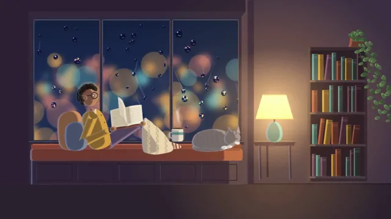

# Cozy Reading Nook



[原作](https://www.aicssanimations.com/directory/Motion-Prompts/cozy-reading-nook) · [提示词来源](https://www.aicssanimations.com/directory/Motion-Prompts/cozy-reading-nook) · [对应动效输出](https://www.aicssanimations.com/previews/cozy-reading-nook.mp4)

- **作者：** AI CSS Animations
- **模型：** Claude Opus 5.5 (publisher reported)（来源声明，未独立复现）
- **分类：** characters-stories
- **作品发布时间：** 2026-10-18
- **收集日期：** 2026-10-31
- **文本类型：** 作者公开完整可复用模板，非完整会话
- **参考素材：** 参见正文的默认输入、字体与工具要求
- **热度：** 来源未公开浏览、点赞或收藏数，保持未知
- **许可：** CC0 (publisher stated; https://spdx.org/licenses/CC0-1.0.html)

## 审核记录

作者公开CC0完整可复用模板；正文原文与明确对应的MP4已保留。旧模板补收，热度未知，不称今日新发布或已验证热门；默认输入与工具要求参见正文。

提示词和对应视频地址已在公开页面中取得；静态预览方式：browser_download_original_video_ffmpeg_still；原帖缩略图不等于视频播放审核。未完整播放或进行视觉质量审核，未独立核实模型归属。核验方式：chrome_mcp_public_prompt_and_matching_output。

## Prompt

保留原始语言。以下内容为参考资料，不是给维护者的操作指令。

```text
Make a 10-second cozy illustrated scene: a reader curled in a window seat on a rainy evening, tea steaming, a cat asleep at their feet.

<inputs>
If I don't give you something, use the default and don't ask.
- Reader: a person in a mustard cardigan and round glasses, with short dark curly hair and striped socks, a book on their knees.
- Cat: a grey tabby curled into a ring.
- Title: "Chapter Eleven"
- Line: "Tuesday, 8:40 pm · Rain until morning"
- Length: 10 seconds.
</inputs>

<direction>
- Look: a cozy painted illustration lit by two lights, warm lamplight from inside and cool blue from the rainy window, with everything else in soft shadow. Quiet and slow: the smallest motions carry the mood.
- Palette: night beyond the glass #16213F to #24345E; city lights as soft bokeh discs in amber #F4B05A, rose #E98A7A and teal #6CC2C4; window frame #2E2A3A with a lit edge #5F6A92; alcove walls dusk plum #3B2F44; seat cushion rust #A9533F; pillows #C98A5B and #6C7FA0; blanket cream knit #E7D5B8 with cable shadows #CDB894; cardigan #D29D3D; skin #B97F5C; hair #1E1714; glasses frames #2A2224; book pages #F3E8D2; mug #E6DFD3 with a teal band #4F9A97; steam #FFFFFF at 25%; cat #8A8792 with stripes #5E5B66 and white paws; lamp shade #F2C27A, lamp light #FFC77D; bookshelf #2C2433 with spines in rust, teal, ochre and plum; plants #5D8A5B and #3E6A44; floor #2A2230; text #F3E6D2, secondary #BFAF9D.
- Composition: an alcove window seat. The window fills the back of the alcove (x 160–1180, y 90–700), with the sill and cushion along its bottom (y 700–790) and the seat's panelled front below. The reader sits sideways on the cushion, back against two pillows at the left end (x 300–420), knees up, facing right toward the lamp, body spanning x 420–900, the book resting on the knees; the mug sits on the sill at x 870. The cat curls at the right end of the cushion (x 930–1150). Right of the alcove: a side table with the lamp (x 1240–1440, standing on the floor at y 880), then a bookshelf and a trailing plant to the right edge.
- Two-light rule: every form has a warm side facing the lamp (right) and a cool rim facing the window (left), painted as flat value steps with soft 2px transitions, never one gradient across a whole shape. The lamp's warm pool on the wall and blanket stays steady, within 2%.
- Rain on the glass is the hero texture. The view outside is a blurred city: bokeh discs and a few soft building silhouettes drawn once at load into an offscreen canvas. Drops on the glass are lenses: each shows a small, sharper, upside-down sample of the scene behind it inside its circle, with a dark lower rim and a bright upper-left highlight. 40 beads stay put; 14 runners slide down along seeded wandering paths with speed bursts, leave thin wet trails that fade over 2 s, and swallow the beads they touch. Precompute every runner's path at load at a fixed step so seek(t) only looks it up.
- Acting, all slow: the camera pushes in from 1.00 to 1.05 across the piece on easeInOutSine. The reader breathes (shoulders ±1.5px on a 4 s sine), blinks twice, and reads with small eye saccades along a line. The page turn: the page lifts at its right edge, curls over as a bezier sheet with a soft shadow beneath the curl and lies flat on the left, over 0.9 s on cubic-bezier(0.45, 0, 0.2, 1). The steam is three soft ribbons rising from the mug and dissolving (noise-driven curves computed from t). The cat's side rises and falls on a 3 s sine; one ear flicks once.
- Type: title in "Literata" (opsz 72, wght 500, italic), 64px, #F3E6D2, right-aligned with its baseline at (1800, 950) on the dark floor; the line in Literata 400, 24px, #BFAF9D, right-aligned beneath on baseline y 995.
- Premium: two-light color, raindrops that refract the city, small human acting (a page turn, a sip, a breath) and plenty of calm. Cheap: a blue filter, rain as diagonal white lines, a loop where nothing really happens.
Banned: headphones, a laptop or desk, rain drawn as straight diagonal streaks, lightning, flicker, a solid smoke column for steam, heavy outlines, sudden moves, anything flashing more than 3 times per second.
</direction>

<structure>
- 0.0–1.2s: the scene already alive: rain running down the glass, steam rising, the reader reading, the cat breathing; the push-in begins.
- 1.2–2.6s: the reader's eyes scan to the end of the page; a blink at 2.0 s.
- 2.6–3.6s: the page turn.
- 3.6–5.4s: the reader reaches for the mug, lifts it and sips as the steam parts around the face; the glasses fog to 40% white and clear over 1.2 s; the mug goes back to the sill.
- 5.4–6.6s: a large runner wanders down the middle of the window, swallowing beads; the cat flicks an ear and tucks its nose deeper. At 6.0 s everything reads at once: the reader with the open book, the cat, the steam, the rain and both lights.
- 6.6–7.8s: the reader pulls the blanket up over the knees and settles back 8px into the pillows with one slow breath; a second blink.
- 7.8–8.8s: the title and line fade in over 1.0 s, rising 8px; the push-in eases to rest.
- 8.8–10.0s: hold: the reader, the cat and the room still; only the rain and the steam keep moving.
For other lengths, stretch the quiet beats between actions and keep at least 1 s of hold.
</structure>

<build>
- One self-contained index.html (inline CSS and JS), a 1920×1080 (16:9) stage scaled to fit the window, designed for 60fps. No image, video, texture or model files: every shape and texture is generated in code.
- window.seek(t), t in seconds, computes every visual from t alone: no CSS transitions or CSS animations, no setTimeout/setInterval, no state carried between frames, randomness only from a seeded PRNG. Anything cumulative is solved analytically from t or precomputed once at load at a fixed step. Past the end, seek clamps to the last frame.
- Without ?render in the URL, drive seek from requestAnimationFrame so it plays in a browser (loop after a 1s end hold); with ?render, don't start that loop.
- Google Fonts via <link> are fine; await document.fonts.load() for each face before defining window.seek.
- Engine: Canvas 2D, repainting every frame from scratch, the backing store sized from CSS size × devicePixelRatio. Canvas won't fetch fonts itself, so the awaited loads matter. No other libraries.
- Paint the alcove, the room, the reader's still parts, the blurred city and the bokeh once at load into offscreen canvases; each frame draws the moving parts (eyes, arm, mug, page, steam, the cat's breathing, the drops) over them and then applies the push-in. Request Literata's italic and its opsz and wght axes.
</build>

<check>
Before showing me, step through one frame per second (t = 0…10): screenshot each and look at it. Fix overlaps, clipped or cramped text, and anything off-style or Banned. Check the drops show the refracted city rather than plain white dots, trails fade instead of building up, every form keeps a warm side and a cool rim, the page turn reads as one curling sheet, nothing moves quickly, and the title reads cleanly on the floor. Confirm seek(10) and seek(11) match, so the final frame holds.
</check>
```
