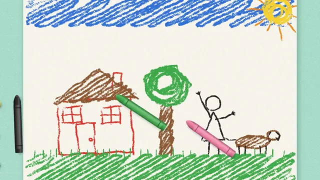

# Crayon Drawing



[原作](https://www.aicssanimations.com/directory/Motion-Prompts/crayon-kids-drawing) · [提示词来源](https://www.aicssanimations.com/directory/Motion-Prompts/crayon-kids-drawing) · [对应动效输出](https://www.aicssanimations.com/previews/crayon-kids-drawing.mp4)

- **作者：** AI CSS Animations
- **模型：** Claude Opus 5.5 (publisher reported)（来源声明，未独立复现）
- **分类：** characters-stories
- **作品发布时间：** 2026-10-19
- **收集日期：** 2026-10-31
- **文本类型：** 作者公开完整可复用模板，非完整会话
- **参考素材：** 参见正文的默认输入、字体与工具要求
- **热度：** 来源未公开浏览、点赞或收藏数，保持未知
- **许可：** CC0 (publisher stated; https://spdx.org/licenses/CC0-1.0.html)

## 审核记录

作者公开CC0完整可复用模板；正文原文与明确对应的MP4已保留。旧模板补收，热度未知，不称今日新发布或已验证热门；默认输入与工具要求参见正文。

提示词和对应视频地址已在公开页面中取得；静态预览方式：browser_download_original_video_ffmpeg_still；原帖缩略图不等于视频播放审核。未完整播放或进行视觉质量审核，未独立核实模型归属。核验方式：chrome_mcp_public_prompt_and_matching_output。

## Prompt

保留原始语言。以下内容为参考资料，不是给维护者的操作指令。

```text
Make a 10-second film of a child's crayon drawing: it scribbles itself onto the paper stroke by stroke, wobbly lines and all, then comes alive in jittery hand-redrawn motion.

<inputs>
If I don't give you something, use the default and don't ask.
- Kicker: "THE FRIDGE GALLERY"
- Title: "Me and Biscuit"
- Line: "Wax crayon on drawing paper, by Rosa, age 6." (fictional)
- Labels in the drawing, in the child's capitals: "ME", "BISCUIT" with its S written backward, and the signature "ROSA 6".
- Scene: a house, a sun, a tree, a girl flying a kite and her dog.
- Length: 10 seconds.
</inputs>

<direction>
- Look: straight down on a sheet of white drawing paper on a mint laminate kitchen table, crayons scattered beside it. The drawing has to look like a six-year-old made it, not like an adult imitating one.
- Palette: table mint laminate #A9DCCB with fine seeded speckles in #9AD0BE and #C2E8DB; paper #FBF8F1 with visible tooth; crayons tomato red #E0352B, orange #F28A1F, sunflower #F7CF2C, grass green #3AA845, sky blue #2F6FD6, violet #7A4AB8, brown #8A5530, pink #F27BA4, black #2A2626; type deep green #1D4A3E. The red house against the mint table is a complementary jolt; pink and violet keep the girl and her kite together.
- Layout, in stage pixels: the paper, 1216 × 860, at x 560–1776, y 110–970, with a soft contact shadow; the crayons lie at left between x 120 and 500, some below the type, one rolled against the paper's edge. Inside the drawing: a blue sky strip along the top (y 140–250) with white paper between it and the ground; the sun scribbled into the top right corner; the house at x 700–1060, y 460–820; the tree at x 1100–1290; the girl at x 1340–1470 standing on the ground strip, her kite at about (1300, 340); the dog at x 1480–1700, y 720–830; a green ground strip along the bottom (y 830–950).
- Wax on tooth, the core of the look: precompute a paper tooth height field (a seeded fine 2px grain plus a softer 14px variation). A stroke deposits wax only where its pressure beats the local tooth, so lines are broken and grainy, flecked with white, denser where the child pressed harder or went over twice, with ragged edges. Later colors lay 75% over earlier ones, the earlier color showing in the gaps. Heavy patches carry a faint waxy sheen, a 4% lighter streak along the stroke.
- How the child draws:
  - outlines wobble ±4px on low-frequency noise, overshoot at corners and don't quite meet; nothing is closed cleanly or measured;
  - fills are back-and-forth scribbles 10–14px wide at about −30°, with loop turnarounds, uneven gaps and overshoots up to 20px past the outline;
  - the house: a red square leaning slightly, a lopsided brown triangle roof, a door with a round knob, two windows with crosses for four panes, a chimney sticking out of the roof slope at a slant with a smoke spiral;
  - the tree: a brown trunk as two lines with scribbled fill, a green cloud-shaped crown scribbled round and round, three red apples;
  - the sun: a yellow scribbled disc, orange rays as straight lines of uneven lengths, a black smiling face;
  - the girl (ME): a round head with dot eyes and a curve smile, violet zigzag hair, a pink triangle dress, stick arms with five-line hands, stick legs standing on the ground strip, one arm up holding the kite string;
  - the dog (BISCUIT): a brown sausage body on four stick legs, floppy ears, a tail, black dots for eyes and nose, a red tongue;
  - the kite: a violet diamond with a cross, a string down to the girl's hand and a tail of four pink bows;
  - two black "m" birds and one blue cloud outline left white inside;
  - the labels in wobbly capitals of uneven size: "ME" with an arrow to the girl, "BISCUIT" by the dog with its S reversed, "ROSA 6" in the bottom left corner.
- Crayons, drawn in code from above: cylinders 260 × 34px shaded across their width to read round, paper wrappers in their own color with two thin darker bands and no lettering, worn conical tips, one peeled back near the tip, soft shadows. The working crayon travels with its tip on the stroke, tilted, about 1800px/s for outlines and faster through scribbles; it is put down beside the others when its color is done and the next one picks up.
- Coming alive: from 5.0s everything is redrawn on threes, 8 drawings a second, each drawing re-seeding the wobble and the scribble gaps, so the lines boil gently (points shift ±2px, gaps move) without any element's coverage or brightness changing by more than 5%. In step with the boil: the sun winks and its rays turn 10°; smoke spirals puff out of the chimney and rise; the dog hops twice and wags its tail through three positions; the girl's free arm waves; the kite climbs 60px, bows swishing; the birds flap between two drawings and cross 200px; the cloud drifts 40px. All of it is stepped, never smoothly tweened.
- Camera: the view opens at 1.35× on the paper's center and eases back to 1.0 by 8.6s (easeInOutSine), bringing in the table, the crayons and the type.
- Type on the table (HTML over the canvas): kicker "THE FRIDGE GALLERY" in Lexend 600, 20px, tracked 0.16em, #1D4A3E, at (120, 140); title in Lexend 700, 64px, #1D4A3E, two lines, beneath; line in Lexend 400, 24px, #1D4A3E at 85%, at most 360px wide. Each rises 12px as it fades in over 0.5s on cubic-bezier(0.22, 1, 0.36, 1).
- Premium: wax that skips over the paper's tooth, scribble fills that overshoot and leave gaps, a child's real choices (the sky as a strip, a sun with a face in the corner, a backward letter), lines that boil like redrawn frames. Cheap: a crayon brush filter on clean clip-art, smooth tweens, adult proportions.
Banned: vector-clean or uniform lines, smooth gradients in any fill, perfectly closed outlines, perspective or shading in the drawing, neat handwriting, smooth tweened motion, crayon brands or wrapper logos, hands, anything flashing more than 3 times per second.
</direction>

<structure>
- 0.0–0.4s: the blank sheet close up, its tooth visible; the red crayon comes in.
- 0.4–1.8s: outlines: the red house with its door and windows, the brown roof and trunk, the black girl and dog.
- 1.8–3.4s: color: the blue sky strip scribbled across the top, the sun disc and rays, the green ground strip and grass ticks, the tree crown, the pink dress, violet hair and kite, red apples and tongue.
- 3.4–4.6s: details and labels: faces and dots, the kite string and bows, birds and the cloud, then ME, BISCUIT and ROSA 6.
- 4.6–5.0s: the last crayon is put down; the camera starts to ease back.
- 5.0–8.0s: the drawing comes alive on threes (the 6.0s frame: the whole picture, the dog mid-hop, the kite rising, smoke puffing, the sun winking).
- 8.0–8.6s: the motion stops on its final drawing; the camera reaches 1.0 and the kicker, title and line rise in on the table.
- 8.6–10.0s: hold, still.
For other lengths, stretch the alive beat; keep at least 1s of hold.
</structure>

<build>
- One self-contained index.html (inline CSS and JS), a 1920×1080 (16:9) stage scaled to fit the window, designed for 60fps. No image, video, texture or model files: every shape and texture is generated in code.
- window.seek(t), t in seconds, computes every visual from t alone: no CSS transitions or CSS animations, no setTimeout/setInterval, no state carried between frames, randomness only from a seeded PRNG. Anything cumulative is solved analytically from t or precomputed once at load at a fixed step. Past the end, seek clamps to the last frame.
- Without ?render in the URL, drive seek from requestAnimationFrame so it plays in a browser (loop after a 1s end hold); with ?render, don't start that loop.
- Google Fonts via <link> are fine; await document.fonts.load() for each face before defining window.seek.
- Engine: Canvas 2D, repainting every frame from scratch, the backing store sized from CSS size × devicePixelRatio. Canvas won't fetch fonts itself, so the awaited loads matter.
- Every stroke is precomputed at load as a polyline with pressure, color and start time; the tooth field, the table and the crayons are rendered once into offscreen canvases. In the alive beat each element is redrawn from the seed floor(t × 8), so any frame can be drawn directly.
</build>

<check>
Before showing me, step through one frame per second (t = 0…10): screenshot each and look at it. Fix overlaps, clipped or cramped text, and anything off-style or Banned. Check the wax shows white tooth flecks at 1280×720, fills overshoot and leave gaps, outlines don't close perfectly, the S in BISCUIT is reversed, the sky is a strip at the top with white below it, the boil never flickers in brightness, the motion is stepped on threes, and the type sits clear of the crayons and the paper. Confirm seek(10) and seek(11) match, so the final frame holds.
</check>
```
