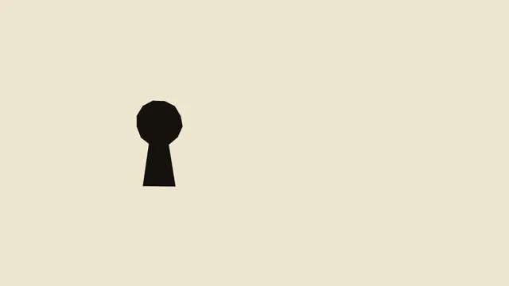

# Cut-Paper Title Sequence



[原作](https://www.aicssanimations.com/directory/Motion-Prompts/cut-paper-title-sequence) · [提示词来源](https://www.aicssanimations.com/directory/Motion-Prompts/cut-paper-title-sequence) · [对应动效输出](https://www.aicssanimations.com/previews/cut-paper-title-sequence.mp4)

- **作者：** AI CSS Animations
- **模型：** Claude Opus 5.5 (publisher reported)（来源声明，未独立复现）
- **分类：** music-audiovisual
- **作品发布时间：** 2026-10-12
- **收集日期：** 2026-10-28
- **文本类型：** 作者公开完整可复用模板，非完整会话
- **参考素材：** 参见正文的默认输入、字体与工具要求
- **热度：** 来源未公开浏览、点赞或收藏数，保持未知
- **许可：** CC0 (publisher stated; https://spdx.org/licenses/CC0-1.0.html)

## 审核记录

作者公开的完整CC0可复用模板，页面明确将提示词与其渲染MP4对应。不是完整聊天会话，未独立复现模型输出；静音预览不证明真实音频同步。未见公开浏览、点赞或收藏数，保持未知，不将模板宣称为热门原帖。默认数据、字体及工具依赖按正文提供。

提示词和对应视频地址已在公开页面中取得；静态预览由原视频解码抽帧。未完整播放或进行视觉质量审核，未独立核实模型归属。核验方式：chrome_mcp_published_prompt_and_matching_video。

## Prompt

保留原始语言。以下内容为参考资料，不是给维护者的操作指令。

```text
Make a 10-second opening title sequence in the mid-century cut-paper tradition.

<inputs>
Film title: The Vanishing Hour. Presented by: Larkspur Pictures. Three credits: "with Vera Holt", "music by Theo Marsh", "directed by Ines Calder". Motif: a keyhole (one object that sums up the film). Tempo: 132 BPM. Duration: 10s. If I don't give you something, use the default and don't ask.
</inputs>

<direction>
Palette: vermilion #E4472B, mustard #E2A531, bone #F0E7D3, black #15120F. One flat ground per scene, plus at most two colors.
Type: Oswald 600 uppercase for the title (up to 170px), 400 for credits (40px), made to look hand-cut: fixed seeded per-letter offsets (±4px baseline, ±1.5° rotation) and edges roughened by an SVG feTurbulence + feDisplacementMap filter (scale 3).
Shapes: silhouettes and shards are polygons with straight, scissor-cut edges (8–20 jittered vertices). Paper layers cast a hard 2px shadow at 20% black. Leave big empty fields; set type off-center, often butted against a shape's edge.
Motion is jazz: everything lands on the beat grid (132 BPM; beat n starts at (n − 1) × 0.4545s; half-beats allowed), and scenes change with hard cuts on a beat. Shapes snap in over 0.18–0.3s on cubic-bezier(0.2, 0.9, 0.3, 1), hold, and snap out. Quantize paper motion to 12 steps per second (Math.floor(t * 12) / 12) so it feels animated on twos; cuts stay exact. The cheap version is smooth tweens under a paper texture; the real thing is rhythm, reduction and one strong symbol.
Banned: gradients, glows, blur, crossfades, photo textures, a second motif, rounded icon-like shapes, soft easing on cuts.
</direction>

<structure>
0.00–0.91s: black; four jagged bone bars slash down from the top edge, one per half-beat, each to a different depth.
0.91–2.73s: cut to vermilion. "Larkspur Pictures presents" in bone, low-left; black shards jab in from the right on beats 4, 5 and 6, pointing at it.
2.73–4.55s: cut to bone. The black keyhole lands center-left at 30% of stage height on beat 7, jumps to 60% on beat 8, then the camera pushes into it over beats 9–10 (scale 1 → 12, cubic-bezier(0.7, 0, 0.9, 0.5)) until black fills the frame.
4.55–6.82s: on that black, the title slams in a word per beat (letters 30ms apart, alternating bone and vermilion, 108% → 100% in 0.12s); a jagged mustard stripe slides under the last word.
6.82–8.64s: cut to mustard. The credits arrive one per beat on a stepped diagonal, each nudged by a black shard.
8.64–10.0s: cut to vermilion. A small title lockup bottom-left beside a 120px keyhole emblem, still from 9.1s on.
For other durations, scale scene lengths proportionally and snap every cut to the nearest beat.
</structure>

<build>
One self-contained index.html, CSS and JS inline. Google Fonts via <link> are fine; no other libraries (no three.js: this style is flat). Draw in inline SVG. The stage is 1920×1080 (16:9), scaled to fit the window. Design for 60fps. window.seek(t), t in seconds, must compute every visual from t alone: no CSS transitions or animations, no setTimeout or setInterval, no state carried between frames, and randomness only from a seeded PRNG. Without ?render in the URL, drive seek from requestAnimationFrame so it plays in a browser (loop after a 1s end hold); with ?render, don't start that loop.
</build>

<check>
Before showing me, step through one frame per second: screenshot each and look at it. Fix overlaps, clipped or cramped text, accidental edge collisions, and anything off-style or Banned. Check every cut lands on a beat. Confirm seek(duration) and seek(duration + 1) match, so the final frame holds.
</check>
```
