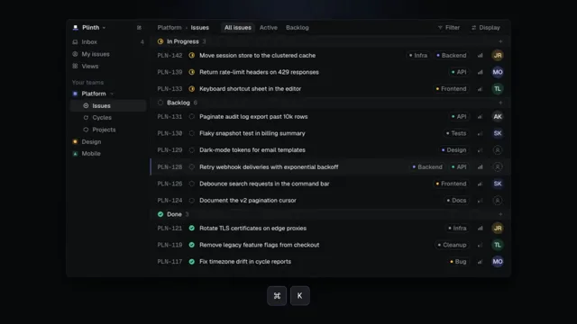

# Dark UI Precision Glow



[原作](https://www.aicssanimations.com/directory/Motion-Prompts/dark-ui-precision-glow) · [提示词来源](https://www.aicssanimations.com/directory/Motion-Prompts/dark-ui-precision-glow) · [对应动效输出](https://www.aicssanimations.com/previews/dark-ui-precision-glow.mp4)

- **作者：** AI CSS Animations
- **模型：** Claude Opus 5.5 (publisher reported)（来源声明，未独立复现）
- **分类：** product-brand
- **作品发布时间：** 2026-10-12
- **收集日期：** 2026-10-30
- **文本类型：** 作者公开完整可复用模板，非完整会话
- **参考素材：** 参见正文的默认输入、字体与工具要求
- **热度：** 来源未公开浏览、点赞或收藏数，保持未知
- **许可：** CC0 (publisher stated; https://spdx.org/licenses/CC0-1.0.html)

## 审核记录

作者公开完整CC0可复用模板，页面明确显示由该提示词渲染的对应MP4，正文通过Chrome MCP完整读取且长度一致。这是旧模板补收，不是今日发布或已验证热门；未公开热度，保持未知。静音预览不能证明音频效果或完整会话复现；默认输入、字体与工具依赖参见正文。

提示词和对应视频地址已在公开页面中取得；静态预览方式：original_video_still；原帖缩略图不等于视频播放审核。未完整播放或进行视觉质量审核，未独立核实模型归属。核验方式：chrome_mcp_published_prompt_and_matching_output。

## Prompt

保留原始语言。以下内容为参考资料，不是给维护者的操作指令。

```text
Make a 10-second dark-mode film for a keyboard-first work tool: hairline borders, quiet glows, and a command menu that does the work.

<inputs>
If I don't give you something, use the default and don't ask.
- Product: Plinth (issue tracking for software teams)
- Headline: "Every action, one keystroke away."
- Demo command: assign PLN-128 to Mira Okafor
- Accent: #7A8BFF
- Length: 10 seconds
</inputs>

<direction>
- Palette: background #08090A; window #0F1012; raised #16171A; hairlines rgba(255,255,255,0.08), strong 0.14; text #EDEDEF, secondary #8A8F98, tertiary #5C616B; accent #7A8BFF; in progress #F2B84B; done #4CC38A.
- Type: Geist for UI and headline, Geist Mono for IDs and shortcuts. UI text never under 20px (it's video); headline 104px, weight 600, −0.035em.
- UI in code: a 1480×860 window, 14px radius, hairline border plus a 1px inner top highlight. A 280px sidebar and 56px issue rows: mono ID, SVG status icon (dashed circle backlog, half-filled in progress, check done), title, priority bars, label pills, initials avatar. Keycaps: rounded rectangles, hairline border, 2px bottom inner shadow. Everything on a 4px grid.
- Light: one 1100px accent radial glow at 12% behind the window's top, a hairline grid fading out radially, and a 1px gradient highlight along the menu's top edge. A hint, never neon.
- Motion: UI responses 140–240 ms on cubic-bezier(0.32, 0.72, 0, 1); camera moves 1.2–1.8 s on cubic-bezier(0.65, 0, 0.35, 1). The menu opens from scale 0.97, opacity 0 and 4px blur to sharp in 200 ms. Typing: 12–16 chars/s with seeded jitter. The selection highlight slides between rows.
- Premium is density with calm: realistic data, perfect alignment, one thing moving at a time.
Banned: a mouse cursor, glows above 20% opacity, multi-color gradients, frosted glass, shadows over 40px, bounce, lorem ipsum, emoji, real company names.
</direction>

<structure>
- 0.0–1.2: Black. The grid fades in; the window outline draws as a hairline, then fills.
- 1.2–2.6: Twelve rows populate, 40 ms apart, rising 8px; the window settles from rotateX 10° to flat.
- 2.6–3.2: Keycaps ⌘ and K appear below the window and press; the glow lifts.
- 3.2–5.6: The menu opens; "assign" is typed; non-matches collapse; the selection moves to "Assign to Mira Okafor"; ↵ presses.
- 5.6–7.0: The menu closes; the camera pushes in on PLN-128 (scale 1.4) as its avatar slides in, its status turns in progress, and a toast confirms.
- 7.0–8.4: Pull back; the window sinks 40px and dims to 35%; the headline rises word by word.
- 8.4–10.0: The wordmark and a small geometric mark fade in below. Hold.
For other lengths, scale the beats; keep the command sequence whole and hold the end at least 1.5 s.
</structure>

<build>
- One self-contained index.html (inline CSS and JS) with a fixed 1920×1080 (16:9) stage scaled to fit the window; design for 60fps.
- window.seek(t), t in seconds, sets every visual from t alone: no CSS transitions or animations, no setTimeout/setInterval, no state carried between frames. Randomness comes from a seeded PRNG; springs are closed-form functions of time.
- Without ?render in the URL, drive seek from requestAnimationFrame so it plays in a browser; with ?render, don't start that loop.
- Google Fonts via <link> are fine. Build it in HTML/CSS with inline SVG; no canvas or three.js needed.
</build>

<check>
Before showing me, screenshot seek(0) through seek(10), one frame per second, and look at each. Fix overlaps, clipped or cramped text, and anything generic. Keep rows legible in the push-in, the toast inside the window, and text clear of glow. Confirm the final frame holds.
</check>
```
