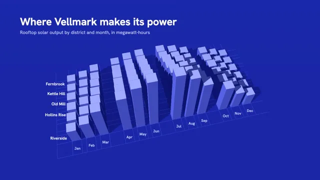

# 3D Data City



[原作](https://www.aicssanimations.com/directory/Motion-Prompts/data-city-3d) · [提示词来源](https://www.aicssanimations.com/directory/Motion-Prompts/data-city-3d) · [对应动效输出](https://www.aicssanimations.com/previews/data-city-3d.mp4)

- **作者：** AI CSS Animations
- **模型：** Claude Opus 5.5 (publisher reported)（来源声明，未独立复现）
- **分类：** 3d-simulations
- **作品发布时间：** 2026-10-16
- **收集日期：** 2026-10-30
- **文本类型：** 作者公开完整可复用模板，非完整会话
- **参考素材：** 参见正文的默认输入、字体与工具要求
- **热度：** 来源未公开浏览、点赞或收藏数，保持未知
- **许可：** CC0 (publisher stated; https://spdx.org/licenses/CC0-1.0.html)

## 审核记录

作者公开完整CC0可复用模板，页面明确显示由该提示词渲染的对应MP4，正文通过Chrome MCP完整读取且长度一致。这是旧模板补收，不是今日发布或已验证热门；未公开热度，保持未知。静音预览不能证明音频效果或完整会话复现；默认输入、字体与工具依赖参见正文。

提示词和对应视频地址已在公开页面中取得；静态预览方式：original_video_still；原帖缩略图不等于视频播放审核。未完整播放或进行视觉质量审核，未独立核实模型归属。核验方式：chrome_mcp_published_prompt_and_matching_output。

## Prompt

保留原始语言。以下内容为参考资料，不是给维护者的操作指令。

```text
Make a 10-second 3D data film: a bar chart rises from a grid like a city skyline and the camera glides down its avenues.

<inputs>
If I don't give you something, use the default and don't ask.
- City: Vellmark (fictional).
- Title: "Where Vellmark makes its power"
- Dek: "Rooftop solar output by district and month, in megawatt-hours"
- Districts and yearly output (MWh): Riverside 15,500 · Harbourside 13,000 · Hollins Rise 11,000 · Old Mill 9,500 · Kettle Hill 7,500 · Fernbrook 6,500 (63,000 in all).
- Monthly share of each district's year, Jan–Dec: 3.6%, 5.0%, 8.0%, 10.0%, 12.0%, 12.8%, 13.0%, 11.6%, 9.2%, 6.8%, 4.6%, 3.4%. Each tower is yearly × share, always a whole number.
- Callouts: "Riverside, July: 2,015 MWh, the city's peak" and "63,000 MWh in all · 49.4% of it from May to August".
- Length: 10 seconds.
</inputs>

<direction>
- One hue, one accent: the whole world is ultramarine and a single orange tower tells the story. Background and fog #1F2CB8, lifting to #3445D6 at the horizon; ground #1B27A6 with 1px grid lines #3B4DE0; towers #5E6DF2 with brighter top caps #B4BCFF; shadows fall as deeper blue, never black. Accent #FF8A3D (emissive 0.25) on the peak tower only. Labels #FFFFFF and #C8CEFF.
- The city: 12 month columns along x, 6 district rows along z, Riverside nearest the camera's final view. Towers are 1.0 × 1.0 units with 0.5-unit streets and a wider 1.6-unit avenue after every third month (the quarters). Height is 1 unit per 250 MWh, so Riverside in July stands 8.06 units and Fernbrook in December 0.88. Soft-bevelled boxes (RoundedBoxGeometry, radius 0.04), MeshStandardMaterial, roughness 0.7, metalness 0.
- Light: HemisphereLight #8C97FF / #101A80 at 0.9, and one DirectionalLight from upper left with soft shadows (PCFSoftShadowMap, 2048 map) so towers cast long blue shadows across the streets; fog fades the far rows into the sky color.
- Labels stay legible: they are HTML, positioned each seek by projecting 3D anchors, always screen-aligned at fixed sizes, never 3D text and never perspective-scaled. Month labels in Hanken Grotesk 600, 22px, along the front edge; district names Hanken Grotesk 600, 24px, like street signs at the left end of each row; tower values in Martian Mono 500, 22px, on a #1B27A6 pill with 10px padding, shown only for towers near the camera (fading in within 7 units, out once behind it) and hidden if they would overlap another label.
- Camera: fov 38, one continuous CatmullRom path paced with easeInOutSine: a high establishing view (pitch 58°) → down to 3.2 units above the street, gliding along the avenue between June and July past the summer peaks → rising to a final three-quarter view (pitch 32°, yaw 35°) with the whole grid in frame. It never passes through a tower.
- Type: title Hanken Grotesk 700, 64px, #FFFFFF, top-left at (120, 96); dek Hanken Grotesk 400, 28px, #C8CEFF, beneath. Callouts Hanken Grotesk 600, 30px, the peak's on a 1px white leader ending at its tower top, the totals line at bottom-left.
- Motion: towers grow from the ground over 0.6 s each (easeOutCubic), month by month left to right 0.15 s apart with 0.04 s between districts; nothing bounces. Text rises 12px as it fades in over 0.5 s on cubic-bezier(0.22, 1, 0.36, 1).
- Premium: one hue doing the work, a true height scale, labels as crisp as a flat chart, a camera that moves like a drone shot. Cheap: rainbow towers, wobbling 3D text, a spinning camera.
Banned: rainbow or height-graded colors, 3D text, labels overlapping each other or the towers they name, bloom, chrome, a second accent, the camera clipping through towers, anything flashing more than 3 times per second.
</direction>

<structure>
- 0.0–1.0s: the high view over an empty ultramarine ground; grid lines draw out from the near corner; the title and dek rise in.
- 1.0–3.6s: the towers grow, January to December; month and district labels appear as their first tower rises.
- 3.6–6.6s: the camera descends and glides down the June–July avenue at street height; value pills appear on the nearest towers and slide past.
- 6.6–7.8s: the camera rises to the final three-quarter view; the Riverside July tower turns orange over 0.4 s and its callout draws.
- 7.8–8.8s: the totals callout rises in at bottom-left.
- 8.8–10.0s: hold.
For other lengths, stretch the avenue glide first; keep at least 1 s of hold.
</structure>

<build>
- One self-contained index.html (inline CSS and JS), a 1920×1080 (16:9) stage scaled to fit the window, designed for 60fps. No image, video, texture or model files: every shape and texture is generated in code.
- window.seek(t), t in seconds, computes every visual from t alone: no CSS transitions or CSS animations, no setTimeout/setInterval, no state carried between frames, randomness only from a seeded PRNG. Anything cumulative is solved analytically from t or precomputed once at load at a fixed step. Past the end, seek clamps to the last frame.
- Without ?render in the URL, drive seek from requestAnimationFrame so it plays in a browser (loop after a 1s end hold); with ?render, don't start that loop.
- Google Fonts via <link> are fine; await document.fonts.load() for each face before defining window.seek.
- Engine: three.js as an ES module pinned to three@0.160.0 through an import map on jsDelivr (`three` and `three/addons/`). WebGLRenderer with antialias, preserveDrawingBuffer: true and setPixelRatio(window.devicePixelRatio); render once at the end of every seek. Text is HTML over the canvas.
- Tower heights come straight from the data; the camera position is a closed-form point on its path at t.
</build>

<check>
Before showing me, step through one frame per second (t = 0…10): screenshot each and look at it. Fix overlaps, clipped or cramped text, and anything off-style or Banned. Check every tower's height equals yearly × share at 250 MWh per unit, no label overlaps or clips, the camera is never inside geometry, and orange appears only on the peak tower. Confirm seek(10) and seek(11) match, so the final frame holds.
</check>
```
