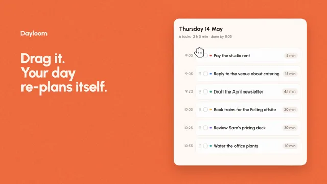

# Drag to Reorder



[原作](https://www.aicssanimations.com/directory/Motion-Prompts/drag-reorder-list) · [提示词来源](https://www.aicssanimations.com/directory/Motion-Prompts/drag-reorder-list) · [对应动效输出](https://www.aicssanimations.com/previews/drag-reorder-list.mp4)

- **作者：** AI CSS Animations
- **模型：** Claude Opus 5.5 (publisher reported)（来源声明，未独立复现）
- **分类：** interactive
- **作品发布时间：** 2026-10-18
- **收集日期：** 2026-10-28
- **文本类型：** 作者公开完整可复用模板，非完整会话
- **参考素材：** 参见正文的默认输入、字体与工具要求
- **热度：** 来源未公开浏览、点赞或收藏数，保持未知
- **许可：** CC0 (publisher stated; https://spdx.org/licenses/CC0-1.0.html)

## 审核记录

作者公开的完整CC0可复用模板，页面明确将提示词与其渲染MP4对应。不是完整聊天会话，未独立复现模型输出；静音预览不证明真实音频同步。未见公开浏览、点赞或收藏数，保持未知，不将模板宣称为热门原帖。默认数据、字体及工具依赖按正文提供。

提示词和对应视频地址已在公开页面中取得；静态预览由原视频解码抽帧。未完整播放或进行视觉质量审核，未独立核实模型归属。核验方式：chrome_mcp_published_prompt_and_matching_video。

## Prompt

保留原始语言。以下内容为参考资料，不是给维护者的操作指令。

```text
Make a 10-second drag-to-reorder demo: a day planner's task cards are grabbed, lifted and dragged into a new order while their neighbors spring out of the way and the schedule re-times itself.

<inputs>
If I don't give you something, use the default and don't ask.
- App: Dayloom, a day planner (fictional). Headline: "Drag it. Your day re-plans itself."
- Day: Thursday 14 May, starting at 9:00.
- Tasks, in order, with minutes: Reply to the venue about catering 15 · Draft the April newsletter 45 · Book trains for the Pelling offsite 20 · Review Sam's pricing deck 30 · Pay the studio rent 5 · Water the office plants 10 (2 h 5 min in all, done by 11:05)
- Moves: drag "Pay the studio rent" from 5th to 1st; drag "Draft the April newsletter" from 3rd to last; check off "Pay the studio rent".
- Length: 10 seconds.
</inputs>

<direction>
- Palette: stage tangerine #F26A3D with a 3% grain; list panel #FFFAF5 with a 32px radius and a shadow of 0 30px 70px rgba(80,24,8,0.25); task cards #FFFFFF with a 1px #F0E4DA border and an 18px radius; ink #1F1A17; secondary #7A6E66; times #A2958B; tangerine for checks and the slot outline; priority dots #E2453C (rent), #3D7BF0, #2FA36B, #F2B33D, #8A5CF6, #17A398.
- Type: Urbanist 500–800: "Dayloom" 40px/800 and the headline 84px/800 (three lines, leading 1.0) in #FFF6EE at left; the panel header "Thursday 14 May" 34px/700; the summary 22px/500 in secondary; card titles 26px/600; durations and times 22px/600 with tabular figures.
- Layout: "Dayloom" at (120, 170) and the headline from y 300 within x 120–860; the list panel, 780×860 at (1020, 110), holds the header, the summary "6 tasks · 2 h 5 min · done by 11:05", then six rows from panel y 170, each a 96px time column ("9:00") and a 620×92 card, 14px apart. A card has a six-dot drag handle at left, a 28px round checkbox, its priority dot, the title and a duration pill at right ("15 min").
- Times are live: each start is 9:00 plus the durations above it, and when the order changes every changed time rolls its digits vertically (200ms) as the card settles. Start: Reply 9:00, Newsletter 9:15, Trains 10:00, Review 10:20, Rent 10:50, Plants 10:55. After move 1: Rent 9:00, Reply 9:05, Newsletter 9:20, Trains 10:05, Review 10:25, Plants 10:55. After move 2: Rent 9:00, Reply 9:05, Trains 9:20, Review 9:40, Plants 10:10, Newsletter 10:20. The day always ends at 11:05.
- Drag physics: a drawn hand cursor (an open hand on hover, a closed hand while grabbing) presses the handle; the card lifts over 0.15s (scale 1.035, shadow 0 24px 48px rgba(31,26,23,0.22), above every other card) and follows the pointer exactly in y, tilting up to ±2° with the pointer's vertical speed (velocity averaged over the previous 0.12s, computed from the path, never stored). When its center crosses a neighbor's midpoint, that neighbor springs into the vacated slot (stiffness 520, damping 38, about 3% overshoot), and the open slot shows a 2px dashed tangerine outline at 40%. On release the card glides into its slot on the same spring as its scale and shadow return over 0.2s.
- Checking: the checkbox fills tangerine and a white check draws (200ms); a strike line draws through the title left to right (250ms) and the title fades to secondary; the summary reads "1 of 6 done · 2 h left".
- Pointer moves: curved paths of 0.45–0.7s on cubic-bezier(0.45, 0, 0.15, 1); drags take 1.0–1.2s on cubic-bezier(0.5, 0, 0.3, 1).
- Premium: weight and consequence: a card you can feel lifting, neighbors making room, times re-planning in the same frame. Cheap: rows swapping places instantly under a static arrow.
Banned: real app names, emoji, confetti, glow, dark mode, a dragged card passing under its neighbors, teleporting cards, times that don't add up, anything flashing more than 3 times per second.
</direction>

<structure>
- 0.0–0.8s: the tangerine stage; "Dayloom" and the headline rise in; the panel rises 30px and the cards stagger in 40ms apart with their times.
- 0.8–1.4s: the hand enters and hovers the rent card's handle, which darkens; it grabs.
- 1.4–1.6s: the card lifts.
- 1.6–2.8s: it is dragged to the top; Review, Trains, Newsletter and Reply each spring down one slot as it passes.
- 2.8–3.2s: release; it settles and the times roll.
- 3.2–3.8s: the hand moves to the newsletter card, now 3rd, grabs it, and it lifts.
- 3.8–5.0s: it is dragged to the bottom; Trains, Review and Plants spring up one slot.
- 5.0–5.4s: release; it settles and the times roll.
- 5.4–6.2s: the hand rests beside the panel. At 6.0s the re-planned list reads cleanly.
- 6.2–7.0s: the hand clicks the top checkbox: check, strike, summary.
- 7.0–8.2s: the hand drifts to rest just below the panel's lower left, clear of the cards.
- 8.2–10.0s: hold, perfectly still.
For other lengths, stretch the pauses between moves; keep drags at 1.0–1.2s and at least 1s of hold.
</structure>

<build>
- One self-contained index.html (inline CSS and JS), a 1920×1080 (16:9) stage scaled to fit the window, designed for 60fps. No image, video, texture or model files: every shape and texture is generated in code.
- window.seek(t), t in seconds, computes every visual from t alone: no CSS transitions or CSS animations, no setTimeout/setInterval, no state carried between frames, randomness only from a seeded PRNG. Anything cumulative is solved analytically from t or precomputed once at load at a fixed step. Past the end, seek clamps to the last frame.
- Without ?render in the URL, drive seek from requestAnimationFrame so it plays in a browser (loop after a 1s end hold); with ?render, don't start that loop.
- Google Fonts via <link> are fine; await document.fonts.load() for each face before defining window.seek.
- Engine: HTML/CSS with inline SVG for the cursors, handles and checks, positioned from seek.
- The pointer path and the drag schedule are a timeline built once at load; springs are closed-form in the time since their trigger, and a spring retargeted mid-motion starts from its current offset and velocity.
</build>

<check>
Before showing me, step through one frame per second (t = 0…10): screenshot each and look at it. Fix overlaps, clipped or cramped text, and anything off-style or Banned. Check the dragged card always stays above its neighbors, each neighbor moves exactly one slot, every set of times matches the lists above and ends at 11:05, the strike runs through the whole title, and no text clips inside its card. Confirm seek(10) and seek(11) match, so the final frame holds.
</check>
```
