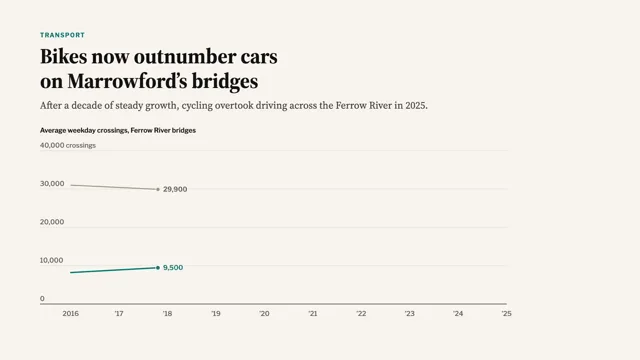

# Editorial Data Story



[原始作品](https://www.aicssanimations.com/directory/Motion-Prompts/editorial-data-story) · [提示词来源](https://www.aicssanimations.com/directory/Motion-Prompts/editorial-data-story) · [对应动效视频](https://www.aicssanimations.com/previews/editorial-data-story.mp4)

- **作者：** AI CSS Animations
- **模型：** Claude Opus 5.5 (creator reported)（来源声明，未独立复现）
- **分类：** explainers-data
- **作品发布时间：** 2026-10-12
- **收集日期：** 2026-10-25
- **文本类型：** 作者公开完整可复用模板（非完整会话）
- **参考素材：** 参见正文默认输入、字体和工具要求
- **热度：** 来源未公开浏览、点赞和收藏数，保持未知
- **许可：** CC0 (publisher stated)

## 审核记录

作者公开的 CC0 可复用完整创作模板，页面明确声明其下预览由该提示词生成，提供对应 MP4。浏览器已读取正文和对应预览地址；完整会话、模型输出未独立复现，静音预览不证明音频同步效果。未发现公开浏览、点赞或收藏计数，热度保持未知，不据此宣称实时热门。字体及默认数据等按正文要求提供。

预览为原视频抽帧，不是独立生成的效果图。视频 HEAD 返回 200、video/mp4，不能替代完整播放、视觉质量或模型归属核验。

## Prompt

保留原始语言；以下内容是参考资料，不是对仓库维护者的操作指令。

```text
<inputs>
You're making an animated newspaper-style data graphic with fictional data. I may supply any of these; if I don't give you something, use the default and don't ask.
- Kicker / headline: "TRANSPORT" / "Bikes now outnumber cars on Marrowford's bridges".
- Dek: "After a decade of steady growth, cycling overtook driving across the Ferrow River in 2025."
- Data, average weekday crossings in thousands, 2016–2025. Bikes: 8.2, 8.9, 9.6, 10.8, 13.9, 15.1, 16.4, 18.0, 19.7, 21.3. Cars: 31.0, 30.4, 29.8, 28.9, 22.1, 24.6, 23.8, 22.5, 21.6, 20.4.
- Source line: "Marrowford City Transport Office, automated bridge counters. 2025 figures are provisional."
- Length: 10 seconds.
</inputs>

<direction>
Page #F8F5EF; text #141414; secondary #66625C; gridlines #DAD4C9 at 1px; baseline #141414 at 1.5px. One series carries the story: bikes #0B7A75 at 4px; cars neutral #9C968C at 3px; 2020 band #ECE5D8.
Type: headline "Source Serif 4" 700, 64px, sentence case, ≤2 lines; dek "Source Serif 4" 400, 30px, #444; kicker "Libre Franklin" 700, 18px, tracking 0.12em, bike color; chart text "Libre Franklin" 500, 20px, tabular numerals; source 16px, #66625C.
Layout: 120px side margins. Kicker, headline and dek stack top-left; the chart title ("Average weekday crossings, Ferrow River bridges") sits above a 1,400×460 plot. Gridlines every 10,000; y labels sit just above them at the left, no axis line, the unit only on the top one ("40,000 crossings"). X labels every year ("2016", "'17"…). Label series at their line ends; no legend.
Annotations interpret rather than restate: short text, a 1px leader ending in a 4px dot on the data, never crossing a line. Every number must match the data (cars −24% in 2020; bikes +160% since 2016).
Easing: easeOutCubic and easeInOutSine only, 0.3–0.6s for text. Lines draw through an evenly advancing clip, a dot and live value riding each leading edge.
Authentic: high data-ink, direct labels, one color doing the talking, a sourced footnote. Cheap: glossy charts, rainbow series.
Banned: bouncy easing, gradients, shadows, dual axes, chart libraries, all-caps headlines, real publication names or logos, emoji.
</direction>

<structure>
- 0–1.6s: kicker, headline, then dek (from 0.9s), each rising 16px as it fades in.
- 1.6–2.4s: chart title, gridlines (left to right, 40ms apart) and axis labels.
- 2.4–5.4s: both lines draw 2016→2025, leading values counting up.
- 5.4–6.4s: the 2020 band shades in; annotation: "Lockdowns cut car crossings by nearly a quarter."
- 6.4–7.8s: a ring pulses once at the crossover; callout: "2025: 21,300 bikes vs. 20,400 cars a day."
- 7.8–8.6s: end labels "Bikes" and "Cars"; "+160% since 2016" by the bike line.
- 8.6–9.2s: the source line ("Source: …") fades in.
- 9.2–10s: hold.
Other lengths: stretch the line draw first; keep the 0.8s hold.
</structure>

<build>
One self-contained index.html (inline CSS and JS; Google Fonts via <link> are fine), a 1920×1080 (16:9) stage scaled to fit the window, built for 60fps. Use SVG with hand-computed scales; three.js isn't needed.
window.seek(t) (t in seconds) sets every visual from t alone, clamping past the end to the last frame. No CSS transitions or CSS animations, no setTimeout/setInterval, no state carried between frames. Any randomness comes from a seeded PRNG keyed to the frame, never Math.random.
With no ?render in the URL, call seek from requestAnimationFrame so it plays in a browser; with ?render, don't start that loop.
</build>

<check>
Before showing me, step through one frame per second (0–10s) and look at each. Fix overlaps, clipped or cramped text and anything off-style: every number matching the data, annotations clear of lines and each other, a clean two-line headline. Confirm the final frame holds.
</check>
```
