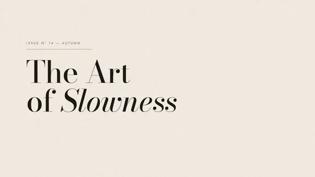

# Editorial Serif Titles



[原作](https://www.aicssanimations.com/directory/Motion-Prompts/editorial-serif-titles) · [提示词来源](https://www.aicssanimations.com/directory/Motion-Prompts/editorial-serif-titles) · [对应动效输出](https://www.aicssanimations.com/previews/editorial-serif-titles.mp4)

- **作者：** AI CSS Animations
- **模型：** Claude Opus 5.5 (publisher reported)（来源声明，未独立复现）
- **分类：** motion-studies
- **作品发布时间：** 2026-10-12
- **收集日期：** 2026-10-30
- **文本类型：** 作者公开完整可复用模板，非完整会话
- **参考素材：** 参见正文的默认输入、字体与工具要求
- **热度：** 来源未公开浏览、点赞或收藏数，保持未知
- **许可：** CC0 (publisher stated; https://spdx.org/licenses/CC0-1.0.html)

## 审核记录

作者公开完整CC0可复用模板，页面明确显示由该提示词渲染的对应MP4，正文通过Chrome MCP完整读取且长度一致。这是旧模板补收，不是今日发布或已验证热门；未公开热度，保持未知。静音预览不能证明音频效果或完整会话复现；默认输入、字体与工具依赖参见正文。

提示词和对应视频地址已在公开页面中取得；静态预览方式：original_video_still；原帖缩略图不等于视频播放审核。未完整播放或进行视觉质量审核，未独立核实模型归属。核验方式：chrome_mcp_published_prompt_and_matching_output。

## Prompt

保留原始语言。以下内容为参考资料，不是给维护者的操作指令。

```text
<inputs>
If I don't give you something, use the default and don't ask.
- Magazine: default "ONDINE"
- Issue line: default "Issue Nº 14 — Autumn"
- Title, two lines: default "The Art" / "of Slowness" (italic "Slowness")
- Standfirst: default "Twelve designers on making less, and making it last."
- Folio: default "p. 48"
- Palette: default cream #F2ECE1, ink #1C1A17, oxblood #6B1E22
- Length: default 10 seconds
</inputs>

<direction>
A fashion monthly's feature opener, animated with the patience of a perfume film. Restraint is the brief: few elements, lots of air, slow exact motion.

Palette: cream ground, ink type, oxblood only for hairlines and the folio, warm grey #8C8376 for secondary labels.

Type: Bodoni Moda (Google Fonts, variable opsz 6–96, wght 400–900) for title and standfirst, opsz maxed at display sizes for razor hairlines. Title 160–200 px, weight 400–500, tracking -0.01em, leading 0.95; the italic word carries the voice. Jost 400 for labels: uppercase, 18–22 px, tracking 0.28–0.35em. Two typefaces only.

Layout: asymmetric, 160 px margins, 12 columns. Title flush-left across columns 1–8; on columns 10–12 a tall 4:5 panel of soft tonal field (two blurred warm-grey radial gradients plus grain) standing in for a photograph. Hairlines exactly 1 px.

Motion: each title line rises its full height from behind a mask at its baseline over 1.3–1.7 s, cubic-bezier(0.22, 1, 0.36, 1). Labels track in (0.6em → 0.3em) with opacity over 1.2 s. Rules draw at constant speed. The panel opens with a clip-path inset from its vertical center, then pushes 1.00 → 1.04 to the end. No move shorter than 0.6 s. The standfirst stays fully visible at least 3 s.

Authentic: optical sizing, true italics, rules aligned to type, motion like a slow breath. Cheap: centered layouts, faux bold.

Banned: Playfair Display, bounce or overshoot, motion blur, drop shadows, gradients on type, #FFFFFF or #000000, typewriter reveals, anything flashing more than 3 times per second.
</direction>

<structure>
Default 10 s:
- 0.0–0.8: cream and grain; an oxblood hairline draws from the left margin to 560 px.
- 0.6–2.0: issue line tracks in above the rule.
- 1.4–3.4: title line 1 rises from its mask; line 2 follows 0.3 s later.
- 3.2–4.4: the image panel opens from its center line.
- 4.4–6.0: standfirst fades up beneath in Bodoni Moda 400, 34 px, lines staggered 0.25 s.
- 6.4–7.6: masthead (Jost, top margin) and folio (bottom right) track in.
- 7.6–10.0: hold; only the image push and grain continue.

Other lengths: scale reveals, never below 1.0 s each; keep at least 2 s of final hold.
</structure>

<build>
- One self-contained index.html, no libraries (three.js from a CDN only when a style truly needs 3D); a 1920×1080 (16:9) stage scaled to fit the window; designed for 60fps.
- window.seek(t), t in seconds, computes every visual from t alone: no CSS transitions or animations, no setTimeout/setInterval, no state carried between frames. Grain comes from a seeded PRNG keyed to the frame.
- No ?render in the URL: drive seek from requestAnimationFrame so it plays in a browser. With ?render: don't start that loop.
- Google Fonts via <link>; await document.fonts.load() for each face before assigning window.seek.
- HTML/CSS: set transform, clip-path, opacity, letter-spacing and font-variation-settings in seek; draw grain on a small upscaled canvas.
</build>

<check>
Before showing me, step through one frame per second and look at each. Fix overlaps, clipped or cramped text and anything off-style. Check the last frame would work as a printed page. Confirm the final frame holds.
</check>
```
