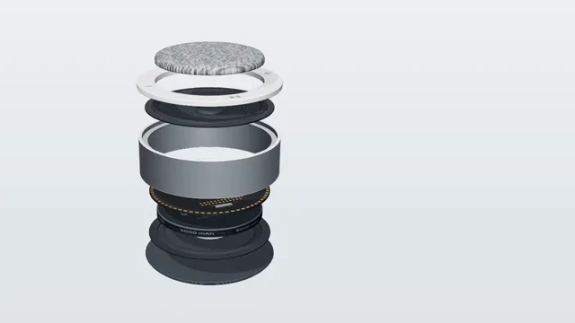

# Exploded View



[原作](https://www.aicssanimations.com/directory/Motion-Prompts/exploded-view-device) · [提示词来源](https://www.aicssanimations.com/directory/Motion-Prompts/exploded-view-device) · [对应动效输出](https://www.aicssanimations.com/previews/exploded-view-device.mp4)

- **作者：** AI CSS Animations
- **模型：** Claude Opus 5.5 (publisher reported)（来源声明，未独立复现）
- **分类：** product-brand
- **作品发布时间：** 2026-10-16
- **收集日期：** 2026-10-30
- **文本类型：** 作者公开完整可复用模板，非完整会话
- **参考素材：** 参见正文的默认输入、字体与工具要求
- **热度：** 来源未公开浏览、点赞或收藏数，保持未知
- **许可：** CC0 (publisher stated; https://spdx.org/licenses/CC0-1.0.html)

## 审核记录

作者公开完整CC0可复用模板，页面明确显示由该提示词渲染的对应MP4，正文通过Chrome MCP完整读取且长度一致。这是旧模板补收，不是今日发布或已验证热门；未公开热度，保持未知。静音预览不能证明音频效果或完整会话复现；默认输入、字体与工具依赖参见正文。

提示词和对应视频地址已在公开页面中取得；静态预览方式：original_video_still；原帖缩略图不等于视频播放审核。未完整播放或进行视觉质量审核，未独立核实模型归属。核验方式：chrome_mcp_published_prompt_and_matching_output。

## Prompt

保留原始语言。以下内容为参考资料，不是给维护者的操作指令。

```text
Make a 10-second exploded-view product animation: a small speaker separates along its axis into labeled layers, holds, then reassembles.

<inputs>
- Product: Marlo Disc speaker, by Marlo Audio.
- Parts, top to bottom: Knit grille · Touch ring · 2.5 in driver · Aluminum body · Logic board · 5,000 mAh battery · Passive radiator · Rubber foot.
- Headline: "Eight parts. One small speaker."
- Length: 10 seconds.
If I don't give you something, use the default and don't ask.
</inputs>

<direction>
Set: a pale cool studio sweep, #EEF0F2 to #E1E4E8. Ink #1D2228, secondary #6B7380, teal #17B3A5 only for leader dots and the light ring.
The device, modeled in code: a disc 1.6 units across and 0.62 tall, every part nesting exactly. Knit grille: domed, procedural knit in heather greys. Touch ring: frosted acrylic with icons and a light ring. Driver: ribbed lathe cone, rubber surround, dust cap, magnet. Body: a bead-blasted aluminum band (metalness 1, roughness 0.38, #C9CDD2). Logic board: matte black PCB, gold pads, chips. Battery: slate wrap printed "5000 mAh". Passive radiator; rubber foot with grip rings.
Light: RoomEnvironment and a soft upper-left key. Camera: fov 24, 22° above the disc's plane, orbiting 20° on easeInOutSine, easing back 8% while apart.
The body stays fixed: parts above rise and parts below drop, straight along the axis, outermost first, to even gaps of about 110px, the stack spanning y 150–950 around x 700. Moves take 0.8s on cubic-bezier(0.65, 0, 0.35, 1), 0.12s apart, each part turning 12°. Reassembly reverses, innermost first, each part landing with a 2px settle (cubic-bezier(0.34, 1.3, 0.64, 1), 0.5s).
Labels: HTML on a strict column at x 1240: a 1px leader from a 6px teal dot on the part's edge (re-projected every frame), an index in JetBrains Mono 500, 20px, and the name in Manrope 600, 26px. Leaders draw in 0.35s; text rises 10px.
Final frame: the assembled disc near (700, 560), 760px wide; at x 1180 the product name in JetBrains Mono 500, 22px, uppercase, over the headline in Manrope 700, 64px, on two lines.
Premium is engineering you believe: exact nesting, even gaps, a strict label column. Cheap is parts flying out at random with glowing outlines.
Banned: off-axis paths, rotation past 20°, wireframes, X-ray views, glow, crossing leaders, labels over parts, anything flashing more than 3 times per second.
</direction>

<structure>
- 0.0–1.2s: the assembled speaker; a soft highlight slides across the aluminum.
- 1.2–3.4s: the explode: grille, ring and driver rise; foot, radiator, battery and board drop; the camera eases back.
- 3.4–5.2s: leaders and labels draw on, top to bottom, 0.18s apart.
- 5.2–6.4s: hold on the exploded view.
- 6.4–7.6s: labels retract; parts return, innermost first, and settle.
- 7.6–8.4s: the light ring wakes teal; the camera eases in.
- 8.4–9.0s: product name and headline rise 14px into place.
- 9.0–10s: hold.
Other lengths: stretch the exploded hold first; keep 1s of final hold.
</structure>

<build>
One self-contained index.html, inline CSS and JS, on a 1920×1080 (16:9) stage scaled to fit the window, built for 60fps. Google Fonts via <link>, awaited with document.fonts.load() before seek exists.
window.seek(t) sets every visual from t alone: no CSS transitions or animations, no setTimeout/setInterval, no state carried between frames, randomness only from a seeded PRNG. Labels re-project from 3D anchors inside seek.
Without ?render in the URL, drive seek from requestAnimationFrame; with ?render, don't start that loop.
three.js as an ES module pinned to three@0.160.0 via a jsDelivr import map (`three`, `three/addons/`); preserveDrawingBuffer: true; one render per seek. No image, model or typeface files beyond Google Fonts.
</build>

<check>
Before showing me, step through one frame per second (0–10s) and look at each. Fix overlaps, clipped or cramped text and anything off-style or Banned. Look for parts leaving the axis, gaps or intersections when assembled, uneven exploded gaps, leaders that cross or end on the wrong part. Confirm the final frame holds.
</check>
```
