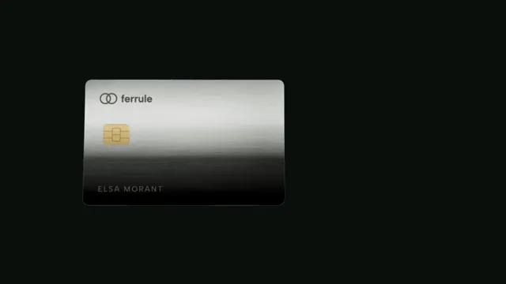

# Fintech Card Wallet



[原作](https://www.aicssanimations.com/directory/Motion-Prompts/fintech-card-wallet) · [提示词来源](https://www.aicssanimations.com/directory/Motion-Prompts/fintech-card-wallet) · [对应动效输出](https://www.aicssanimations.com/previews/fintech-card-wallet.mp4)

- **作者：** AI CSS Animations
- **模型：** Claude Opus 5.5 (publisher reported)（来源声明，未独立复现）
- **分类：** product-brand
- **作品发布时间：** 2026-10-16
- **收集日期：** 2026-10-30
- **文本类型：** 作者公开完整可复用模板，非完整会话
- **参考素材：** 参见正文的默认输入、字体与工具要求
- **热度：** 来源未公开浏览、点赞或收藏数，保持未知
- **许可：** CC0 (publisher stated; https://spdx.org/licenses/CC0-1.0.html)

## 审核记录

作者公开完整CC0可复用模板，页面明确显示由该提示词渲染的对应MP4，正文通过Chrome MCP完整读取且长度一致。这是旧模板补收，不是今日发布或已验证热门；未公开热度，保持未知。静音预览不能证明音频效果或完整会话复现；默认输入、字体与工具依赖参见正文。

提示词和对应视频地址已在公开页面中取得；静态预览方式：original_video_still；原帖缩略图不等于视频播放审核。未完整播放或进行视觉质量审核，未独立核实模型归属。核验方式：chrome_mcp_published_prompt_and_matching_output。

## Prompt

保留原始语言。以下内容为参考资料，不是给维护者的操作指令。

```text
Make a 10-second fintech launch film: a brushed metal card turns in 3D, flies into a phone wallet, transactions slide in, the balance counts up and a spending chart draws.

<inputs>
If I don't give you something, use the default and don't ask.
- Brand: Ferrule. Line: "One heavy card. One calm app."
- Card: ELSA MORANT, ending 4417. Balance: $12,480.35
- Today: Metro pass −$62.00, Corner Market −$38.40, Salary · Odell & Hart +$4,200.00, Bluebell Café −$6.80
- October spending by day: 42.10, 118.60, 23.40, 64.95, 210.00, 35.80, 18.25, 96.40, 54.30, 141.75, 27.60, 72.15, 88.90, 31.50, 152.00, 107.20 (total $1,284.90; September by day 16: $1,412.30)
- Length: 10 seconds
</inputs>

<direction>
Figures tie out: day 16 is today's three purchases, and $1,284.90 is 9% below September, as the chart caption says.
Palette: stage #0B0F0D, screen #101512, text #EEF2EC, secondary #8D9A92, lime #C8F560 for October's line, income and the caption; September dashed in #4A5650. Spending stays in text color.
The card is real 3D, 85.6 : 54, 760px wide: an extruded rounded rectangle, 6px deep with a 1px bevel, in MeshPhysicalMaterial (#B9BDB9, metalness 1, roughness 0.3, anisotropy 0.7), brushed by a seeded roughness map of fine horizontal streaks. Thin face overlays with CanvasTextures carry a two-ring mark, "ferrule" and the name laser-frosted, a brushed-gold chip, and on the back a dark stripe and "•••• 4417".
Light: an environment built once with PMREMGenerator.fromScene from a black scene holding one long horizontal softbox and a dim warm panel. As the card turns, the softbox must slide across the brushed face as one long, soft streak.
Camera: fov 30 at z = 540 ÷ tan(15°) ≈ 2015, so the z = 0 plane maps 1:1 to stage pixels and the landed card lines up with the HTML phone beneath.
The phone: 450×940, 70px radius, centered at (1270, 540): "Wallet"; a 380×240 card slot with two flat cards peeking above; the balance at 56px; "Spent in October", a cumulative line over Oct 1–31 that stops at day 16, "9% less than September"; four transaction rows.
Type: Albert Sans 400–700, UI text 20–30px, with tabular figures (or fixed-width digit boxes) so counters never jitter.
Motion: the turn is slow and heavy (2.6s, cubic-bezier(0.25, 0.1, 0.1, 1)); the flight is 1.1s on cubic-bezier(0.65, 0, 0.2, 1) along a gentle arc, ending exactly face-on; rows slide 40px from the right, 80ms apart; the balance counts over 1.4s on cubic-bezier(0.16, 1, 0.3, 1).
Premium is a heavy object and a calm ledger: one highlight crawling across real brushed metal. Cheap is a flat gradient card spinning on neon.
Banned: over 200° of rotation, lens flares, bloom, card-network or contactless symbols, a full card number, red for ordinary spending, emoji, anything flashing more than 3 times per second.
</direction>

<structure>
0.0–0.6s: black; a thin streak of light appears where the card will be, at x 700.
0.6–3.2s: the card turns from its back (rotateY 160°, rotateX 10°) to its front (0°, 4°); the streak crosses the brushed face and catches the chip.
3.0–3.6s: the phone slides in 60px from the right, fading up.
3.6–4.7s: the card flies into the slot and lands on the two peeking cards.
4.7–5.6s: transactions slide in, the salary in lime.
5.0–6.4s: the balance counts up from $0.00.
6.0–7.4s: September's line draws, then October's; its end dot pops; the caption fades up.
7.4–8.6s: where the card turned, "Ferrule" rises out of a mask with the line beneath.
8.6–10.0s: hold, completely still.
For other lengths, stretch the turn and hold first; keep the flight 0.9–1.3s.
</structure>

<build>
One self-contained index.html, CSS and JS inline; Google Fonts via <link>, awaited with document.fonts.load() before window.seek is defined; no libraries besides three.js. Use three.js for the card: an ES module pinned to three@0.160.0 via an import map on jsDelivr (three and three/addons/), its WebGLRenderer transparent with preserveDrawingBuffer: true over the HTML phone, rendered once per seek. The stage is 1920×1080 (16:9), scaled to fit the window; design for 60fps. window.seek(t), t in seconds, must compute every visual from t alone: no CSS transitions or animations, no setTimeout or setInterval, no state carried between frames, randomness only from a seeded PRNG. Generate textures once at load. Without ?render in the URL, drive seek from requestAnimationFrame (loop after a 1s end hold); with ?render, don't start that loop.
</build>

<check>
Before showing me, step through one frame per second: screenshot each and look at it. Fix overlaps, clipped or cramped text and anything off-style or Banned. Check the highlight visibly travels across the metal, the faces never z-fight, the landed card sits pixel-aligned in its slot, and every figure ties out. Confirm seek(10) and seek(11) match, so the final frame holds.
</check>
```
