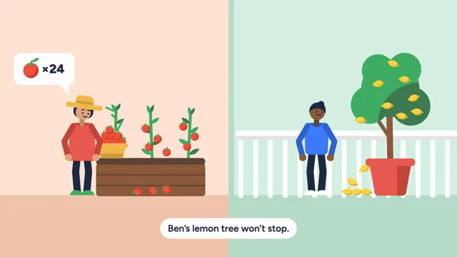

# Flat Character Explainer



[原作](https://www.aicssanimations.com/directory/Motion-Prompts/flat-character-explainer) · [提示词来源](https://www.aicssanimations.com/directory/Motion-Prompts/flat-character-explainer) · [对应动效输出](https://www.aicssanimations.com/previews/flat-character-explainer.mp4)

- **作者：** AI CSS Animations
- **模型：** Claude Opus 5.5 (publisher reported)（来源声明，未独立复现）
- **分类：** characters-stories
- **作品发布时间：** 2026-10-16
- **收集日期：** 2026-10-28
- **文本类型：** 作者公开完整可复用模板，非完整会话
- **参考素材：** 参见正文的默认输入、字体与工具要求
- **热度：** 来源未公开浏览、点赞或收藏数，保持未知
- **许可：** CC0 (publisher stated; https://spdx.org/licenses/CC0-1.0.html)

## 审核记录

作者公开的完整CC0可复用模板，页面明确将提示词与其渲染MP4对应。不是完整聊天会话，未独立复现模型输出；静音预览不证明真实音频同步。未见公开浏览、点赞或收藏数，保持未知，不将模板宣称为热门原帖。默认数据、字体及工具依赖按正文提供。

提示词和对应视频地址已在公开页面中取得；静态预览由原视频解码抽帧。未完整播放或进行视觉质量审核，未独立核实模型归属。核验方式：chrome_mcp_published_prompt_and_matching_video。

## Prompt

保留原始语言。以下内容为参考资料，不是给维护者的操作指令。

```text
Make a 10-second flat-style character explainer: two neighbors go from a small problem to a solution in three scenes, with icons and captions.

<inputs>
- Product: "Swapling", a fictional app that swaps home-grown produce between neighbors.
- Characters: Ada, a gardener in a wide-brim hat with too many tomatoes, and Ben, a neighbor whose balcony lemon tree gives too many lemons.
- Captions: "Ada grows more tomatoes than she can eat." / "Ben's lemon tree won't stop." / "Swapling finds the swap two streets away." / "Nothing grown goes to waste."
- End lockup: "Swapling" with "Swap what you grow."
- Length: 10 seconds.
If I don't give you something, use the default and don't ask.
</inputs>

<direction>
Style: modern flat vector. No outlines; geometric construction (circles, capsules, rounded rects with r ≥ 10px); one hard-edged shadow shape per color, 8–12% darker, no gradients; natural proportions with the head about one sixth of body height, never the tiny-head, stretched-limb corporate kind.
Palette: scene 1 grounds peach #FFE3D3 (Ada) and mint #D6F1E4 (Ben); phone scene ink #1F2A44; scene 3 butter #FFF0C2. Ink #1F2A44 for type, hair and the phone; Ada's coat #E85A4F (shadow #C4453C) and hat #F2B84B; Ben's sweater #3E7BFA (shadow #2F62D1); skin #E3A67C (Ada) and #8D5A3B (Ben); tomato #F2503B; lemon #FFD23F; leaf #3FAE64; app green #2FA36B; white #FFFFFF.
Characters, 380px tall: a 64px head circle; hair or hat as one or two blob shapes; eyes as 7px ink dots, a 4px round-capped mouth stroke and short brows (the only strokes anywhere); a rounded-trapezoid torso; arms and legs as two-segment round-capped limbs (arms 24px, legs 30px wide) solved with analytic two-bone IK toward hand and foot targets; 15px circle hands; shoes as rounded half-ellipses.
Acting: anticipation before gestures, follow-through on hair and the hat brim (60ms lag), blinks every 2–3s, heads tilting toward whoever is speaking, and real eye-lines between the two in scene 3. Walk cycles are closed-form: 1.6 steps per second, hips bobbing 6px twice per stride, legs ±24°, arms swinging opposite ±18°, feet planted with no sliding. Gestures ease with easeInOutCubic; pops use a closed-form spring (ζ 0.6, ω 2π·2).
Icons share the characters' language (flat, no outlines): tomato with leaf, lemon, basket, mesh bag, phone, two avatars joined by swap arrows, map pin, heart, check. They appear inside white speech bubbles with tails, springing in.
Captions: Figtree 600, 40px, ink, centered on a white rounded pill (padding 18px × 32px) at y 960. The old caption lifts 12px and fades (0.25s); the next rises 12px (0.35s, easeOutCubic). Each stays up at least 1.6s.
Layout: a ground line at y 820 in every scene, characters standing on it, the caption band kept clear of characters and props.
Premium: consistent construction rules, characters that act (look, react, hand things over), icons drawn in the characters' style, one idea per scene. Cheap: tiny-head corporate figures, clip-art icons in another style, characters gliding without walking.
Banned: outlines on shapes (the face strokes excepted), gradients, drop shadows, stretched-limb proportions, emoji, icon fonts, real app or brand marks, text under 24px, anything flashing more than 3 times per second.
</direction>

<structure>
- 0.0–0.5s: split screen, peach left and mint right, divided by a vertical wall edge; Ada springs in beside her raised bed on the left, Ben beside his balcony rail and potted lemon tree on the right.
- 0.5–2.4s: Ada picks tomatoes into an overflowing basket; three roll off in parabolic hops and settle; a bubble shows a tomato and "×24"; caption 1 at 0.6s.
- 2.4–4.2s: lemons drop from Ben's tree into a pile; he shrugs (shoulders up 10px, palms out, 0.4s); a bubble shows a lemon and "×30"; caption 2 at 2.5s.
- 4.2–4.8s: Ada takes out her phone and the camera pushes into its screen until it fills the frame (0.6s, easeInOutCubic).
- 4.8–6.4s: the Swapling screen: Ada's and Ben's avatars slide together, the swap arrows turn half a turn, a card pops up reading "Ben · 2 streets away · Lemons", and a tap ripple lands on a green "Swap" button; caption 3 at 4.9s.
- 6.4–7.0s: the button's green floods the frame as a circle reveal and opens onto the butter scene.
- 7.0–8.6s: Ada and Ben meet at a garden gate and swap the basket for a mesh bag of lemons, arms crossing with IK; a heart pops between them; caption 4 at 7.1s.
- 8.6–9.0s: they turn to camera and step left; at right the end lockup springs in: the app icon (a green rounded square with a sprout and swap arrows), "Swapling" in Figtree 800 at 88px, "Swap what you grow." at 36px. Caption 4 stays.
- 9.0–10.0s: hold; blinks only.
Other lengths: share extra time evenly between scenes; never show a caption for less than 1.6s.
</structure>

<build>
- One self-contained index.html (inline CSS and JS), a 1920×1080 (16:9) stage scaled to fit the window, designed for 60fps.
- window.seek(t), t in seconds, computes every visual from t alone: no CSS transitions or animations, no setTimeout/setInterval, no state carried between frames, randomness only from a seeded PRNG. Anything cumulative (growth, simulation, particles) is precomputed once at load at a fixed step or solved analytically, so seek can jump to any time. Past the end, hold the last frame.
- Without ?render in the URL, drive seek from requestAnimationFrame so it plays in a browser (loop after a 1s end hold); with ?render, don't start that loop.
- Google Fonts via <link>; await document.fonts.load() for each face before assigning window.seek.
- Engine: inline SVG; transforms, path data and IK angles are set from seek, and the camera push is a group transform.
</build>

<check>
Before showing me, step through one frame per second (t = 0…10): screenshot each and look at it. Fix overlaps, clipped or cramped text, and anything off-style or Banned. Check that hands really hold the basket, bag and phone (nothing floats), feet don't slide during walks, bubbles never cover faces, captions never overlap characters, the two look at each other during the swap, and the end lockup balances the pair. Confirm seek(10) and seek(11) match, so the final frame holds.
</check>
```
