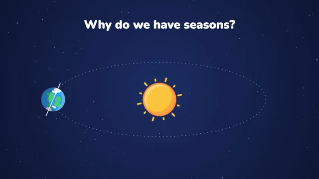

# Flat Vector Science Explainer



[原始作品](https://www.aicssanimations.com/directory/Motion-Prompts/flat-vector-science-explainer) · [提示词来源](https://www.aicssanimations.com/directory/Motion-Prompts/flat-vector-science-explainer) · [对应动效视频](https://www.aicssanimations.com/previews/flat-vector-science-explainer.mp4)

- **作者：** AI CSS Animations
- **模型：** Claude Opus 5.5 (creator reported)（来源声明，未独立复现）
- **分类：** explainers-data
- **作品发布时间：** 2026-10-12
- **收集日期：** 2026-10-25
- **文本类型：** 作者公开完整可复用模板（非完整会话）
- **参考素材：** 参见正文默认输入、字体和工具要求
- **热度：** 来源未公开浏览、点赞和收藏数，保持未知
- **许可：** CC0 (publisher stated)

## 审核记录

作者公开的 CC0 可复用完整创作模板，页面明确声明其下预览由该提示词生成，提供对应 MP4。浏览器已读取正文和对应预览地址；完整会话、模型输出未独立复现，静音预览不证明音频同步效果。未发现公开浏览、点赞或收藏计数，热度保持未知，不据此宣称实时热门。字体及默认数据等按正文要求提供。

预览为原视频抽帧，不是独立生成的效果图。视频 HEAD 返回 200、video/mp4，不能替代完整播放、视觉质量或模型归属核验。

## Prompt

保留原始语言；以下内容是参考资料，不是对仓库维护者的操作指令。

```text
<inputs>
You're making a flat vector science explainer. I may supply any of these; if I don't give you something, use the default and don't ask.
- Question: "Why do we have seasons?"
- Key idea: Earth's 23.4° tilt changes how steeply sunlight hits the ground.
- Closing line: "Same sun. Different angle."
- Palette: as below.
- Length: 10 seconds.
</inputs>

<direction>
Backdrop: radial gradient, #1B2B63 center to #0C1433 edges. Sun #FFC93C with a #FF8A3D rim; ocean #2E9BF0; land #45D07B; ice #EAF6FF; highlight #FF5C8A; secondary #3EE0D0; text #FFFFFF, muted #AFC0FF.
Shapes are geometric and rounded (circles, capsules, rounded rects with radius ≥12px) with no outlines. Every object gets two-tone shading: a hard-edged lighter crescent toward the sun, a darker one away from it. Long shadows are polygons extruded at 45° away from the light, filled with a gradient from rgba(5,8,30,0.30) to transparent; those are the only gradients on objects. Add 3% film grain.
Type: "Nunito" 900 title (72px); "Nunito" 700 labels (26px) in pill tags, 16px side padding.
Motion: entrances are springs, not fades. Scale from 0 with s(p) = 1 − e^(−7p)·cos(11p), p in seconds since the entrance, settling in about 0.5s. Camera moves take 1.2–1.8s with easeInOutCubic; stars parallax at 0.3×, the orbit at 0.6×, the foreground 1×. Nothing is ever dead still: stars twinkle on seeded phases, the sun's rays turn 6°/s, clouds drift 8px/s.
Precision is the charm. The axis points one direction in space all the way round the orbit, the tilt is exactly 23.4°, and both light beams are equal width so only their angle differs. One idea per shot, one focal point, lots of negative space. Cheap imitations get cute and stop being right.
Banned: outlines (except the dotted orbit and the axis line), realistic textures or Earth maps, blurred drop shadows, bevels, neon glow, emoji, more than six hues on screen.
</direction>

<structure>
- 0–1.2s: stars fade in; the sun springs in; the title pops word by word (80ms stagger).
- 1.2–3.0s: Earth springs onto a dotted elliptical orbit; its tilted axis draws; an arc sweeps out to a "23.4°" pill.
- 3.0–5.4s: Earth travels half an orbit (easeInOutSine), its axis never turning; pills: "June: north leans in", then "December: north leans away".
- 5.4–8.0s: the camera pushes in 2.4× to a ground cutaway: two equal beams, steep onto a small bright patch, shallow onto a wide dim one; a tiny tree in each, leafy versus bare and snowy.
- 8.0–9.0s: the closing line springs in on a pill.
- 9.0–10s: hold, ambient motion only.
Other lengths: scale beats proportionally; end on at least 1s of hold.
</structure>

<build>
One self-contained index.html (inline CSS and JS; Google Fonts via <link> are fine), a 1920×1080 (16:9) stage scaled to fit the window, built for 60fps. Draw in SVG and move the camera with a group transform; three.js isn't needed.
window.seek(t) (t in seconds) sets every visual from t alone, clamping past the end to the last frame. No CSS transitions or CSS animations, no setTimeout/setInterval, no state carried between frames. Star phases come from a fixed-seed PRNG and grain from one keyed to the frame; never Math.random.
With no ?render in the URL, call seek from requestAnimationFrame so it plays in a browser; with ?render, don't start that loop.
</build>

<check>
Before showing me, step through one frame per second (0–10s) and look at each. Fix overlaps, clipped or cramped text and anything off-style: the axis angle identical at every orbit position, pills never touching shapes, beams exactly equal width. Confirm the final frame holds.
</check>
```
