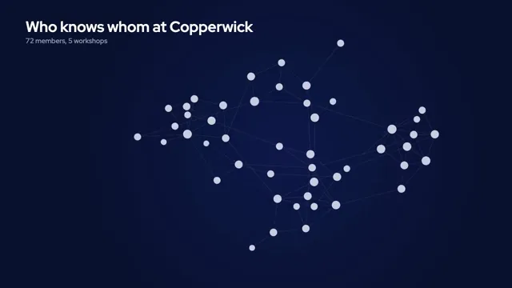

# Network Graph



[原作](https://www.aicssanimations.com/directory/Motion-Prompts/force-network-graph) · [提示词来源](https://www.aicssanimations.com/directory/Motion-Prompts/force-network-graph) · [对应动效输出](https://www.aicssanimations.com/previews/force-network-graph.mp4)

- **作者：** AI CSS Animations
- **模型：** Claude Opus 5.5 (publisher reported)（来源声明，未独立复现）
- **分类：** explainers-data
- **作品发布时间：** 2026-10-16
- **收集日期：** 2026-10-30
- **文本类型：** 作者公开完整可复用模板，非完整会话
- **参考素材：** 参见正文的默认输入、字体与工具要求
- **热度：** 来源未公开浏览、点赞或收藏数，保持未知
- **许可：** CC0 (publisher stated; https://spdx.org/licenses/CC0-1.0.html)

## 审核记录

作者公开完整CC0可复用模板，页面明确显示由该提示词渲染的对应MP4，正文通过Chrome MCP完整读取且长度一致。这是旧模板补收，不是今日发布或已验证热门；未公开热度，保持未知。静音预览不能证明音频效果或完整会话复现；默认输入、字体与工具依赖参见正文。

提示词和对应视频地址已在公开页面中取得；静态预览方式：original_video_still；原帖缩略图不等于视频播放审核。未完整播放或进行视觉质量审核，未独立核实模型归属。核验方式：chrome_mcp_published_prompt_and_matching_output。

## Prompt

保留原始语言。以下内容为参考资料，不是给维护者的操作指令。

```text
Make a 10-second force-directed network graph: 72 members of a fictional makerspace join one by one, five communities take color, and the shortest path between two members lights up.

<inputs>
- Network: Copperwick Makerspace (fictional), 72 members in five workshops: Woodshop 18, Electronics 16, Textiles 14, Ceramics 13, Print Studio 11.
- Title: "Who knows whom at Copperwick". Subtitle: "72 members, 5 workshops".
- Path: from Ottilie (Textiles) to Bram (Electronics). Readout: "Ottilie to Bram: 4 introductions".
- Length: 10 seconds.
If I don't give you something, use the default and don't ask.
</inputs>

<direction>
Data: generate the graph once at load from a seeded PRNG (mulberry32, seed 72) as a stochastic block model: two members of the same workshop are linked with probability 0.24, members of different workshops with probability 0.014; if any component is cut off, link it to the nearest hub. Choose Ottilie and Bram as a Textiles member and an Electronics member whose breadth-first-search distance is exactly 4 (re-seed if no such pair exists). The readout's number is that BFS distance, and the lit path is a BFS shortest path.
Palette: ground #0A1230 with a very soft radial lift to #10194A behind the graph's center; nodes before coloring #C7CEE0; communities Woodshop #F2A541, Electronics #4CC9F0, Textiles #F25F8B, Ceramics #8BD17C, Print Studio #B79CFF; edges 1.2px #C7CEE0 at 16%, and edges inside a community take its color at 30% once it is colored; the path #FFFFFF. Node radius 6 + 2.2·√degree px, each with a 2px ring of the ground color so edges read as passing behind.
Type: "Red Hat Display" 700 for the title (56px), 500 for the subtitle (26px), 600 for workshop and person labels (24px); "Red Hat Mono" 500 for the readout (28px) and legend counts (22px).
Layout: title top-left at x 96, baselines y 120 and 162. The graph fits a 1,100 × 740 box centered at (1060, 560). Legend bottom-left at x 96 from y 840: five rows with 14px dots, workshop names and member counts. Readout right-aligned at x 1824, baseline y 1000.
Physics is precomputed, never live: at load, simulate the whole piece at a fixed step of 1/120s and store every node's position per step; seek(t) interpolates between stored steps. Forces: springs on links (rest length 64px inside a workshop, 150px across), pairwise repulsion falling off with distance, a weak pull to the center, collision keeping circles 4px apart, and velocity damping. Each joining node reheats the system a little; after the last join it cools so the layout is completely still (under 0.3px per frame) by 8.0s.
Joining: members enter in a seeded order in which each newcomer already has a neighbor present; it spawns 24px from that neighbor and scales 0 → 1 over 0.25s on cubic-bezier(0.34, 1.56, 0.64, 1), its links drawing out from the existing ends over 0.2s.
Camera: fit the bounding box of the nodes present, averaged over the previous 0.6s (10 samples), so it eases out as the graph grows; zoom stays between 0.85× and 1.6×.
Color: each community floods from its highest-degree member outward by hop distance inside the workshop, 90ms per hop, each node crossfading from gray to its color over 0.25s.
Path: rings mark the search: every node at distance 1, then 2, 3 and 4 from Ottilie gets one thin 1.5px white ring that grows and fades once (0.4s), never repeated. The path's edges then draw in white at 3.5px, 0.22s per hop; path nodes scale to 1.25× with 3px white rings; everything else dims to 30%; a 6px white dot travels the path once (0.8s, easeInOutSine). Person labels sit on the outer side of their node, clear of edges.
The real thing is a layout with mass: nodes ease in and stop, thin edges let the structure read, and color arrives only when it means something. The cheap version is neon spaghetti: glow on everything, a label on every node, endless jitter.
Banned: glow or bloom, 3D, labels on every node, rainbow edges, jitter in the hold, nodes teleporting, rings that repeat, graph libraries, emoji, anything flashing more than 3 times per second.
</direction>

<structure>
0.0–0.6s: ground; the title and subtitle rise 12px and fade in.
0.6–4.2s: members join one by one, 50ms apart; links draw to their neighbors; the layout breathes and spreads while the camera eases out to fit.
4.2–5.4s: the layout settles; colors flood out from each hub; legend rows fade in as each community colors.
5.4–6.0s: workshop names fade in just outside each cluster, in their color.
6.0–6.6s: Ottilie and Bram ring in white with their names; the search rings ripple outward hop by hop.
6.6–7.8s: the path draws hop by hop; the rest dims to 30%; the dot travels; the readout types on at 30ms per character.
7.8–8.6s: the dimmed graph returns to 55% so the communities still read around the lit path.
8.6–10.0s: hold, perfectly still.
Other lengths: stretch the join phase first; keep the settle and the hold at least 1s each.
</structure>

<build>
One self-contained index.html, CSS and JS inline. Google Fonts via <link> are fine; no other libraries. Draw in Canvas 2D, repainting every frame from scratch, with the backing store sized from the CSS size × devicePixelRatio. Canvas won't fetch fonts itself, so the font wait matters here. Await document.fonts.load() for every face before defining window.seek. The stage is 1920×1080 (16:9), scaled to fit the window. Design for 60fps. window.seek(t), t in seconds, must compute every visual from t alone: no CSS transitions or animations, no setTimeout or setInterval, no state carried between frames, and randomness only from a seeded PRNG. The graph, the search and the whole force simulation are computed once at load at a fixed step; seek only reads them. Without ?render in the URL, drive seek from requestAnimationFrame so it plays in a browser (loop after a 1s end hold); with ?render, don't start that loop.
</build>

<check>
Before showing me, step through one frame per second: screenshot each and look at it. Fix overlaps, clipped or cramped text, accidental edge collisions, and anything off-style or Banned. Check that the lit path is a true BFS shortest path and its hop count matches the readout, no two node circles overlap after the settle, workshop and person labels clear nodes and edges, and nothing moves during the hold. Confirm seek(duration) and seek(duration + 1) match, so the final frame holds.
</check>
```
