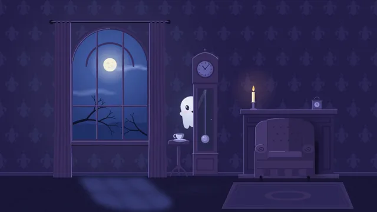

# Friendly Ghosts



[原作](https://www.aicssanimations.com/directory/Motion-Prompts/friendly-ghosts) · [提示词来源](https://www.aicssanimations.com/directory/Motion-Prompts/friendly-ghosts) · [对应动效输出](https://www.aicssanimations.com/previews/friendly-ghosts.mp4)

- **作者：** AI CSS Animations
- **模型：** Claude Opus 5.5 (publisher reported)（来源声明，未独立复现）
- **分类：** characters-stories
- **作品发布时间：** 2026-10-18
- **收集日期：** 2026-10-30
- **文本类型：** 作者公开完整可复用模板，非完整会话
- **参考素材：** 参见正文的默认输入、字体与工具要求
- **热度：** 来源未公开浏览、点赞或收藏数，保持未知
- **许可：** CC0 (publisher stated; https://spdx.org/licenses/CC0-1.0.html)

## 审核记录

作者公开完整CC0可复用模板，页面明确显示由该提示词渲染的对应MP4，正文通过Chrome MCP完整读取且长度一致。这是旧模板补收，不是今日发布或已验证热门；未公开热度，保持未知。静音预览不能证明音频效果或完整会话复现；默认输入、字体与工具依赖参见正文。

提示词和对应视频地址已在公开页面中取得；静态预览方式：original_video_still；原帖缩略图不等于视频播放审核。未完整播放或进行视觉质量审核，未独立核实模型归属。核验方式：chrome_mcp_published_prompt_and_matching_output。

## Prompt

保留原始语言。以下内容为参考资料，不是给维护者的操作指令。

```text
Make a 10-second picture-book night scene: small friendly ghosts float, peek out from behind furniture and play in a moonlit old house.

<inputs>
If I don't give you something, use the default and don't ask.
- Ghosts: Wisp, Puddle and Hush.
- Title: "Nobody's Home"
- Line: "A bedtime story in one room"
- Length: 10 seconds.
</inputs>

<direction>
- Look: a modern picture-book illustration at night: deep blue-violet shapes, one tall moonlit window, soft gradients only in the light, and small white ghosts that glow just enough to light what's near them. Cozy and playful, never scary.
- Palette: walls #241F4A with a low-contrast damask #2C2757; floor planks #1A1738 with seams #141230; moonlight #C6D6FF, falling through the window as a skewed, soft-edged patch on the floor (#3A3F7A); furniture plum #3A2F5E with lit edges #6C64A8 where the moon reaches; window sky #2A3C7A brightening to #4C66B0 around the moon; moon #F4F1DE with a soft halo; branch silhouette #13112A; ghosts #F6F8FF with shade #C9D3F2 and glow #A9BEFF; eyes and mouths #2A2552; blush #FFB7CC; one warm accent, a candle on the mantel, flame #FFC86B with a 15% glow #FF9E4A; text #EEF0FF, secondary #A9AEDB.
- The room, back to front: the back wall; a tall arched window (x 360–760, y 140–720) showing the moon, two drifting cloud wisps and a bare branch; long curtains on either side of it (x 280–360 and 760–840) that can bulge; a side table with a teacup (x 860–960, top at y 720); a grandfather clock (x 980–1110, y 260–900) whose pendulum swings on a 2.0 s period behind a glass door; a mantel and fireplace (x 1240–1700, shelf at y 560) with the candle and a carriage clock; a wingback armchair in front of the fireplace (x 1300–1600, y 600–920); a rug. The title zone at top right (x 1180–1800, y 110–270) stays plain wall.
- Ghosts, 150–190px tall: a domed head flowing into a sheet with a four-scallop hem; oval eyes 18×26 with a catchlight, a small mouth, blush, and two little arm bumps that lift from the sheet. The hem ripples with a traveling wave at 1.2 Hz; bodies bob on slow sines (1.8–2.4 s periods, ±10px); every change of direction tips the body 8–12° into the move with a 6% squash. Ghosts are 90% opaque with a pre-rendered 60px glow behind them, and each casts a soft cool pool of light (additive, 10%) onto the floor and furniture beneath it.
- Peeking is about layers: ghosts pass behind the armchair, the clock and the curtains, which are drawn in front of them. A peek slides out 40–80px with the head tilted 15° and the eyes on the camera, holds 0.4 s, and ducks back in 0.25 s on cubic-bezier(0.6, 0, 0.4, 1).
- Motion: floating paths are smooth Catmull-Rom curves through keyed points, paced with easeInOutSine; only the ducks are quick. The candle flame sways ±4° on a 1.4 s sine and its brightness never varies more than ±5%.
- Type: title in "Fraunces" (wght 700, SOFT 100, opsz 144), 96px, #EEF0FF, right-aligned with its baseline at (1800, 200); the line in "Quicksand" 600, 26px, #A9AEDB, right-aligned beneath on baseline y 250. Text rises 10px as it fades in over 0.8 s on cubic-bezier(0.22, 1, 0.36, 1).
- Premium: a believable room built in layers, ghosts that light their surroundings, and peeks timed like hide-and-seek. Cheap: white blobs on a black screen, a Halloween clip-art set, ghosts sliding at constant speed.
Banned: skulls, bats, pumpkins, cobwebs, blood, fangs, angry or scary faces, lightning, flicker, green glow, a ghost showing in front of a layer it should be hiding behind, anything flashing more than 3 times per second.
</direction>

<structure>
- 0.0–1.0s: the moonlit parlor, still but for the pendulum and the candle; a cloud wisp drifts across the moon.
- 1.0–2.4s: Wisp rises from behind the armchair, peeks at the camera and ducks back.
- 2.4–3.6s: Puddle peeks around the left edge of the grandfather clock, then the right, as if checking; the right curtain bulges at 3.2 s.
- 3.6–5.0s: Hush pops out of the curtain (which sways back and settles), and the game begins: the three chase each other around the clock, over the armchair and past the window, their light pools sliding across the floor and furniture.
- 5.0–6.4s: they meet in front of the window and circle each other, arm bumps linked, in a slow ring around the moon. At 6.0 s all three are fully in view against the window, clear of every piece of furniture.
- 6.4–7.6s: Wisp nudges the teacup on the side table; it tips, Wisp catches it and sets it back; the other two bounce twice, giggling.
- 7.6–8.6s: they drift to their final places: Wisp on the armchair's arm, Puddle in front of the clock's face, Hush half-hidden by the right curtain, all looking at the camera; the title and line rise in.
- 8.6–10.0s: hold: the ghosts' bobbing eases to rest; only the pendulum and the candle flame move.
For other lengths, stretch the chase and keep at least 1 s of hold.
</structure>

<build>
- One self-contained index.html (inline CSS and JS), a 1920×1080 (16:9) stage scaled to fit the window, designed for 60fps. No image, video, texture or model files: every shape and texture is generated in code.
- window.seek(t), t in seconds, computes every visual from t alone: no CSS transitions or CSS animations, no setTimeout/setInterval, no state carried between frames, randomness only from a seeded PRNG. Anything cumulative is solved analytically from t or precomputed once at load at a fixed step. Past the end, seek clamps to the last frame.
- Without ?render in the URL, drive seek from requestAnimationFrame so it plays in a browser (loop after a 1s end hold); with ?render, don't start that loop.
- Google Fonts via <link> are fine; await document.fonts.load() for each face before defining window.seek.
- Engine: Canvas 2D, repainting every frame from scratch, the backing store sized from CSS size × devicePixelRatio. Canvas won't fetch fonts itself, so the awaited loads matter. No other libraries.
- Paint the room once at load into separate offscreen layers (wall and window, clock, armchair, mantel, curtains) so ghosts can pass between them, and pre-render each ghost's glow sprite; each frame composites the layers in depth order, inserting each ghost at its keyed depth, then adds the light pools with 'lighter' compositing. Redraw a curtain only while it bulges. Request the Fraunces opsz, wght and SOFT axes.
</build>

<check>
Before showing me, step through one frame per second (t = 0…10): screenshot each and look at it. Fix overlaps, clipped or cramped text, and anything off-style or Banned. Check each ghost hides behind the right layer whenever it should, faces read friendly at 1280×720, light pools sit under their ghosts, the 6.0 s frame shows all three in front of the window clear of furniture, nothing flickers, and the title sits on plain wall. Confirm seek(10) and seek(11) match, so the final frame holds.
</check>
```
