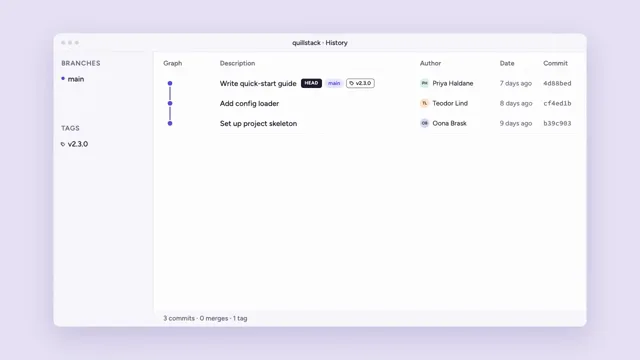

# Git Branch Graph



[原作](https://www.aicssanimations.com/directory/Motion-Prompts/git-branch-graph) · [提示词来源](https://www.aicssanimations.com/directory/Motion-Prompts/git-branch-graph) · [对应动效输出](https://www.aicssanimations.com/previews/git-branch-graph.mp4)

- **作者：** AI CSS Animations
- **模型：** Claude Opus 5.5 (publisher reported)（来源声明，未独立复现）
- **分类：** explainers-data
- **作品发布时间：** 2026-10-16
- **收集日期：** 2026-10-30
- **文本类型：** 作者公开完整可复用模板，非完整会话
- **参考素材：** 参见正文的默认输入、字体与工具要求
- **热度：** 来源未公开浏览、点赞或收藏数，保持未知
- **许可：** CC0 (publisher stated; https://spdx.org/licenses/CC0-1.0.html)

## 审核记录

作者公开完整CC0可复用模板，页面明确显示由该提示词渲染的对应MP4，正文通过Chrome MCP完整读取且长度一致。这是旧模板补收，不是今日发布或已验证热门；未公开热度，保持未知。静音预览不能证明音频效果或完整会话复现；默认输入、字体与工具依赖参见正文。

提示词和对应视频地址已在公开页面中取得；静态预览方式：original_video_still；原帖缩略图不等于视频播放审核。未完整播放或进行视觉质量审核，未独立核实模型归属。核验方式：chrome_mcp_published_prompt_and_matching_output。

## Prompt

保留原始语言。以下内容为参考资料，不是给维护者的操作指令。

```text
Make a 10-second animated commit graph for a fictional repository: a feature branch and a fix branch split off main, commits land one by one, both merge home, and release tags are cut, all mirrored in a commit list.

<inputs>
- Repository: quillstack (fictional). Window title: "quillstack · History".
- Branches and lane colors: main #5B4BDB, feature/search #F08C00, fix/login-timeout #E03174.
- Commits, oldest first (branch · message · author · date · tag):
  1. main · Set up project skeleton · Oona Brask · 9 days ago
  2. main · Add config loader · Teodor Lind · 8 days ago
  3. main · Write quick-start guide · Priya Haldane · 7 days ago · v2.3.0
  4. feature/search, from 3 · Add search index · Teodor Lind · 6 days ago
  5. fix/login-timeout, from 3 · Extend session timeout to 30 min · Oona Brask · 5 days ago
  6. feature/search · Rank results by recency · Teodor Lind · 4 days ago
  7. main, merging 5 · Merge fix/login-timeout · Oona Brask · 3 days ago · v2.3.1
  8. feature/search · Add search shortcut · Priya Haldane · 2 days ago
  9. main · Update changelog · Priya Haldane · yesterday
  10. main, merging 8 · Merge feature/search · Teodor Lind · 3 hours ago
  11. main · Release 2.4.0 · Priya Haldane · just now · v2.4.0
- Footer: "11 commits · 2 merges · 3 tags".
- Length: 10 seconds.
If I don't give you something, use the default and don't ask.
</inputs>

<direction>
Palette: backdrop lilac #E6E1F4; window #FFFFFF with a 1px #DEDAEA border, an 18px radius and one soft shadow (0 30px 80px rgba(46,30,110,0.16)); toolbar and sidebar #F8F7FC; text #1E1B2E; muted #6E6A80; row dividers #F0EEF6. Lanes in their given colors; branch pills are the lane color at 14% with lane-colored text; tag pills have a 1px #1E1B2E outline and a small drawn tag shape. Avatars are 28px circles with initials, tinted #D9D3F5, #FFE2C2 and #D6F0E4, one per author.
Type: "Figtree" for the UI: window title 500, 20px; column headers 600, 20px, muted; messages 500, 22px; authors and dates 400, 20px; sidebar 500, 22px; footer 500, 20px. Hashes in "Source Code Pro" 500, 20px, muted: seven lowercase hex characters per commit from a seeded PRNG.
Layout: window at x 160–1760, y 100–980; a 56px toolbar with three 12px #D9D5E4 dots and the centered title. Sidebar 300px wide with "Branches" and "Tags" sections (20px uppercase muted headers, 44px rows). Main panel from x 460: column headers at baseline y 196 ("Graph", "Description", "Author", "Date", "Commit"); rows from y 220 at a 60px pitch. Graph lanes at x 510 (main), 550 (feature/search) and 590 (fix/login-timeout); messages from x 660 with branch and tag pills after them; author column at x 1260, date at x 1500, hash at x 1630. Footer bar inside the window at y 932–980.
Graph rules: newest commit on top; lines 3px in the lane color. Between rows an edge runs straight down its lane; a branch leaves its parent dot on a smooth S-curve that reaches its lane within half a row; a merge enters the main dot on the same S-curve from half a row below. No edge ever passes through a dot or under text. Dots are 14px on main and 12px elsewhere, each with a 3px white ring; merge commits are rings (3px lane color, white center).
Motion: the history builds from empty, and commit n lands at 0.8 + 0.75·(n − 1) seconds. As it lands, the older rows slide down one row as a single block (0.35s, cubic-bezier(0.2, 0, 0, 1)); the new dot pops in (scale 0 → 1, 0.25s, cubic-bezier(0.34, 1.56, 0.64, 1)); its edge to its parent draws upward (0.3s); its message, author and date slide in 16px from the left while fading in (0.3s); its hash types on at 25ms per character. A branch pill rides on its branch's newest commit. On a merge, the merge edge draws from the branch head into the new dot (0.35s), that branch's pill fades, and the sidebar marks the branch "merged" and dims it to 50%. A tag pill stamps in (scale 1.15 → 1, 0.2s) 0.15s after its commit lands and joins the sidebar's tag list. Sidebar branch rows appear when their branch's first commit lands.
The real thing feels like a well-made desktop client: lanes that never cross a dot, consistent curves, rows aligned to the pixel that move as one. The cheap version is a neon subway map with random dots and a terminal font for everything.
Banned: edges through dots or text, lanes changing x, glow, gradients (the window shadow aside), real product names or logos, emoji, rows jumping without motion, anything flashing more than 3 times per second.
</direction>

<structure>
0.0–0.8s: the backdrop, then the window rises 20px and fades in with an empty history, the column headers and the sidebar showing only "main".
0.8, 1.55, 2.3s: commits 1–3 land on main; v2.3.0 stamps on commit 3.
3.05s: commit 4 opens feature/search; 3.8s: commit 5 opens fix/login-timeout; each new lane and sidebar row arrives with its first commit.
4.55s: commit 6 on feature/search. 5.3s: commit 7 merges the fix into main; v2.3.1 stamps in.
6.05s: commit 8 on feature/search. 6.8s: commit 9 on main.
7.55s: commit 10 merges feature/search into main. 8.3s: commit 11, "Release 2.4.0", lands on top with v2.4.0; the main pill and a "HEAD" marker sit on it.
8.6–9.0s: the footer, which has been counting along, settles on "11 commits · 2 merges · 3 tags".
9.0–10.0s: hold.
For other lengths, scale the gap between commits; keep each landing's motions at their own speed and the hold at least 1s.
</structure>

<build>
One self-contained index.html, CSS and JS inline. Google Fonts via <link> are fine; no other libraries. Use absolutely positioned elements, setting transforms, sizes, clip-paths, text and opacity from seek. Await document.fonts.load() for every face before defining window.seek. The stage is 1920×1080 (16:9), scaled to fit the window. Design for 60fps. window.seek(t), t in seconds, must compute every visual from t alone: no CSS transitions or animations, no setTimeout or setInterval, no state carried between frames, and randomness only from a seeded PRNG. Draw the graph lanes in one inline SVG beside the rows, its paths and dots set from seek. Without ?render in the URL, drive seek from requestAnimationFrame so it plays in a browser (loop after a 1s end hold); with ?render, don't start that loop.
</build>

<check>
Before showing me, step through one frame per second: screenshot each and look at it. Fix overlaps, clipped or cramped text, accidental edge collisions, and anything off-style or Banned. Check that every edge runs in its lane and curves only between rows, no edge crosses a dot or text, rows stay aligned to the 60px pitch while sliding, pills never collide with the author column, and the footer matches the history. Confirm seek(duration) and seek(duration + 1) match, so the final frame holds.
</check>
```
