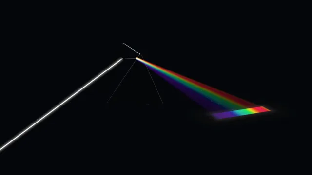

# Glass Prism Dispersion



[原作](https://www.aicssanimations.com/directory/Motion-Prompts/glass-prism-dispersion) · [提示词来源](https://www.aicssanimations.com/directory/Motion-Prompts/glass-prism-dispersion) · [对应动效输出](https://www.aicssanimations.com/previews/glass-prism-dispersion.mp4)

- **作者：** AI CSS Animations
- **模型：** Claude Opus 5.5 (publisher reported)（来源声明，未独立复现）
- **分类：** 3d-simulations
- **作品发布时间：** 2026-10-16
- **收集日期：** 2026-10-28
- **文本类型：** 作者公开完整可复用模板，非完整会话
- **参考素材：** 参见正文的默认输入、字体与工具要求
- **热度：** 来源未公开浏览、点赞或收藏数，保持未知
- **许可：** CC0 (publisher stated; https://spdx.org/licenses/CC0-1.0.html)

## 审核记录

作者公开的完整CC0可复用模板，页面明确将提示词与其渲染MP4对应。不是完整聊天会话，未独立复现模型输出；静音预览不证明真实音频同步。未见公开浏览、点赞或收藏数，保持未知，不将模板宣称为热门原帖。默认数据、字体及工具依赖按正文提供。

提示词和对应视频地址已在公开页面中取得；静态预览由原视频解码抽帧。未完整播放或进行视觉质量审核，未独立核实模型归属。核验方式：chrome_mcp_published_prompt_and_matching_video。

## Prompt

保留原始语言。以下内容为参考资料，不是给维护者的操作指令。

```text
Make a 10-second glass prism film: a white beam strikes a slowly turning prism and fans into a spectrum that paints the floor.

<inputs>
- Brand: Aldane Optics.
- Title: "Every color was already in the light."
- Labels at the band's ends: "700 nm" and "400 nm".
- Length: 10 seconds.
If I don't give you something, use the default and don't ask.
</inputs>

<direction>
Set: background #06070A; a matte charcoal floor #141519 lit only by the beams, melting into black. Text #EDEDEA, labels #8B8F99.
Prism: equilateral, apex up, floating above the floor, long axis 20° off the camera axis, bevelled edges catching thin lines of light. MeshPhysicalMaterial: transmission 1, ior 1.7, thickness 1.2, roughness 0.02, lit by an environment baked once from a black room with two strip lights.
Physics is the point: trace light through the cross-section with Snell's law at both faces, per wavelength, n(λ) = 1.62 + 32000/λ² (λ in nm; exaggerated so the fan reads): 48 rays from 400 to 700 nm, violet bent most, no total internal reflection. Color each ray from its wavelength (CIE approximation).
Beams: a slit of light with a white core and soft halo, a pale wedge inside the glass, then 48 additive ribbons drawn after the glass, dimming with distance. The floor shader paints the band where rays land, red farthest from the prism. Seeded motes glint only inside beams.
Camera: fov 32, 18° above the floor, pushing in 5%.
Layout: prism near (820, 470); beam enters from the left edge near y 330; band from x 1120 to 1720 near y 800. Title at x 120, baseline y 960, Red Hat Display 400, 52px; brand above in Red Hat Display 500, 22px, uppercase, tracking 0.24em; labels in Red Hat Mono 400, 22px, on 1px leaders at the band's ends.
Motion is slow and exact: the beam draws in over 0.6s on cubic-bezier(0.65, 0, 0.35, 1); the prism turns on one easeInOutSine curve and the fan moves only because of it; type rises 16px over 0.8s on cubic-bezier(0.22, 1, 0.36, 1).
Premium is physics you could check: violet bent most, a fan widening with distance, one clean band in darkness. Cheap is a rainbow gradient and a lens flare.
Banned: color not computed from wavelengths, red bending more than violet, lens flares, bloom, colored ambient light, anything flashing more than 3 times per second.
</direction>

<structure>
- 0.0–1.0s: darkness; the prism's edges fade up as thin cool lines.
- 1.0–1.8s: the white beam draws in from the left and strikes the left face.
- 1.8–2.8s: the wedge crosses the glass; the fan leaves the right face and the band lights across the floor.
- 2.8–6.2s: the prism turns −7° → +7° around minimum deviation; the band slides and breathes.
- 6.2–7.2s: the prism eases to rest; leaders draw and labels fade in.
- 7.2–8.4s: brand, then title 0.3s later, rise in at bottom-left.
- 8.4–10s: hold; only the motes drift.
Other lengths: scale the turn first; keep at least 1.2s of hold.
</structure>

<build>
One self-contained index.html, inline CSS and JS, on a 1920×1080 (16:9) stage scaled to fit the window, built for 60fps. Google Fonts via <link>, awaited with document.fonts.load() before seek exists.
window.seek(t) sets every visual from t alone: no CSS transitions or animations, no setTimeout/setInterval, no state carried between frames, randomness only from a seeded PRNG. The ray trace runs fresh in every seek from the prism's angle.
Without ?render in the URL, drive seek from requestAnimationFrame; with ?render, don't start that loop.
three.js as an ES module pinned to three@0.160.0 via a jsDelivr import map (`three`, `three/addons/`); preserveDrawingBuffer: true; one render per seek. No image, model or typeface files beyond Google Fonts.
</build>

<check>
Before showing me, step through one frame per second (0–10s) and look at each. Fix overlaps, clipped or cramped text and anything off-style or Banned. Look for violet not landing nearest the prism, the band leaving the floor or frame, white-out where beams overlap, labels off the band's ends. Confirm the final frame holds.
</check>
```
