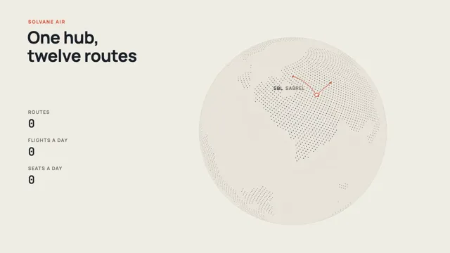

# Globe Flight Paths



[原作](https://www.aicssanimations.com/directory/Motion-Prompts/globe-flight-arcs) · [提示词来源](https://www.aicssanimations.com/directory/Motion-Prompts/globe-flight-arcs) · [对应动效输出](https://www.aicssanimations.com/previews/globe-flight-arcs.mp4)

- **作者：** AI CSS Animations
- **模型：** Claude Opus 5.5 (publisher reported)（来源声明，未独立复现）
- **分类：** 3d-simulations
- **作品发布时间：** 2026-10-16
- **收集日期：** 2026-10-30
- **文本类型：** 作者公开完整可复用模板，非完整会话
- **参考素材：** 参见正文的默认输入、字体与工具要求
- **热度：** 来源未公开浏览、点赞或收藏数，保持未知
- **许可：** CC0 (publisher stated; https://spdx.org/licenses/CC0-1.0.html)

## 审核记录

作者公开完整CC0可复用模板，页面明确显示由该提示词渲染的对应MP4，正文通过Chrome MCP完整读取且长度一致。这是旧模板补收，不是今日发布或已验证热门；未公开热度，保持未知。静音预览不能证明音频效果或完整会话复现；默认输入、字体与工具依赖参见正文。

提示词和对应视频地址已在公开页面中取得；静态预览方式：original_video_still；原帖缩略图不等于视频播放审核。未完整播放或进行视觉质量审核，未独立核实模型归属。核验方式：chrome_mcp_published_prompt_and_matching_output。

## Prompt

保留原始语言。以下内容为参考资料，不是给维护者的操作指令。

```text
Make a 10-second dotted-globe animation: flight arcs rise between cities while route counters tick up.

<inputs>
If I don't give you something, use the default and don't ask.
- Airline: Solvane Air (fictional). Hub: Sabrel.
- Title: "One hub, twelve routes"
- Closing line: "Daily from Sabrel from 1 March."
- Cities (name, code, fictional latitude and longitude): Sabrel SBL 38, 12 · Ombrine OMB 52, −8 · Kaminor KMN 47, 41 · Lunetta LNT 18, 33 · Tavolin TVL 4, 58 · Okkara OKR −22, 22 · Corvessa CVS 24, −20 · Pellacre PLC 61, 24.
- Routes (flights a day, seats a day): SBL–OMB 12, 2,160 · SBL–KMN 10, 1,800 · SBL–LNT 8, 1,440 · SBL–TVL 6, 1,320 · SBL–OKR 4, 1,160 · SBL–CVS 9, 1,620 · SBL–PLC 7, 1,260 · OMB–KMN 6, 1,080 · LNT–TVL 5, 900 · OKR–CVS 4, 880 · PLC–OMB 8, 1,440 · KMN–LNT 7, 1,260. Totals: 12 routes, 86 flights, 16,320 seats a day.
- Length: 10 seconds.
</inputs>

<direction>
- Palette: paper #F1EEE6; globe body #E8E4DA with a 1px #D5CFC2 limb; land dots #27313D; ocean dots #CEC7B7; hub routes vermilion #E4472B; point-to-point routes cobalt #2B57C2; city markers white with a 2.5px ring in their route color; text #1C222B, secondary #6A675F.
- The globe is a fictional planet, so no real coastlines: sample the sphere with a Fibonacci lattice of 14,000 points; land is wherever seeded 3D fBm noise (4 octaves) plus a soft bump under every city passes a threshold, giving about 32% land in a few continents with ragged coasts. Land dots 3.4px, ocean dots 1.6px; both shrink and fade toward the limb (size × (0.45 + 0.55·z)) so the sphere reads round without shading. Only the front hemisphere is drawn.
- Projection: orthographic, globe radius 400px, centered at (1250, 560), tilted 16° toward the viewer, turning 7°/s about its own axis and easing to a stop at 7.6 s with longitude 20° facing the camera, so the whole network sits front and center.
- Arcs: great-circle paths raised off the surface by 0.25 × (angular distance ÷ 90°) × sin(πs) of the radius, sampled every 1° and projected each frame; any arc point behind the globe's disc is hidden. Each flight draws its arc from origin to destination over 1.3 s (easeInOutCubic), led by a 7px head dot with a short soft tail; the arc then stays as a 2px line at 85% opacity. On landing, the city marker springs to 1.25× and back and a ring grows to 28px, fading over 0.5 s.
- Counters (left column): Routes, Flights a day and Seats a day in JetBrains Mono 500, 48px, tabular figures, each under a 20px uppercase label. Each landing adds that route's numbers with an odometer roll (digits slide vertically, 0.35 s, easeOutCubic). The totals must land exactly on 12, 86 and 16,320.
- Type: kicker "SOLVANE AIR" in Manrope 700, 20px, tracked 0.16em, vermilion; title Manrope 700, 72px, two lines at most, top-left at (120, 120); city labels Manrope 600, 20px, uppercase, tracked 0.08em, the code in ink and the city name in secondary beside it, set on the side away from the globe's center and fading near the limb; closing line Manrope 500, 30px, below the counters.
- Layout: the text column spans x 120–680 with counters stacked from y 470 at 120px intervals; the globe and its labels stay right of x 760.
- Easing: entrances rise 14px over 0.5 s on cubic-bezier(0.22, 1, 0.36, 1); nothing bounces except the landing spring (at most 10% overshoot).
- Premium: an editorial, print-like globe with crisp dots, two route colors that mean something, numbers that add up. Cheap: neon arcs on a black globe, glow, every dot the same size.
Banned: real coastlines or real city names, glow or bloom, black backgrounds, airplane icons, flat map projections, a third route color, labels overlapping each other or a flight's head, anything flashing more than 3 times per second.
</direction>

<structure>
- 0.0–1.2s: the globe forms as dots scale in from the view center outward in a 0.8 s ripple; it is already turning.
- 1.2–2.0s: the kicker and title rise in; the hub marker appears with a ring; the counters appear at 0.
- 2.0–6.0s: the twelve flights launch in table order, 0.36 s apart; each lands 1.3 s later and adds to the counters; a city's marker and label appear when it is first reached.
- 6.0–7.6s: the last flights land; the rotation eases to a stop with the network centered.
- 7.6–8.6s: the closing line rises in under the counters.
- 8.6–10.0s: hold.
For other lengths, change the launch spacing, keep each flight at 1.3 s and keep at least 1 s of hold.
</structure>

<build>
- One self-contained index.html (inline CSS and JS), a 1920×1080 (16:9) stage scaled to fit the window, designed for 60fps. No image, video, texture or model files: every shape and texture is generated in code.
- window.seek(t), t in seconds, computes every visual from t alone: no CSS transitions or CSS animations, no setTimeout/setInterval, no state carried between frames, randomness only from a seeded PRNG. Anything cumulative is solved analytically from t or precomputed once at load at a fixed step. Past the end, seek clamps to the last frame.
- Without ?render in the URL, drive seek from requestAnimationFrame so it plays in a browser (loop after a 1s end hold); with ?render, don't start that loop.
- Google Fonts via <link> are fine; await document.fonts.load() for each face before defining window.seek.
- Engine: Canvas 2D, repainting every frame from scratch, the backing store sized from CSS size × devicePixelRatio. Canvas won't fetch fonts itself, so the awaited loads matter.
- The dot lattice and land mask are computed once at load; every frame rotates and projects them fresh, and counters are sums over the flights landed by t.
</build>

<check>
Before showing me, step through one frame per second (t = 0…10): screenshot each and look at it. Fix overlaps, clipped or cramped text, and anything off-style or Banned. Check every arc is hidden where it passes behind the globe and never dips below the surface, the counters read exactly 12, 86 and 16,320 at the end, and labels stay clear of each other and of the text column. Confirm seek(10) and seek(11) match, so the final frame holds.
</check>
```
