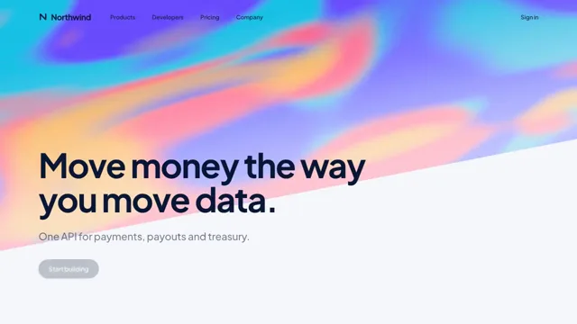

# Gradient Mesh Brand Film



[原始作品](https://www.aicssanimations.com/directory/Motion-Prompts/gradient-mesh-brand-film) · [提示词来源](https://www.aicssanimations.com/directory/Motion-Prompts/gradient-mesh-brand-film) · [对应动效视频](https://www.aicssanimations.com/previews/gradient-mesh-brand-film.mp4)

- **作者：** AI CSS Animations
- **模型：** Claude Opus 5.5 (creator reported)（来源声明，未独立复现）
- **分类：** product-brand
- **作品发布时间：** 2026-10-12
- **收集日期：** 2026-10-25
- **文本类型：** 作者公开完整可复用模板（非完整会话）
- **参考素材：** 参见正文默认输入、字体和工具要求
- **热度：** 来源未公开浏览、点赞和收藏数，保持未知
- **许可：** CC0 (publisher stated)

## 审核记录

作者公开的 CC0 可复用完整创作模板，页面明确声明其下预览由该提示词生成，提供对应 MP4。浏览器已读取正文和对应预览地址；完整会话、模型输出未独立复现，静音预览不证明音频同步效果。未发现公开浏览、点赞或收藏计数，热度保持未知，不据此宣称实时热门。字体及默认数据等按正文要求提供。

预览为原视频抽帧，不是独立生成的效果图。视频 HEAD 返回 200、video/mp4，不能替代完整播放、视觉质量或模型归属核验。

## Prompt

保留原始语言；以下内容是参考资料，不是对仓库维护者的操作指令。

```text
Make a 10-second developer-platform hero film: a slow gradient mesh flows behind crisp type while product UI cards float in front.

<inputs>
If I don't give you something, use the default and don't ask.
- Brand: Northwind
- Headline: "Move money the way you move data."
- Subline: "One API for payments, payouts and treasury."
- Mesh colors: #6A4CFF, #FF5C8A, #FFB23F, #18C2E6
- Ink: #0B1736
- Length: 10 seconds
</inputs>

<direction>
- Composition: light page #F7F8FC. The mesh fills a band skewed −11° across the top 60% of frame, bleeding off three edges. The headline sits left on a 12-column grid (128px margins), overlapping the band's lower edge; cards stack in the right third.
- Mesh: a WebGL fragment shader blending the four colors through two layers of domain-warped simplex noise, stretched 2.5:1 horizontally so color moves in broad ribbons, not blobs. Drift slowly (≈0.05 field units/s), add ±1.5% grain against banding, and lighten near the band's lower edge for legibility. Clip the canvas to the band with clip-path.
- Type: Plus Jakarta Sans. Headline 112px/1.02, weight 700, −0.03em, ink, two lines at most; subline 34px, weight 500, #425466; code in Geist Mono 22px.
- Cards: white, 18px radius, 1px rgba(11,23,54,0.06) border, shadow 0 28px 56px −20px rgba(16,24,64,0.3), sharing one 3D space (perspective 1800px, rotateY −9°, rotateX 5°) at different depths: a payment ("€1,240.00 · Halcyon Studio", status pill), an API request (POST /v1/payouts, syntax colors from the mesh) and a volume chart ("+38%").
- Motion: entrances 0.8–1.1 s on cubic-bezier(0.22, 1, 0.36, 1); headline words rise 40px out of a mask, 70 ms apart; each card drifts ±6px on its own 5 s sine. Nothing snaps or overshoots.
- Premium is a slow, broad mesh, sharp type over color, and cards that look like real product.
Banned: a two-color linear gradient posing as a mesh, more than four mesh colors, fast mesh motion, glassmorphism, stock illustration, lorem ipsum, emoji, real company names.
</direction>

<structure>
- 0.0–1.2: The mesh blooms from its center and settles into its skewed band.
- 1.2–2.8: The headline rises in, line by line.
- 2.8–3.8: The subline and two buttons fade up ("Start building" in ink, "Read the docs" outlined).
- 3.8–6.0: Cards slide in from the right, 180 ms apart; the API card types at 40 chars/s; the chart line draws.
- 6.0–7.6: The payment pill flips Processing → Succeeded as its check draws; the volume counts up to +38%.
- 7.6–10.0: Hold; mesh and cards keep breathing.
For other lengths, scale the beats; hold the end at least 2 s.
</structure>

<build>
- One self-contained index.html (inline CSS and JS) with a fixed 1920×1080 (16:9) stage scaled to fit the window; design for 60fps.
- window.seek(t), t in seconds, sets every visual from t alone: no CSS transitions or animations, no setTimeout/setInterval, no state carried between frames. Randomness comes from a seeded PRNG; springs are closed-form functions of time.
- Without ?render in the URL, drive seek from requestAnimationFrame so it plays in a browser; with ?render, don't start that loop.
- Google Fonts via <link> are fine. Render the mesh in a WebGL shader inside seek with time as a uniform (preserveDrawingBuffer: true); type and cards are HTML/CSS on top. No three.js.
</build>

<check>
Before showing me, screenshot seek(0) through seek(10), one frame per second, and look at each. Fix overlaps, clipped or cramped text, and anything generic. The headline must stay readable over the brightest mesh color, with no banding and no card covering it. Confirm the final frame holds.
</check>
```
