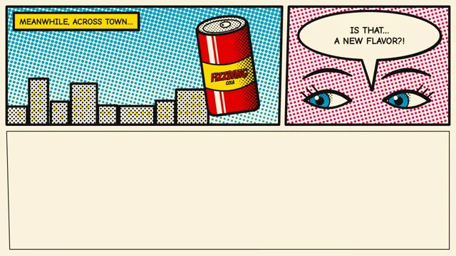

# Halftone Pop Art



[原作](https://www.aicssanimations.com/directory/Motion-Prompts/halftone-pop-art) · [提示词来源](https://www.aicssanimations.com/directory/Motion-Prompts/halftone-pop-art) · [对应动效输出](https://www.aicssanimations.com/previews/halftone-pop-art.mp4)

- **作者：** AI CSS Animations
- **模型：** Claude Opus 5.5 (publisher reported)（来源声明，未独立复现）
- **分类：** motion-studies
- **作品发布时间：** 2026-10-12
- **收集日期：** 2026-10-30
- **文本类型：** 作者公开完整可复用模板，非完整会话
- **参考素材：** 参见正文的默认输入、字体与工具要求
- **热度：** 来源未公开浏览、点赞或收藏数，保持未知
- **许可：** CC0 (publisher stated; https://spdx.org/licenses/CC0-1.0.html)

## 审核记录

作者公开完整CC0可复用模板，页面明确显示由该提示词渲染的对应MP4，正文通过Chrome MCP完整读取且长度一致。这是旧模板补收，不是今日发布或已验证热门；未公开热度，保持未知。静音预览不能证明音频效果或完整会话复现；默认输入、字体与工具依赖参见正文。

提示词和对应视频地址已在公开页面中取得；静态预览方式：original_video_still；原帖缩略图不等于视频播放审核。未完整播放或进行视觉质量审核，未独立核实模型归属。核验方式：chrome_mcp_published_prompt_and_matching_output。

## Prompt

保留原始语言。以下内容为参考资料，不是给维护者的操作指令。

```text
<inputs>
If I don't give you something, use the default and don't ask.
- Brand: default "Fizzbang Cola"
- Burst word: default "POW!"
- Caption box: default "MEANWHILE, ACROSS TOWN…"
- Speech bubble: default "IS THAT… A NEW FLAVOR?!"
- Tagline: default "Flavor with a bang."
- Length: default 10 seconds
</inputs>

<direction>
A newsprint comic page celebrated the way pop artists did: blown-up dots, fat keylines, flat process color.

Inks: cyan #00A8E8, magenta #E6007E, yellow #FFE600, black #141414, on newsprint #FBF3DC. Secondary colors come only from overprinting with 'multiply' (red = magenta over yellow).

Halftone: tone comes only from dot size. Ben-Day dots on rotated grids (cyan 15°, magenta 75°, yellow 0°, black 45°), pitch 14–18 px, radius mapped from tone. Misregister cyan 3 px right and magenta 2 px down.

Line: 10 px black keylines, round joins; 28 px gutters; panel borders skewed 1–2° on one edge, as if hand-ruled.

Type: Bangers for sound effects and the logo; Comic Neue 700 caps for captions and speech, 34–40 px, leading 1.1. Captions in yellow keylined boxes; speech in white ovals with tails.

Drawing: a flat soda can (rounded body, elliptical top, branded label band), speed lines, a 14-point jagged burst.

Motion: hold, slam, hold. Panels slam in over 0.25–0.35 s with easeOutBack (8–12% overshoot). The burst scales 0 → 1.15 → 1.0 in 0.35 s with a ±4° wobble settling in 0.4 s; on impact the page shakes 8 px, decaying over 0.3 s. Dot fields wipe in by growing radius along a direction over 0.5 s. Shadows are hard 6 px print offsets. The speech bubble holds at least 1.4 s.

Authentic: visible dots, misregistration, overprint mixing; dots that blur when scaled read cheap.

Banned: gradients, soft shadows, glow, Comic Sans, photo textures, full-frame flashes, repeated shakes, flashing more than 3 times per second.
</direction>

<structure>
Default 10 s:
- 0.0–0.5: blank newsprint; gutters ink in.
- 0.5–2.2: panel 1 (wide, top left) slams in: a cyan dot sky wipes in, the can at right, the caption box drops in.
- 2.2–3.8: panel 2 (top right) drops from above; the speech bubble pops in 0.2 s; hold.
- 3.8–6.0: panel 3 (full-width bottom) slams up with magenta radial dots and speed lines behind the can; at 4.4 the burst word hits, with shake.
- 6.0–7.4: the camera pushes into panel 3 until the dots read big.
- 7.4–8.4: cut to the end card: Bangers logo, yellow fill, black keyline, cyan offset; tagline caption below.
- 8.4–10.0: hold; still from 8.8.

Other lengths: keep slam speeds, scale the holds.
</structure>

<build>
- One self-contained index.html, no libraries (three.js from a CDN only when a style truly needs 3D); a 1920×1080 (16:9) stage scaled to fit the window; designed for 60fps.
- window.seek(t), t in seconds, computes every visual from t alone: no CSS transitions or animations, no setTimeout/setInterval, no state carried between frames. Shake offsets come from a seeded PRNG keyed to the frame.
- No ?render in the URL: drive seek from requestAnimationFrame so it plays in a browser. With ?render: don't start that loop.
- Google Fonts via <link>; await document.fonts.load() for each face before assigning window.seek.
- Canvas 2D, redrawn every seek; on the push-in, redraw dots and lines at the new scale rather than scaling a bitmap.
</build>

<check>
Before showing me, step through one frame per second and look at each. Fix overlaps, clipped or cramped text and anything off-style. Check speech text has padding inside its oval. Confirm the final frame holds.
</check>
```
