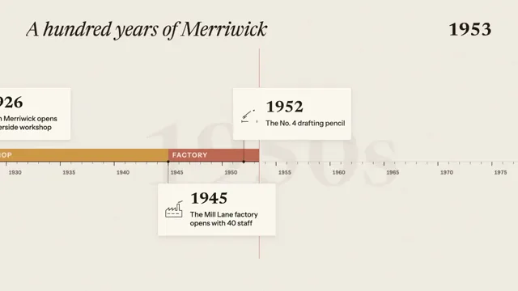

# History Timeline



[原作](https://www.aicssanimations.com/directory/Motion-Prompts/history-timeline) · [提示词来源](https://www.aicssanimations.com/directory/Motion-Prompts/history-timeline) · [对应动效输出](https://www.aicssanimations.com/previews/history-timeline.mp4)

- **作者：** AI CSS Animations
- **模型：** Claude Opus 5.5 (publisher reported)（来源声明，未独立复现）
- **分类：** explainers-data
- **作品发布时间：** 2026-10-16
- **收集日期：** 2026-10-30
- **文本类型：** 作者公开完整可复用模板，非完整会话
- **参考素材：** 参见正文的默认输入、字体与工具要求
- **热度：** 来源未公开浏览、点赞或收藏数，保持未知
- **许可：** CC0 (publisher stated; https://spdx.org/licenses/CC0-1.0.html)

## 审核记录

作者公开完整CC0可复用模板，页面明确显示由该提示词渲染的对应MP4，正文通过Chrome MCP完整读取且长度一致。这是旧模板补收，不是今日发布或已验证热门；未公开热度，保持未知。静音预览不能证明音频效果或完整会话复现；默认输入、字体与工具依赖参见正文。

提示词和对应视频地址已在公开页面中取得；静态预览方式：original_video_still；原帖缩略图不等于视频播放审核。未完整播放或进行视觉质量审核，未独立核实模型归属。核验方式：chrome_mcp_published_prompt_and_matching_output。

## Prompt

保留原始语言。以下内容为参考资料，不是给维护者的操作指令。

```text
Make a 10-second history timeline for a fictional company: the camera pans along a century of era bands and event cards, then zooms out to show the whole story at once.

<inputs>
- Company: Merriwick Pencil Co. (fictional). Title: "A hundred years of Merriwick".
- Eras: Workshop 1926–1945, Factory 1945–1968, Color 1968–1990, Design 1990–2010, Studio 2010–2026.
- Events, as year, card text and short label: 1926, "Edith Merriwick opens a riverside workshop", Workshop opens; 1945, "The Mill Lane factory opens with 40 staff", Factory opens; 1952, "The No. 4 drafting pencil", No. 4 pencil; 1968, "A 24-color set launches", 24 colors; 1979, "The barrel turns hexagonal for grip", Hexagon barrel; 1990, "One million pencils a month", 1M a month; 2014, "Barrels move to reclaimed cedar", Reclaimed cedar; 2026, "A hundred years, still sharpening", 100 years.
- Length: 10 seconds.
If I don't give you something, use the default and don't ask.
</inputs>

<direction>
Palette: paper #F1ECE2 with a faint seeded fiber grain at 3%; ink #1F1B16; muted #6E665B; hairlines #CFC6B6; cards #FBF8F2 with a 1px #DDD4C4 border, 6px radius and a 0 8px 20px rgba(31,27,22,0.08) shadow; era colors ochre #C98B2B, brick #B5523B, teal #2F7F7A, slate #3E5C8A, plum #7A4E7E; playhead #D0442C.
Type: Newsreader 400 italic for the title (72px) and 600 for years (card years 56px, the year counter 64px, lining tabular figures); Instrument Sans 600 for era names (24px, uppercase, tracked 0.12em), 500 for card text (26px, two lines at most), and 600 for axis labels and overview chips (20–22px).
World: a strictly linear scale of 40px per year from 1926 to 2026 (4,000px), in a world layer the camera moves. The axis is a 2px ink line at y 600, with a dotted lead-in before 1926. Era bands sit on top of it, 48px tall, in their colors at 85%, names reversed out in paper color. Ticks hang below: 1px for each year (8px long), 2px every five years (14px), decade labels at y 640. Behind everything, giant decade numerals ("1930s" and so on, Newsreader 600, 320px, ink at 5%) move at 0.6× the camera's speed for depth.
Cards: 440×196, alternating above the axis (bottom edge at y 520: 1926, 1952, 1979, 2014) and below it (top edge at y 680: 1945, 1968, 1990, 2026), each with its left edge 40px left of its year. Each hangs from a 10px ink dot on the axis by a 1px leader and carries a 72px line illustration on its left, drawn in code with 2px ink strokes: a workbench, a factory roofline, a drafting pencil, a fan of pencils, a hexagonal cross-section, a counter dial, a cedar log end, a sharpened pencil.
Camera: one continuous pan that brings 1926 through 2026 under a fixed playhead at x 960 (1px #D0442C, from y 180 to 960), its speed dipping to 40% within ±0.3s of each event. A year counter at the top right rolls through the year under the playhead.
Card build, triggered when the playhead is 240px before its year: the dot pops (scale 0 → 1, 0.2s), the leader draws up or down from the axis (0.25s), the card unfolds from its axis side through a clip (0.35s, cubic-bezier(0.2, 0.8, 0.2, 1)), year and text rise 12px with a 60ms stagger, and the illustration draws on via stroke-dashoffset (0.5s). Built cards stay.
Zoom-out: the time scale compresses (only x positions change; heights and type keep their size) until the century spans x 96–1824 at 17.28px per year. Cards fade out over 0.3s and are replaced by overview chips (the year in 600 plus the short label, 22px) above and below their dots in the same alternation, right-aligned where they would cross the margin; decade labels thin to every ten years; era names stay inside their bands.
The real thing feels like an exhibition wall: a true scale of years, eras you can read at a glance, and cards that land as the eye arrives. The cheap version is a row of identical bubbles sliding past at a constant speed.
Banned: uneven year spacing, 3D card flips, bouncing, stock icons or emoji, photographs, real people, companies or historical events, more than two lines on a card, anything flashing more than 3 times per second.
</direction>

<structure>
0.0–1.0s: paper; the title rises 16px out of a mask at (96, 72) over 0.5s; the axis draws from the left edge to the playhead; the playhead and the year counter (1926) appear.
1.0–8.0s: the pan: the playhead sweeps 1926 → 2026; each era band grows as the playhead crosses into it, its name sliding in 0.3s later; the eight cards build as the playhead reaches them; the counter rolls with the year.
8.0–9.0s: the zoom-out on cubic-bezier(0.65, 0, 0.35, 1): cards give way to overview chips, the playhead and counter fade, and the whole century settles into one composed strip under the title.
9.0–10.0s: hold.
For other durations, stretch the pan, keep the zoom-out at 1s, and hold at least 1s.
</structure>

<build>
One self-contained index.html, CSS and JS inline. Google Fonts via <link> are fine; await document.fonts.load() for each face before defining window.seek. No other libraries (no three.js: this style is flat). Use absolutely positioned elements, setting transforms, clip-paths and opacity from seek; card illustrations are inline SVG. Place everything through one year-to-x function so the zoom-out only changes that function's scale. The stage is 1920×1080 (16:9), scaled to fit the window. Design for 60fps. window.seek(t), t in seconds, must compute every visual from t alone: no CSS transitions or animations, no setTimeout or setInterval, no state carried between frames, and randomness only from a seeded PRNG. Solve the camera's position against time once at load as a lookup table at a 1ms step, so seek reads it. Without ?render in the URL, drive seek from requestAnimationFrame so it plays in a browser (loop after a 1s end hold); with ?render, don't start that loop.
</build>

<check>
Before showing me, step through one frame per second: screenshot each and look at it. Fix overlaps, clipped or cramped text, accidental edge collisions, and anything off-style or Banned. Measure two decade ticks to confirm the scale is linear in both the pan and the overview; check every card and chip sits on its own year, no card overlaps another or the counter, nothing drops below 20px in the overview, and the counter shows the year actually under the playhead. Confirm seek(duration) and seek(duration + 1) match, so the final frame holds.
</check>
```
