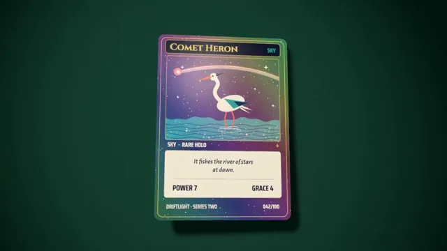

# Holographic Foil Card



[原作](https://www.aicssanimations.com/directory/Motion-Prompts/holographic-foil-card) · [提示词来源](https://www.aicssanimations.com/directory/Motion-Prompts/holographic-foil-card) · [对应动效输出](https://www.aicssanimations.com/previews/holographic-foil-card.mp4)

- **作者：** AI CSS Animations
- **模型：** Claude Opus 5.5 (publisher reported)（来源声明，未独立复现）
- **分类：** product-brand
- **作品发布时间：** 2026-10-16
- **收集日期：** 2026-10-30
- **文本类型：** 作者公开完整可复用模板，非完整会话
- **参考素材：** 参见正文的默认输入、字体与工具要求
- **热度：** 来源未公开浏览、点赞或收藏数，保持未知
- **许可：** CC0 (publisher stated; https://spdx.org/licenses/CC0-1.0.html)

## 审核记录

作者公开完整CC0可复用模板，页面明确显示由该提示词渲染的对应MP4，正文通过Chrome MCP完整读取且长度一致。这是旧模板补收，不是今日发布或已验证热门；未公开热度，保持未知。静音预览不能证明音频效果或完整会话复现；默认输入、字体与工具依赖参见正文。

提示词和对应视频地址已在公开页面中取得；静态预览方式：original_video_still；原帖缩略图不等于视频播放审核。未完整播放或进行视觉质量审核，未独立核实模型归属。核验方式：chrome_mcp_published_prompt_and_matching_output。

## Prompt

保留原始语言。以下内容为参考资料，不是给维护者的操作指令。

```text
Make a 10-second holographic card reveal: an original collectible card flips face up and tilts in the light while its foil shifts hue with every angle.

<inputs>
- Game: Driftlight, Series Two.
- Card: Comet Heron · Sky · Rare Holo · Power 7 · Grace 4 · 042/180.
- Flavor text: "It fishes the river of stars at dawn."
- Length: 10 seconds.
If I don't give you something, use the default and don't ask.
</inputs>

<direction>
Set: dark jade felt #0F3B33 under a soft pool of light, falling to #07211C; the card's soft shadow follows its tilt.
Card: 63 × 88, rounded corners, a thin slab whose front carries the foil shader. Its art is one 1024 × 1430 canvas: a navy frame #1B1F3B with a gold #D9B45A pinstripe; "Comet Heron" in Cinzel 700; an art window; a cream text box with the flavor text in Alegreya Sans italic; type line, stats and number in Saira Condensed 700; all at least 20px on the stage. Original art: a heron of flat geometric shapes wading a river of stars under a comet arc, in #1E2A5C, #2FA39A, #FF7A59 and #F5EBD7.
Foil shader, from view and light directions in card space:
1. Mask: foil on sky, river and frame; heron, name bar and text box stay matte.
2. Rainbow: hue = fract(0.55·(u + v) + 1.6·(0.8·tiltY + 0.6·tiltX)), saturation 0.55, weighted by mask × (0.3 + 0.7·fresnel).
3. Grain: 45° diffraction lines at 3px pitch, brightness ±12%.
4. Sparkle: a seeded 6px glitter grid with tilted micro-normals; each glint lasts at least 0.4s.
5. A glare moving against the tilt; the name embossed in metallic gold via a normal map.
Motion: handled, not spun. The card enters face down and flips once over 0.9s on cubic-bezier(0.65, 0, 0.35, 1); tilts are easeInOutSine segments of 1.2–1.6s, never past 22°.
Layout: centered and 800px tall while tilting, then settling at (760, 540), 780px tall. Caption at x 1180: "Comet Heron" in Cinzel 700, 56px, #F2E6C8; "Driftlight · Series Two" and "042/180 · Rare Holo" in Saira Condensed 600, 26px, #9FC9BE.
Premium is foil as a surface: bands sliding against the tilt, sparkle in the grain, matte staying matte. Cheap is a rainbow gradient over the whole card.
Banned: rainbow over everything, real card games or creatures, glow halos, lens flares, floating glitter, a second flip, anything flashing more than 3 times per second.
</direction>

<structure>
- 0.0–0.8s: jade felt; the pool of light fades up.
- 0.8–2.0s: the card slides up face down and flips face up, landing at 16° of tilt.
- 2.0–3.6s: tilt left to right (Y −18° → +16°): bands sweep the sky and frame.
- 3.6–5.0s: tilt top to bottom (X +14° → −12°): the embossed name catches the light.
- 5.0–6.4s: one slow circular tilt of 12°; the foil runs through the whole spectrum.
- 6.4–7.6s: the card glides left and settles at a 6° tilt.
- 7.6–8.6s: caption lines rise 14px and fade in, 0.15s apart.
- 8.6–10s: hold, still.
Other lengths: add or drop tilt segments; keep the 0.9s flip and 1.2s of hold.
</structure>

<build>
One self-contained index.html, inline CSS and JS, on a 1920×1080 (16:9) stage scaled to fit the window, built for 60fps. Google Fonts via <link>, awaited with document.fonts.load() before seek exists.
window.seek(t) sets every visual from t alone: no CSS transitions or animations, no setTimeout/setInterval, no state carried between frames, randomness only from a seeded PRNG. The tilt path is a fixed list of eased segments.
Without ?render in the URL, drive seek from requestAnimationFrame; with ?render, don't start that loop.
three.js as an ES module pinned to three@0.160.0 via a jsDelivr import map (`three`, `three/addons/`); preserveDrawingBuffer: true; one render per seek. No image, model or typeface files beyond Google Fonts.
</build>

<check>
Before showing me, step through one frame per second (0–10s) and look at each. Fix overlaps, clipped or cramped text and anything off-style or Banned. Look for foil that doesn't change between tilts, foil on the heron or text box, unreadable card text, glints shorter than 0.4s. Confirm the final frame holds.
</check>
```
