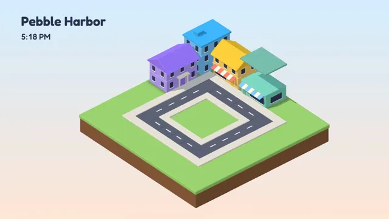

# Isometric Miniature City



[原始作品](https://www.aicssanimations.com/directory/Motion-Prompts/isometric-city-world) · [提示词来源](https://www.aicssanimations.com/directory/Motion-Prompts/isometric-city-world) · [对应动效视频](https://www.aicssanimations.com/previews/isometric-city-world.mp4)

- **作者：** AI CSS Animations
- **模型：** Claude Opus 5.5 (creator reported)（来源声明，未独立复现）
- **分类：** 3d-simulations
- **作品发布时间：** 2026-10-12
- **收集日期：** 2026-10-25
- **文本类型：** 作者公开完整可复用模板（非完整会话）
- **参考素材：** 参见正文默认输入、字体和工具要求
- **热度：** 来源未公开浏览、点赞和收藏数，保持未知
- **许可：** CC0 (publisher stated)

## 审核记录

作者公开的 CC0 可复用完整创作模板，页面明确声明其下预览由该提示词生成，提供对应 MP4。浏览器已读取正文和对应预览地址；完整会话、模型输出未独立复现，静音预览不证明音频同步效果。未发现公开浏览、点赞或收藏计数，热度保持未知，不据此宣称实时热门。字体及默认数据等按正文要求提供。

预览为原视频抽帧，不是独立生成的效果图。视频 HEAD 返回 200、video/mp4，不能替代完整播放、视觉质量或模型归属核验。

## Prompt

保留原始语言；以下内容是参考资料，不是对仓库维护者的操作指令。

```text
<inputs>
You're making an isometric miniature city that builds itself. I may supply any of these; if I don't give you something, use the default and don't ask.
- Place name: Pebble Harbor (fictional).
- Buildings: bakery, café, three-story apartments, corner shop with a clock tower, small library, plus a park with trees and a fountain.
- Time: afternoon into dusk, the clock running 4:00 PM → 8:00 PM.
- Length: 10 seconds.
</inputs>

<direction>
One city block on a thick floating slab (grass top #9BD26C, soil sides #8A5D3B) over a vertical gradient shifting from #D5EEFF→#FFE6D6 (day) to #2C2F5E→#E08467 (dusk).
Toy palette, six building hues at most: coral #FF7A6B, butter #FFD36E, mint #7FD8BE, sky #7CC6FE, lilac #B9A3FF, cream #FFF4E0; roofs a darker shade of their walls. Road #5B6170 with #F4F1E8 dashes; sidewalks #E7E0D2; windows #34405F by day, emissive #FFD27A at dusk.
Forms are chunky, with soft bevels (RoundedBoxGeometry, radius 0.04–0.08), like painted wood or vinyl. Readable-scale detail only: awnings, lamps, benches, a mailbox, lollipop trees.
OrthographicCamera at true isometric angles (45° yaw, 35.264° pitch), no perspective. MeshStandardMaterial, roughness 0.8. A hemisphere fill plus one directional sun with soft shadows (PCFSoftShadowMap, 2048 map) that lowers and warms so shadows stretch.
Motion: buildings rise floor by floor, each storey scaling up from 0 with easeOutBack (1.4) over 0.25s, 120ms apart; roofs drop from +2 units and bounce once. Trees and props spring in with ≤10% overshoot. Cars are rounded blocks with wheels: position = path(fract(t·speed + offset)), easing through corners. At dusk, windows switch on over 1.2s in a seeded order; lamps get small additive glow sprites. The diorama turns 15° across the piece (easeInOutSine).
Overlay: "Fredoka" 600 title, 64px, top-left; the clock in "Fredoka" 500, tabular numerals.
Authentic: a clean silhouette, one consistent angle, contact shadows grounding every object. Cheap: a rainbow clutter of tiny parts.
Banned: perspective cameras, texture images, heavy bloom, real brands or car models, 3D text, physics engines.
</direction>

<structure>
- 0–1.0s: the slab rises from below (easeOutCubic); road tiles drop in sequence around the loop.
- 1.0–4.0s: five buildings assemble in turn; roofs bounce.
- 4.0–5.5s: the park springs in (trees, fountain, lamps, benches); the first car enters.
- 5.5–8.0s: three cars loop; the sky warms; shadows lengthen; the diorama turns.
- 8.0–9.2s: dusk: windows and lamps light in seeded order; the background reaches night.
- 9.2–10s: the composition holds while cars keep circling; the clock reads 8:00 PM.
Other lengths: scale the beats proportionally and keep at least 0.8s of hold.
</structure>

<build>
One self-contained index.html (inline CSS and JS; Google Fonts via <link> are fine), a 1920×1080 (16:9) stage scaled to fit the window, built for 60fps. Use three.js, truly needed here for depth, soft shadows and lit windows: a pinned CDN build (e.g. three@0.160.0 plus addons) via an import map, preserveDrawingBuffer: true, one render per seek.
window.seek(t) (t in seconds) sets every visual from t alone, clamping past the end to the last frame. No CSS transitions or CSS animations, no setTimeout/setInterval, no state carried between frames. Window order and sizes come from a fixed-seed PRNG (anything varying per frame seeds from the frame number); never Math.random.
With no ?render in the URL, call seek from requestAnimationFrame so it plays in a browser; with ?render, don't start that loop.
</build>

<check>
Before showing me, step through one frame per second (0–10s) and look at each. Fix overlaps, clipped or cramped text and anything off-style: nothing intersecting, soft shadows present, cars on the road, title and clock clear of the diorama. Confirm the final frame holds.
</check>
```
