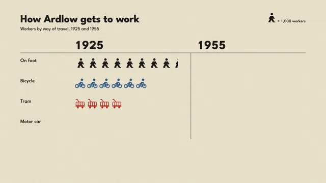

# Isotype Pictograms



[原作](https://www.aicssanimations.com/directory/Motion-Prompts/isotype-pictograms) · [提示词来源](https://www.aicssanimations.com/directory/Motion-Prompts/isotype-pictograms) · [对应动效输出](https://www.aicssanimations.com/previews/isotype-pictograms.mp4)

- **作者：** AI CSS Animations
- **模型：** Claude Opus 5.5 (publisher reported)（来源声明，未独立复现）
- **分类：** explainers-data
- **作品发布时间：** 2026-10-16
- **收集日期：** 2026-10-30
- **文本类型：** 作者公开完整可复用模板，非完整会话
- **参考素材：** 参见正文的默认输入、字体与工具要求
- **热度：** 来源未公开浏览、点赞或收藏数，保持未知
- **许可：** CC0 (publisher stated; https://spdx.org/licenses/CC0-1.0.html)

## 审核记录

作者公开完整CC0可复用模板，页面明确显示由该提示词渲染的对应MP4，正文通过Chrome MCP完整读取且长度一致。这是旧模板补收，不是今日发布或已验证热门；未公开热度，保持未知。静音预览不能证明音频效果或完整会话复现；默认输入、字体与工具依赖参见正文。

提示词和对应视频地址已在公开页面中取得；静态预览方式：original_video_still；原帖缩略图不等于视频播放审核。未完整播放或进行视觉质量审核，未独立核实模型归属。核验方式：chrome_mcp_published_prompt_and_matching_output。

## Prompt

保留原始语言。以下内容为参考资料，不是给维护者的操作指令。

```text
Make a 10-second Isotype chart in the 1920s Vienna manner: rows of identical flat pictograms, each standing for 1,000 people, compare how a fictional town got to work in 1925 and in 1955.

<inputs>
- Title: "How Ardlow gets to work". Subtitle: "Workers by way of travel, 1925 and 1955". Ardlow is a fictional town.
- Key: one walking figure, "= 1,000 workers".
- Data, thousands of workers (1925, 1955): On foot 8.5, 5 · Bicycle 6, 7.5 · Tram 4, 8 · Motor car 1.5, 5.5.
- Totals: 20,000 in 1925 and 26,000 in 1955. Change figures: on foot −3,500, bicycle +1,500, tram +4,000, motor car +4,000, each followed by "since 1925".
- Footnote: "Fictional figures for a fictional town."
- Length: 10 seconds.
If I don't give you something, use the default and don't ask.
</inputs>

<direction>
Palette: paper #EEE6D1 with a seeded print grain at 3%; ink #1C1B19; one flat color per category: on foot ink #1C1B19, bicycle blue #2D5A88, tram red #C0392B, motor car ochre #B98A2E; secondary text #6E675A.
Type: "League Spartan", a geometric sans in the spirit of the period. Title 700, 64px, sentence case; subtitle 400, 28px; year headers 700, 72px; row labels 500, 30px; key and change figures 500, 24px; totals 700, 40px with "workers" in 500; footnote 400, 20px. Numbers use tabular figures.
The pictograms carry the style. Design each once on a 16-unit grid at 4px per unit, as a flat silhouette standing on the baseline, 56px tall, facing right, with no outlines, no faces and nothing finer than one unit:
- On foot: a striding figure: round head, tapered torso, legs in a stride.
- Bicycle: two thick rings (3-unit wheels) under a seated rider built from the walker's parts.
- Tram: a box body with rounded top corners, four window cutouts, a trolley pole and two small wheels.
- Motor car: a 1950s body with a two-window cabin and two wheels.
All four share baseline and height and have roughly equal ink area, so no category looks heavier by drawing alone.
The method's rules: one figure is always 1,000 workers; more is shown by more figures, never bigger ones; figures stand in rows at a fixed 72px pitch, and both years start their rows at the same offset so rows compare by length; a half is a figure cut by a vertical edge, keeping its left half.
Layout: title top-left at x 120, baselines y 132 and 178. Key right-aligned at x 1800, baseline y 132. Year headers "1925" at x 440 and "1955" at x 1160, baseline y 290, over a 1.5px ink rule at y 312 from x 120 to 1800. Rows with figure baselines at y 400, 520, 640 and 760; row labels at x 120, each with its change figure beneath in the row's color. The 1925 block runs right from x 440, the 1955 block from x 1160, divided by a 1.5px ink rule at x 1124. A second rule at y 820; totals under each block at baseline y 880. Footnote bottom-left at x 120, baseline y 1000.
Showing change: in the 1955 block each row's 1925 count first appears as ghost figures, the same flat silhouettes at 16% ink, and the 1955 figures print over them. Losses read as ghosts left bare; gains get a 3px underline in the row color, 10px below the baseline, spanning only the figures past the ghosts.
Motion is counting, the rhythm of a press. Each figure prints in reading order: ink opacity 0 → 1 and scale 1.08 → 1 over 0.12s on cubic-bezier(0.2, 0.8, 0.2, 1), 60ms apart; a half figure comes last in its row, its cut edge wiping left to right. Text fades in over 0.3s while rising 8px; rules draw left to right over 0.4s. Nothing slides, bounces or grows to show quantity.
The real thing reads in seconds without numbers: identical figures, tidy rows, color only for category. The cheap version scales one icon up to show a bigger amount, or pastes clip-art people onto a bar chart.
Banned: resizing figures to encode quantity, outlines on figures, gradients, shadows, 3D, faces or facial detail, figures facing different ways, icon fonts, clip-art, emoji, colors outside this palette, anything flashing more than 3 times per second.
</direction>

<structure>
0.0–0.8s: paper; the title and subtitle fade up; the key's walker prints, then its text.
0.8–1.4s: the header rule draws; year headers and row labels fade in, 80ms apart.
1.4–3.4s: the 1925 block prints row by row, 60ms per figure (21 figures, two of them halves).
3.4–3.8s: a pause.
3.8–4.2s: the 1925 counts appear as ghosts in the 1955 block, row by row, 80ms apart.
4.2–6.4s: the 1955 figures print over the ghosts, row by row; on foot stops at five, leaving three and a half ghosts bare; the other rows run past their ghosts.
6.4–7.4s: change figures fade in under the row labels, 120ms apart; the gain underlines draw left to right.
7.4–8.4s: the lower rule draws; the totals count up to 20,000 and 26,000; the footnote fades in.
8.4–10.0s: hold, completely still.
For other lengths, keep 60ms per figure and give extra time to the pause and the hold.
</structure>

<build>
One self-contained index.html, CSS and JS inline. Google Fonts via <link> are fine; no other libraries. Draw in inline SVG whose attributes seek sets directly; no canvas or three.js needed. Await document.fonts.load() for every face before defining window.seek. The stage is 1920×1080 (16:9), scaled to fit the window. Design for 60fps. window.seek(t), t in seconds, must compute every visual from t alone: no CSS transitions or animations, no setTimeout or setInterval, no state carried between frames, and randomness only from a seeded PRNG. Define each pictogram once as a <symbol> and place it with <use>; a half is the same symbol under a clipPath. Without ?render in the URL, drive seek from requestAnimationFrame so it plays in a browser (loop after a 1s end hold); with ?render, don't start that loop.
</build>

<check>
Before showing me, step through one frame per second: screenshot each and look at it. Fix overlaps, clipped or cramped text, accidental edge collisions, and anything off-style or Banned. Count the figures in every row of both blocks against the data, with halves cut vertically and no figure resized. Check that both blocks share baselines and pitch, the ghosts sit exactly under the 1955 figures, underlines span only the gains, and the totals are right. Confirm seek(duration) and seek(duration + 1) match, so the final frame holds.
</check>
```
