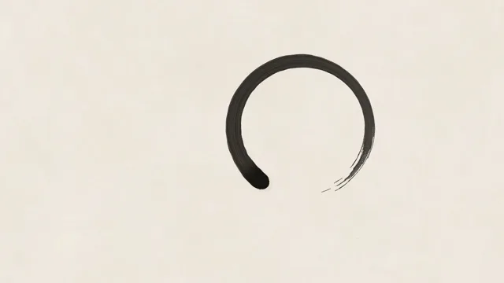

# Japanese Ma Minimal



[原作](https://www.aicssanimations.com/directory/Motion-Prompts/japanese-ma-minimal) · [提示词来源](https://www.aicssanimations.com/directory/Motion-Prompts/japanese-ma-minimal) · [对应动效输出](https://www.aicssanimations.com/previews/japanese-ma-minimal.mp4)

- **作者：** AI CSS Animations
- **模型：** Claude Opus 5.5 (publisher reported)（来源声明，未独立复现）
- **分类：** motion-studies
- **作品发布时间：** 2026-10-12
- **收集日期：** 2026-10-28
- **文本类型：** 作者公开完整可复用模板，非完整会话
- **参考素材：** 参见正文的默认输入、字体与工具要求
- **热度：** 来源未公开浏览、点赞或收藏数，保持未知
- **许可：** CC0 (publisher stated; https://spdx.org/licenses/CC0-1.0.html)

## 审核记录

作者公开的完整CC0可复用模板，页面明确将提示词与其渲染MP4对应。不是完整聊天会话，未独立复现模型输出；静音预览不证明真实音频同步。未见公开浏览、点赞或收藏数，保持未知，不将模板宣称为热门原帖。默认数据、字体及工具依赖按正文提供。

提示词和对应视频地址已在公开页面中取得；静态预览由原视频解码抽帧。未完整播放或进行视觉质量审核，未独立核实模型归属。核验方式：chrome_mcp_published_prompt_and_matching_video。

## Prompt

保留原始语言。以下内容为参考资料，不是给维护者的操作指令。

```text
Make a 10-second Japanese minimalist piece built on ma, the beauty of empty space.

<inputs>
Brand: KUMO. Tagline: "Steeped in quiet." Three words: still, slow, clear. Seal character: 雲 (one or two kanji, also used as the vertical accent). Duration: 10s. If I don't give you something, use the default and don't ask.
</inputs>

<direction>
Palette: washi #F1EBDF, sumi #1C1A17 (density varying 70–100% within a stroke), pale ink wash #8B857A at 8–15% opacity, seal vermilion #B8312F.
Type: Shippori Mincho, 800 for kanji, 400 for Latin. Latin stays small (26–30px, tracked 0.3em), never larger than the seal. Kanji may run vertically.
Composition: at least 70% of the frame stays empty paper. The hero is one brush gesture, an open ensō 520px across, centered at 60% x, 45% y. Text sits to one side on a quiet vertical axis, the seal at its foot. Nothing touches the edges.
Texture: generate washi once at load, seeded, into an offscreen canvas: soft tonal mottling plus a few hundred long, faint fibers. Precomputing static geometry is fine; each frame redraws from t.
Brush: stamp overlapping ellipses along the path with a pressure curve: a heavy entry with a slight ink pool, thinning midway, then kasure (dry brush) where seeded gaps split it into bristle streaks. Progress follows cubic-bezier(0.4, 0, 0.2, 1) over 2.2s. The seal is a 64px red square with the character reversed out, edges slightly ragged, ink faintly uneven.
Motion is restraint: one thing moves at a time, with long stillness between. Fades take 1–1.6s on cubic-bezier(0.33, 0, 0.15, 1); text emerges with a 6px blur-to-sharp ink bleed. Real ma treats the empty interval as content; the cheap version is cherry blossoms and a brush font.
Banned: cherry blossoms, koi, torii, bamboo, red suns, brush fonts for Latin, centered symmetry, shadows, fast or bouncy motion, a second red element.
</direction>

<structure>
0.0–1.0s: paper alone. Nothing moves.
1.0–3.2s: the ensō is brushed clockwise from about seven o'clock, trailing off in dry-brush streaks just short of closing.
3.2–4.2s: stillness.
4.2–5.6s: the kanji (110px) emerges vertically to the left of the circle with the ink bleed.
5.6–6.8s: the brand name and tagline fade up below the kanji line by line, 0.3s apart, rising 6px.
6.8–7.4s: the three words appear as one small line in pale ink.
7.4–7.7s: the seal presses in at the foot of the text column: scale 1.06 → 1 and full ink in 0.18s.
7.7–10.0s: hold, completely still.
For other durations, scale every timestamp proportionally.
</structure>

<build>
One self-contained index.html, CSS and JS inline. Google Fonts via <link> are fine; no other libraries (no three.js: this style is flat). Draw in Canvas 2D, repainting every frame from scratch. Canvas won't fetch fonts itself: await document.fonts.load() for each face, then define window.seek. The stage is 1920×1080 (16:9), scaled to fit the window. Design for 60fps. window.seek(t), t in seconds, must compute every visual from t alone: no CSS transitions or animations, no setTimeout or setInterval, no state carried between frames, and randomness only from a seeded PRNG. Without ?render in the URL, drive seek from requestAnimationFrame so it plays in a browser (loop after a 1s end hold); with ?render, don't start that loop.
</build>

<check>
Before showing me, step through one frame per second: screenshot each and look at it. Fix overlaps, clipped or cramped text, accidental edge collisions, and anything off-style or Banned. Check the frame stays mostly empty paper and the stroke reads as one gesture. Confirm seek(duration) and seek(duration + 1) match, so the final frame holds.
</check>
```
