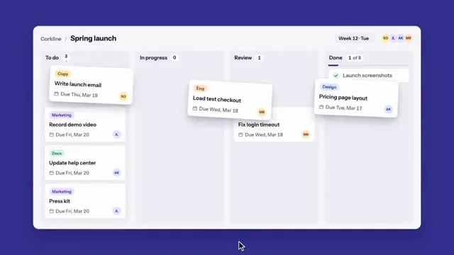

# Kanban Board



[原作](https://www.aicssanimations.com/directory/Motion-Prompts/kanban-board-flow) · [提示词来源](https://www.aicssanimations.com/directory/Motion-Prompts/kanban-board-flow) · [对应动效输出](https://www.aicssanimations.com/previews/kanban-board-flow.mp4)

- **作者：** AI CSS Animations
- **模型：** Claude Opus 5.5 (publisher reported)（来源声明，未独立复现）
- **分类：** interactive
- **作品发布时间：** 2026-10-16
- **收集日期：** 2026-10-31
- **文本类型：** 作者公开完整可复用模板，非完整会话
- **参考素材：** 参见正文的默认输入、字体与工具要求
- **热度：** 来源未公开浏览、点赞或收藏数，保持未知
- **许可：** CC0 (publisher stated; https://spdx.org/licenses/CC0-1.0.html)

## 审核记录

作者公开CC0完整可复用模板；正文原文与明确对应的MP4已保留。旧模板补收，热度未知，不称今日新发布或已验证热门；默认输入与工具要求参见正文。

提示词和对应视频地址已在公开页面中取得；静态预览方式：browser_download_original_video_ffmpeg_still；原帖缩略图不等于视频播放审核。未完整播放或进行视觉质量审核，未独立核实模型归属。核验方式：chrome_mcp_public_prompt_and_matching_output。

## Prompt

保留原始语言。以下内容为参考资料，不是给维护者的操作指令。

```text
Make a 10-second product animation of a kanban board: a cursor drags cards between columns, counts update, and a week of work fills the Done column.

<inputs>
If I don't give you something, use the default and don't ask.
- Product: default "Corkline", board "Spring launch"
- Cards (title · label), by starting column: default To do: Write launch email · Copy; Record demo video · Marketing; Update help center · Docs; Press kit · Marketing. In progress: Load test checkout · Eng; Fix login timeout · Bug. Review: Pricing page layout · Design. Done: Launch screenshots · Design.
- Closing line: default "Ship it together."
- Length: default 10 seconds
</inputs>

<direction>
- Palette: stage indigo #34308F; board #F7F7FA; columns #EEEEF4; cards #FFFFFF, 1px #E2E2EA; ink #1B1A2E; muted #6B6A80; done #1F9D61. Pills fill/text: Copy #FFE9B0/#7A5300, Marketing #EADFFF/#5A2DB0, Docs #D6F2E3/#17734A, Eng #FFE1C7/#9A4A00, Bug #FFD9D5/#A3261B, Design #DCE6FF/#2547B8.
- Type: Instrument Sans 500–700, tabular figures; card titles 22px on one line, meta 20px, wordmark 56px.
- Layout: a 1640×860 board at (140, 110); a top bar with the title, a "Week 12 · Mon" chip and initials avatars; four 376px columns with count pills; 344×150 cards (pill, title, due line, avatar) joining the bottom of a column. Done shows "N of 8".
- Drag: the arrow cursor becomes a grab hand; the card lifts in 120ms (scale 1.04, deeper shadow), trails the cursor by 60ms and tilts up to ±5° with its speed. The target opens a dashed slot (280ms, cubic-bezier(0.2, 0, 0, 1)) as the source closes; the drop settles on a spring (stiffness 380, damping 30).
- Time-lapse: cards hop on a 28px arc in 420ms and land on the same spring, right-most first, 90ms apart. Counts and the day chip roll in 220ms. In Done, cards compact to 60px rows with a drawn green check and a muted title.
- Premium is physical and exact: cards lift, lean and settle, the board makes room, every count matches its column. Cheap is cards teleporting or cross-fading while numbers jump.
Banned: cross-fading cards, overlaps at rest, wrong counts, overshoot above 4%, confetti, gradients, emoji, real product names, anything flashing more than 3 times per second.
</direction>

<structure>
- 0.0–0.9: The board rises 40px (0.7s, cubic-bezier(0.22, 1, 0.36, 1)); columns appear 60ms apart, cards 35ms apart. Counts 4, 2, 1, 1.
- 0.9–2.5: The cursor drags "Fix login timeout" into Review. Counts 4, 1, 2, 1.
- 2.5–6.3: The cursor rests below the board; from 2.7s the week time-lapses, a day every 0.9s (counts after each):
  Tue: Pricing page layout → Done; Load test checkout → Review; Write launch email, Record demo video → In progress. (2, 2, 2, 2)
  Wed: Fix login timeout, Load test checkout → Done; Write launch email → Review; Update help center → In progress. (1, 2, 1, 4)
  Thu: Write launch email → Done; Record demo video, Update help center → Review; Press kit → In progress. (0, 1, 2, 5)
  Fri: Record demo video, Update help center → Done; Press kit → Review. (0, 0, 1, 7)
- 6.3–7.6: The cursor drags "Press kit" into Done: 8 of 8.
- 7.6–8.2: Done's bar turns green, a check badge pops, empty columns read "Nothing here".
- 8.2–9.0: The board scales to 0.86 and rises; "Corkline" and the closing line rise below it, centered at y 930.
- 9.0–10.0: Hold.
For other lengths, add or drop days, keeping counts right, and hold at least 1s.
</structure>

<build>
One self-contained index.html (inline CSS and JS), a 1920×1080 (16:9) stage scaled to fit the window, built for 60fps. Google Fonts via <link>, awaiting document.fonts.load() for each face before defining window.seek. HTML/CSS with inline SVG; no canvas or three.js. Interpolate each card between its slots before and after the move in progress. window.seek(t) (t in seconds) sets every visual from t alone, clamping past the end: no CSS transitions or animations, no setTimeout/setInterval, no state carried between frames, randomness only from a seeded PRNG. Without ?render in the URL, drive seek from requestAnimationFrame; with ?render, don't start that loop.
</build>

<check>
Before showing me, step through one frame per second (0–10s) and look at each. Fix overlaps, clipped or cramped text and anything off-style or Banned. Recount every column against its pill at each day boundary; the carried card stays under the cursor. Confirm seek(10) and seek(11) match.
</check>
```
