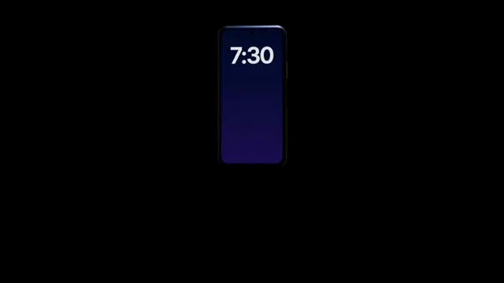

# Keynote Product Reveal



[原始作品](https://www.aicssanimations.com/directory/Motion-Prompts/keynote-product-reveal) · [提示词来源](https://www.aicssanimations.com/directory/Motion-Prompts/keynote-product-reveal) · [对应动效视频](https://www.aicssanimations.com/previews/keynote-product-reveal.mp4)

- **作者：** AI CSS Animations
- **模型：** Claude Opus 5.5 (creator reported)（来源声明，未独立复现）
- **分类：** product-brand
- **作品发布时间：** 2026-10-12
- **收集日期：** 2026-10-25
- **文本类型：** 作者公开完整可复用模板（非完整会话）
- **参考素材：** 参见正文默认输入、字体和工具要求
- **热度：** 来源未公开浏览、点赞和收藏数，保持未知
- **许可：** CC0 (publisher stated)

## 审核记录

作者公开的 CC0 可复用完整创作模板，页面明确声明其下预览由该提示词生成，提供对应 MP4。浏览器已读取正文和对应预览地址；完整会话、模型输出未独立复现，静音预览不证明音频同步效果。未发现公开浏览、点赞或收藏计数，热度保持未知，不据此宣称实时热门。字体及默认数据等按正文要求提供。

预览为原视频抽帧，不是独立生成的效果图。视频 HEAD 返回 200、video/mp4，不能替代完整播放、视觉质量或模型归属核验。

## Prompt

保留原始语言；以下内容是参考资料，不是对仓库维护者的操作指令。

```text
Make a 10-second keynote-style reveal: a device rises from darkness into a sweep of light, then a giant headline lands.

<inputs>
If I don't give you something, use the default and don't ask.
- Product: Halcyon One
- Device: phone (or laptop, watch)
- Headline: "Barely there."
- Subline: "Halcyon One. 5.1 mm of titanium."
- Finish: graphite titanium #3A3D42
- Length: 10 seconds
</inputs>

<direction>
- Palette: stage #000000, device #3A3D42, glass #050608, headline #F5F5F7, subline #86868B. The only color is a faint cool rim light, #A9C1FF.
- Type: headline in Inter Tight 600, 168px, −0.035em, one line; subline in Inter 400, 40px; both centered in the lower third.
- The device is real 3D: a RoundedBoxGeometry body (phone: 0.78 × 1.6 × 0.07, radius 0.11) in MeshPhysicalMaterial (metalness 1, roughness 0.3, clearcoat 0.5), an inset glass face with a CanvasTexture screen you draw (a #0B1530 → #2B1B4D wallpaper, a large clock reading 7:30), and a side button plus hairline antenna breaks for the highlight to catch.
- The sweep is a reflection, not a moving lamp: build an environment once (PMREMGenerator.fromScene) from a tiny black scene holding one long emissive softbox and a dim fill panel, then yaw the device slowly so the softbox glides along its edges. A SpotLight from above adds a rim; ACESFilmic tone mapping.
- Camera: a 26° field of view (telephoto), pushing in about 8% over the whole piece.
- Easing: rise cubic-bezier(0.16, 1, 0.3, 1) over 2–2.6 s; turns cubic-bezier(0.45, 0, 0.15, 1); text fades up 24px in 0.9 s on cubic-bezier(0.22, 1, 0.36, 1). Nothing bounces; one thing moves at a time.
- Premium is darkness, restraint and long holds. Generic is a spinning product and filled silence.
Banned: lens flares, bloom on text, gradient text, particles, more than 50° total rotation, bouncy easing, shadows on type, emoji, real brand names.
</direction>

<structure>
- 0.0–1.0: Black. A thin sliver of reflected light fades in where the device will stand.
- 1.0–3.4: The device rises to center, yaw −38° → −14°; the highlight runs along its edge.
- 3.4–5.2: It turns toward camera (−4°) and the screen wakes over 0.6 s.
- 5.2–6.2: The camera eases back; the device drifts into the upper 60% of frame.
- 6.2–7.2: The headline fades up below; the subline follows 0.4 s later.
- 7.2–10.0: Hold. Only the highlight creeps (2° more yaw) and the push continues.
For other lengths, scale beats proportionally; keep the rise and final hold at least 2 s each.
</structure>

<build>
- One self-contained index.html (inline CSS and JS) with a fixed 1920×1080 (16:9) stage scaled to fit the window; design for 60fps.
- window.seek(t), t in seconds, sets every visual from t alone: no CSS transitions or animations, no setTimeout/setInterval, no state carried between frames. Randomness comes from a seeded PRNG; springs are closed-form functions of time.
- Without ?render in the URL, drive seek from requestAnimationFrame so it plays in a browser; with ?render, don't start that loop.
- Google Fonts via <link> are fine. Real 3D is needed here: three.js at a pinned version from a CDN via an import map (with the RoundedBoxGeometry addon); call renderer.render at the end of every seek. Text is HTML on top.
</build>

<check>
Before showing me, screenshot seek(0) through seek(10), one frame per second, and look at each. Fix overlaps, clipped or cramped text, and anything generic. The highlight must not blow out to flat white, the silhouette must read against black, and the headline must clear the device. Confirm the final frame holds.
</check>
```
