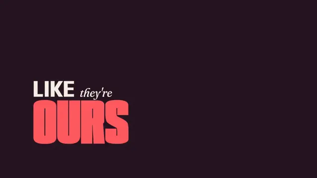

# Kinetic Lyric Video



[原始作品](https://www.aicssanimations.com/directory/Motion-Prompts/kinetic-lyric-video) · [提示词来源](https://www.aicssanimations.com/directory/Motion-Prompts/kinetic-lyric-video) · [对应动效视频](https://www.aicssanimations.com/previews/kinetic-lyric-video.mp4)

- **作者：** AI CSS Animations
- **模型：** Claude Opus 5.5 (creator reported)（来源声明，未独立复现）
- **分类：** music-audiovisual
- **作品发布时间：** 2026-10-16
- **收集日期：** 2026-10-25
- **文本类型：** 作者公开完整可复用模板（非完整会话）
- **参考素材：** 参见正文默认输入、字体和工具要求
- **热度：** 来源未公开浏览、点赞和收藏数，保持未知
- **许可：** CC0 (publisher stated)

## 审核记录

作者公开的 CC0 可复用完整创作模板，页面明确声明其下预览由该提示词生成，提供对应 MP4。浏览器已读取正文和对应预览地址；完整会话、模型输出未独立复现，静音预览不证明音频同步效果。未发现公开浏览、点赞或收藏计数，热度保持未知，不据此宣称实时热门。字体及默认数据等按正文要求提供。

预览为原视频抽帧，不是独立生成的效果图。视频 HEAD 返回 200、video/mp4，不能替代完整播放、视觉质量或模型归属核验。

## Prompt

保留原始语言；以下内容是参考资料，不是对仓库维护者的操作指令。

```text
Make a 10-second kinetic lyric video for an original song, every word landing on a 120 BPM beat.

<inputs>
Artist: Odile Varga. Song: "A World Asleep". Lyrics, one line per bar: "Hold the city lights" / "like they're ours to keep" / "we were wide awake" / "in a world asleep". Hero word per line: LIGHTS, OURS, AWAKE, ASLEEP. Tempo: 120 BPM. Duration: 10s. If I don't give you something, use the default and don't ask.
</inputs>

<direction>
Beat grid: a beat is 0.5s and a bar 2.0s; after a half-second pickup, bar n starts at 0.5 + (n − 1) × 2.0s. Every word lands exactly on a beat or an eighth. Default word times, in beats from the start of the line's bar: line 1: Hold 0, the 0.5, city 1, LIGHTS 2. Line 2: like 0, they're 0.5, OURS 1, to 2.5, keep 3. Line 3: we 0, were 0.5, wide 1, AWAKE 2. Line 4: in 0, a 0.5, world 1, ASLEEP 2.
Palette: ground #17111D, type #F4EEE4, and one accent per line, used only on its hero word: amber #FFB020, coral #FF5A5F, aqua #2FD9C9, lilac #B49BFF. During each line the ground mixes in 7% of that line's accent, switching on the downbeat.
Type: two families in hard contrast. Content words in Anybody (variable, wdth 50–150, wght 100–900), uppercase: hero words at weight 900 and width 150, sized 1100–1500px wide and at most 300px tall, leading 0.86; other content words at weight 700, width 90, 120–160px. Small words (the, they're, to, we, were, in, a) in Fraunces italic 400, 72px, lowercase, tucked onto a content word's baseline or cap line.
Layout: each line builds as a flush-left stack from x 200, kept vertically centered; nothing within 120px of an edge.
Motion: scale, stack, slide. A word lands by scaling from 1.35 to 1.0 in 0.18s on cubic-bezier(0.2, 0.9, 0.1, 1). Each new row pushes the rows above it up over 0.2s on cubic-bezier(0.65, 0, 0.35, 1). A hero word also sweeps its width from 50 to 150 over 0.3s as it lands. On every beat the current hero word kicks to scale 1.03 and back in 0.12s. On the next bar's downbeat the whole stack slides up and off in 0.25s on cubic-bezier(0.7, 0, 0.84, 0) as the next line's first word lands: no crossfades. Behind each hero word, a copy at 3× scale and 6% opacity, cropped by the frame, drifts at half speed for depth.
Premium is every word on the beat and a hierarchy that tells you which word to sing loudest. Cheap is every word popping the same way, centered, in one weight.
Banned: centered stacks, equalizer bars, waveforms, particles, glow, gradient text, typewriter reveals, elastic or bounce easing, emoji, flashing more than 3 times per second.
</direction>

<structure>
0.0–0.5s: pickup: the ground fades up from black; nothing else.
0.5–2.5s: line 1 builds on its beats; LIGHTS lands in amber at 1.5s.
2.5–4.5s: line 2 takes over on the downbeat; OURS lands in coral at 3.0s.
4.5–6.5s: line 3; AWAKE lands in aqua at 5.5s.
6.5–8.5s: line 4; ASLEEP lands in lilac at 7.5s.
8.5–8.8s: outro on the downbeat: the line-4 stack slides up 140px and the beat kick stops; beneath it the song title rises 16px into place in Fraunces italic 44px, with "ODILE VARGA" in Anybody 700, width 100, 28px, tracked 0.12em.
8.8–10.0s: hold, still.
For other durations or tempos, recompute every time from the BPM, fit whole bars, and keep at least 1.2s of final hold.
</structure>

<build>
One self-contained index.html, CSS and JS inline. The stage is 1920×1080 (16:9), scaled to fit the window. Design for 60fps. window.seek(t), t in seconds, must compute every visual from t alone, clamping past the end to the last frame: no CSS transitions or animations, no setTimeout or setInterval, no state carried between frames, and randomness only from a seeded PRNG. Anything cumulative is precomputed once at load at a fixed step or solved analytically, so seek can jump to any time. Load Google Fonts via <link> and await document.fonts.load() for each face before defining window.seek. Without ?render in the URL, drive seek from requestAnimationFrame so it plays in a browser (loop after a 1s end hold); with ?render, don't start that loop.
Engine: HTML/CSS. DOM text with transform, font-size and font-variation-settings set in seek; request Anybody's wdth and wght axis ranges in the css2 URL. No canvas or three.js.
</build>

<check>
Before showing me, step through one frame per second (0–10s): screenshot each and look at it. Fix overlaps, clipped or cramped text, accidental edge collisions, and anything off-style or Banned. Check that each word's landing frame matches its beat time, hero words stay within 1500px and clear of the edges, small words sit on a shared baseline or cap line, and each accent appears only on its line's hero word. Confirm seek(10) and seek(11) match, so the final frame holds.
</check>
```
