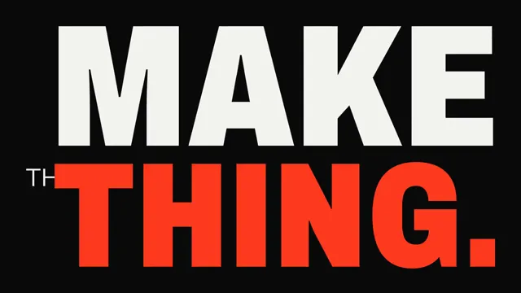

# Kinetic Type Manifesto



[原作](https://www.aicssanimations.com/directory/Motion-Prompts/kinetic-manifesto) · [提示词来源](https://www.aicssanimations.com/directory/Motion-Prompts/kinetic-manifesto) · [对应动效输出](https://www.aicssanimations.com/previews/kinetic-manifesto.mp4)

- **作者：** AI CSS Animations
- **模型：** Claude Opus 5.5 (publisher reported)（来源声明，未独立复现）
- **分类：** motion-studies
- **作品发布时间：** 2026-10-12
- **收集日期：** 2026-10-30
- **文本类型：** 作者公开完整可复用模板，非完整会话
- **参考素材：** 参见正文的默认输入、字体与工具要求
- **热度：** 来源未公开浏览、点赞或收藏数，保持未知
- **许可：** CC0 (publisher stated; https://spdx.org/licenses/CC0-1.0.html)

## 审核记录

作者公开完整CC0可复用模板，页面明确显示由该提示词渲染的对应MP4，正文通过Chrome MCP完整读取且长度一致。这是旧模板补收，不是今日发布或已验证热门；未公开热度，保持未知。静音预览不能证明音频效果或完整会话复现；默认输入、字体与工具依赖参见正文。

提示词和对应视频地址已在公开页面中取得；静态预览方式：original_video_still；原帖缩略图不等于视频播放审核。未完整播放或进行视觉质量审核，未独立核实模型归属。核验方式：chrome_mcp_published_prompt_and_matching_output。

## Prompt

保留原始语言。以下内容为参考资料，不是给维护者的操作指令。

```text
<inputs>
If I don't give you something, use the default and don't ask.
- Manifesto, four lines: default "Stop waiting for permission." / "Make the thing." / "Break it. Make it better." / "Build loud."
- Brand name: default "Ferrowell"
- Accent color: default #FF3B1F
- Length: default 10 seconds
</inputs>

<direction>
Swiss-school kinetic type cut to an imagined 120 BPM: a beat is 0.5 s and every cut lands on a beat or half-beat. Palette: #0A0A0A, #F4F4F0 and the accent only; the accent touches at most one word per line.

Type: Archivo (Google Fonts, variable wdth 62–125, wght 100–900). Hero words: weight 900, width 62–75, uppercase, leading 0.86, spanning 75–100% of frame width; let one or two bleed off an edge. Connectives: weight 300, width 100, 1/6–1/8 of hero size, tucked against a hero word on a shared baseline or cap line. That scale-and-weight contrast is the style.

Layout: 12-column grid, 96 px margins, flush-left or flush-right, never a centered stack. Texture: none; flat color only.

Motion: hard cuts, no crossfades. An arriving word snaps from scale 1.06 to 1.0 in 0.2–0.3 s (expo-out), then drifts 1–2% through its hold. One weight sweep per piece (300 → 900, 0.6 s, easeInOutCubic) for emphasis. At most two inverted frames (light ground, dark type), at least 1 s apart.

Pace: no word on screen under 0.4 s; each completed line holds at least 0.8 s.

Authentic: tight leading, optical kerning, grid-locked alignments, decisive crops. Cheap: everything bouncing, uniform weights.

Banned: drop shadows, glow, gradients, outlined text, elastic or bounce easing, typewriter or letter-by-letter reveals, a second accent, emoji, icons, full-frame flashes, anything flashing more than 3 times per second.
</direction>

<structure>
Default 10 s:
- 0.0–0.5: black; a 6 px accent rule wipes across two-thirds of the frame.
- 0.5–2.5: "STOP" fills the width; 1.0 small "waiting for" beneath; 1.5 "PERMISSION." cuts in, bleeding off the right and drifting left.
- 2.5–4.0: "MAKE" over "THE THING.", accent on "THING."; a snap on each beat.
- 4.0–6.0: inverted frame, "BREAK IT."; 5.0 back to dark, small "MAKE IT" over "BETTER." as its weight sweeps 300 → 900.
- 6.0–7.5: "BUILD" fills the top half, "LOUD." in accent the bottom, both bleeding.
- 7.5–8.5: all four lines reassemble as a flush-left lockup at 64–80 px, sliding in 0.08 s apart.
- 8.5–10.0: brand name in weight 300 under a short accent rule; still from 9.0.

Other lengths: keep the beat grid, scale holds, end on at least 1.2 s of hold. For custom lines, pick one or two hero words (the strongest verb or noun) per line.
</structure>

<build>
- One self-contained index.html, no libraries (three.js from a CDN only when a style truly needs 3D); a 1920×1080 (16:9) stage scaled to fit the window; designed for 60fps.
- window.seek(t), t in seconds, computes every visual from t alone: no CSS transitions or animations, no setTimeout/setInterval, no state carried between frames. Any randomness comes from a seeded PRNG keyed to the frame.
- No ?render in the URL: drive seek from requestAnimationFrame so it plays in a browser. With ?render: don't start that loop.
- Google Fonts via <link>; await document.fonts.load() for each face before assigning window.seek.
- DOM text; set transform, font-size and font-variation-settings in seek.
</build>

<check>
Before showing me, step through one frame per second and look at each. Fix overlaps, clipped or cramped text and anything off-style. Make sure bleeding words still read and no line holds under 0.8 s. Confirm the final frame holds.
</check>
```
