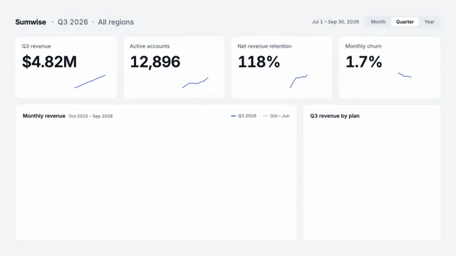

# KPI Dashboard Reveal



[原作](https://www.aicssanimations.com/directory/Motion-Prompts/kpi-dashboard-reveal) · [提示词来源](https://www.aicssanimations.com/directory/Motion-Prompts/kpi-dashboard-reveal) · [对应动效输出](https://www.aicssanimations.com/previews/kpi-dashboard-reveal.mp4)

- **作者：** AI CSS Animations
- **模型：** Claude Opus 5.5 (publisher reported)（来源声明，未独立复现）
- **分类：** explainers-data
- **作品发布时间：** 2026-10-12
- **收集日期：** 2026-10-28
- **文本类型：** 作者公开完整可复用模板，非完整会话
- **参考素材：** 参见正文的默认输入、字体与工具要求
- **热度：** 来源未公开浏览、点赞或收藏数，保持未知
- **许可：** CC0 (publisher stated; https://spdx.org/licenses/CC0-1.0.html)

## 审核记录

作者公开的完整CC0可复用模板，页面明确将提示词与其渲染MP4对应。不是完整聊天会话，未独立复现模型输出；静音预览不证明真实音频同步。未见公开浏览、点赞或收藏数，保持未知，不将模板宣称为热门原帖。默认数据、字体及工具依赖按正文提供。

提示词和对应视频地址已在公开页面中取得；静态预览由原视频解码抽帧。未完整播放或进行视觉质量审核，未独立核实模型归属。核验方式：chrome_mcp_published_prompt_and_matching_video。

## Prompt

保留原始语言。以下内容为参考资料，不是给维护者的操作指令。

```text
Make a 10-second dashboard reveal: counters roll, sparklines draw, bars grow and a big metric lands, from fictional data that adds up.

<inputs>
If I don't give you something, use the default and don't ask.
- Product: Sumwise (analytics), Q3 2026
- Monthly revenue, Oct 2025–Sep 2026, $k: 1104, 1131, 1187, 1162, 1219, 1262, 1318, 1349, 1404, 1523, 1588, 1709
- Q3 revenue by plan, $M: Starter 0.61, Growth 1.94, Enterprise 2.27
- Active accounts 12,906 (+6.1%); net revenue retention 118%; monthly churn 1.7% (down 0.4 points)
- Length: 10 seconds
</inputs>

<direction>
- Honesty: derive every number from the data. Q3 revenue is Jul–Sep summed ($4.82M) versus Apr–Jun (+18.4%); plan bars sum to the same total. Sparklines are 13 weekly points from a seeded random walk ending exactly on the shown value.
- Palette: canvas #F3F4F6; cards #FFFFFF, 1px #E4E7EC border, 20px radius; ink #101828; muted #667085; gridlines #EEF0F3; series #2F5BEA; earlier periods #C9D2E3; good #12A150 (including falling churn); bad #E5484D.
- Type: Inter with tabular figures ("tnum") so counters never shift. Labels 22px/500 muted; KPI values 64px/600, −0.03em; hero metric 220px.
- Layout: 64px margins, 24px gutters. Header: "Sumwise · Q3 2026 · All regions" plus a period control. Row 1: four KPI cards (label, value, delta chip, sparkline). Row 2: a monthly revenue line-and-area chart over 8 columns (Q3 in the series color, earlier months as context) and plan bars over 4.
- SVG charts: lines revealed by stroke-dashoffset, areas fading in after, bars scaling from the baseline; axis labels ≥18px.
- Motion: counters roll 1.2–1.6 s on cubic-bezier(0.16, 1, 0.3, 1), formatted with separators every frame; lines draw on cubic-bezier(0.65, 0, 0.35, 1); bars grow over 0.6 s, 60 ms apart. Data never overshoots; digits never spin like a slot machine.
- Premium is a dashboard a real team would trust: aligned baselines, quiet gridlines, one emphasis color.
Banned: 3D charts, pies or donuts, gradient bars, glow, lorem ipsum, emoji, real company names.
</direction>

<structure>
- 0.0–0.8: Hairline card outlines draw.
- 0.8–2.2: Cards fill and rise 8px, 80 ms apart.
- 2.2–3.8: Counters roll while sparklines draw; each delta chip fades in as its count lands.
- 3.8–5.6: Gridlines fade in; the revenue line draws in 1.4 s, the area follows; September gets a "$1.71M" label.
- 5.6–6.8: Plan bars grow, values counting in step.
- 6.8–8.2: Everything but the revenue card dims to 30%; its figure lifts into a centered hero, "$4.82M", over "Q3 revenue · +18.4% vs Q2".
- 8.2–10.0: Hold.
For other lengths, scale the beats; counters need at least 1 s and the final hold at least 1.5 s.
</structure>

<build>
- One self-contained index.html (inline CSS and JS) with a fixed 1920×1080 (16:9) stage scaled to fit the window; design for 60fps.
- window.seek(t), t in seconds, sets every visual from t alone: no CSS transitions or animations, no setTimeout/setInterval, no state carried between frames. Randomness comes from a seeded PRNG; springs are closed-form functions of time.
- Without ?render in the URL, drive seek from requestAnimationFrame so it plays in a browser; with ?render, don't start that loop.
- Google Fonts via <link> are fine. Draw everything as inline SVG whose attributes seek sets directly; no canvas or three.js needed.
</build>

<check>
Before showing me, screenshot seek(0) through seek(10), one frame per second, and look at each. Fix overlaps, clipped or cramped text, and anything generic. Recheck every number against the data; counter widths must not jitter, and labels must clear chart lines. Confirm the final frame holds.
</check>
```
